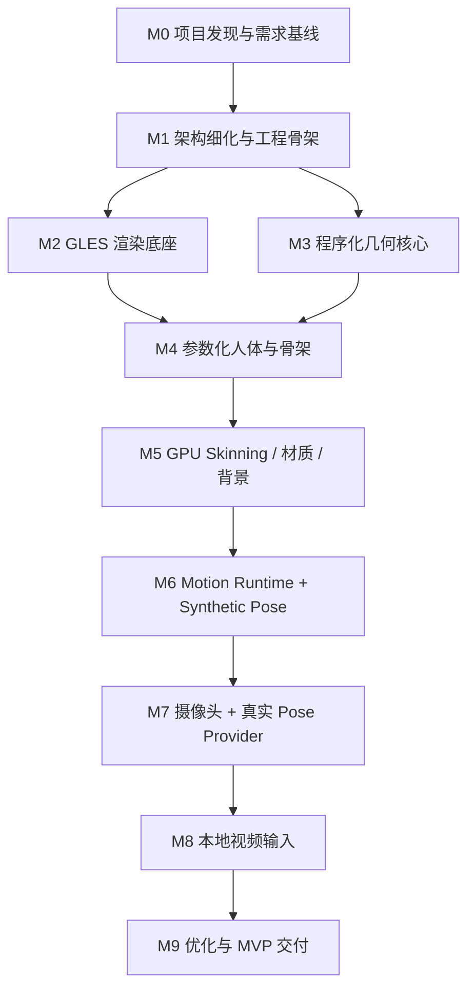

# Procedural Avatar Engine 开发指导计划

- 文档版本：v1.0
- 文档类型：项目级开发路线图 / AI Agent 阶段执行手册
- 状态：MVP 开发基线
- 适用对象：Qwen4 Max、Codex、Claude Code 等具备仓库读写、终端和构建能力的编码型 AI Agent，以及项目开发者
- 配套文档：
  1. `Procedural_Avatar_Engine_Technical_Spec_v1.0.md`
  2. `AI_Implementation_Prompt_v1.1.md`

---

## 0. 本文档的目的与使用方式

本计划补齐技术规范与工程提示词之间的项目管理层。

- **技术设计规范**定义系统边界、架构、技术决策、算法约束与 MVP 验收条件，即“系统应该是什么”。
- **开发指导计划**定义如何逐阶段澄清需求、形成设计、实施代码、验证结果与放行阶段，即“工作应该按什么顺序、用什么交付物完成”。
- **AI 工程实施总提示词**定义 AI Agent 的职责、执行纪律和仓库操作行为，即“AI 应该怎样遵循计划完成工作”。

三份文档必须联合使用。若出现冲突，按以下优先级处理：

1. 用户明确提出且没有违反安全/平台约束的最新决定；
2. 技术设计规范中的已确认架构决策；
3. 本开发指导计划中的阶段流程、交付物和阶段门；
4. AI 实施提示词中的操作建议；
5. Agent 自行提出的优化意见。

Agent 不得自行把纯程序化资产路线改回 GLB/FBX/OBJ 或外部美术资产路线。若发现技术规范存在不可实现或明显错误的要求，先提交影响分析和 ADR，再采用最小必要调整；不能静默改变架构。

### 0.1 总开发流程

每一个开发阶段都必须执行同一闭环：

```text
需求澄清与基线
      ↓
需求分析与验收条件
      ↓
技术/模块设计
      ↓
设计评审与阶段任务拆解
      ↓
编码实施
      ↓
自动化测试 + 集成/设备验证
      ↓
验收证据与问题修复
      ↓
阶段门评审
      ↓
下一阶段
```

**禁止跳过需求和设计直接大量写代码；也禁止只完成文档、不落实代码。** 对小型、低风险改动，需求和设计可以简化为短记录，但仍须保留问题、方案和验收证据。

### 0.2 AI Agent 工作模式

AI Agent 应以“自主推进、阶段可验收”为工作方式：

- 不需要每完成一个小任务就向用户询问许可。
- 缺少非关键细节时，采用保守默认值并记录假设。
- 只有在涉及产品行为改变、重大依赖引入、架构决策冲突、破坏性操作、隐私/许可风险或无法回滚的决定时，才暂停并请求用户决策。
- 如果当前环境无法运行模拟器、连接设备或访问某 SDK，继续完成不依赖该条件的工作，并把受阻验证清楚标记为“未验证”，不得假报通过。
- 发现阶段失败，先定位和修复；不得把已知失败带入下一阶段并标记完成。
- 如果单次上下文/执行资源不足，先完成一个可构建、可测试的最小垂直切片，更新状态与交接说明，再继续后续阶段；不能为追求一次性完成而制造空壳模块。

---

## 1. 产品目标、使用场景与范围基线

### 1.1 产品愿景

构建一个运行于 Android 手机和 Android TV / 电视盒子的轻量级实时数字人引擎。输入为实时摄像头视频流或本地视频文件，系统识别人体姿态，驱动由程序代码和参数生成的卡通 3D 数字人；用户可调整数字人形象、体型、皮肤/头发/服装颜色及程序化背景。

产品核心不是通用游戏引擎，而是专注于：

1. 程序化人体与外观资产生成；
2. 程序化骨骼、自动蒙皮与 GPU 骨骼驱动；
3. 姿态输入与动作重定向；
4. Android 原生 OpenGL ES 3.0 实时渲染；
5. 低性能设备上的可测量性能与稳定性。

### 1.2 确认的硬性约束

- 核心运行时：C++17；Android 宿主：Kotlin；构建：Gradle + NDK + CMake。
- 渲染：EGL + OpenGL ES 3.0，自研专用 Renderer。
- 禁止 Filament、Unity、Unreal、Godot、Three.js 等完整 3D 渲染引擎。
- 禁止运行时加载 GLB/GLTF/FBX/OBJ/DAE 等外部模型资产。
- 禁止外部角色、服装、头发、皮肤、场景贴图、HDRI、环境贴图和预制动画资源。
- 人体几何、骨骼、Bind Pose、蒙皮权重、材质表现与背景由代码/参数生成。
- 姿态识别可通过可插拔 SDK 接入；其算法模型属于软件/推理依赖，不是美术资产，必须单独披露许可证、版本、包体、联网和离线能力。
- 初始化/参数变化时生成和缓存资产；每帧主要更新 Pose、Bone Matrices 和少量材质参数。
- GLES 3.0 是 MVP 渲染最低目标；运行时必须检测设备能力，不承诺所有 Android 设备都支持。
- 单目姿态估计只能提供带不确定性的姿态线索，不宣称精确真实三维动捕。

### 1.3 MVP 范围

| 能力 | MVP 要求 | 明确不包含 |
|---|---|---|
| 输入 | 实时摄像头、预留并实现本地视频输入主链路 | 网络直播、云端视频处理 |
| 姿态 | 统一 PoseFrame、Synthetic Provider、至少一个真实 Provider | 精确深度重建、多人高精度动捕 |
| 数字人 | 一个完整卡通 Humanoid，具备头、躯干、四肢、手脚 | 写实人体、复杂面部表情、逐指动作 |
| 几何 | 全部由程序生成 | 外部模型文件 |
| 骨骼 | 固定版本化 Humanoid Skeleton | 任意自定义骨架导入 |
| 蒙皮 | 自动权重 + GLES 3.0 GPU LBS | 高级肌肉/软组织模拟 |
| 外观 | 皮肤、头发、服装颜色；至少两种体型比例参数 | 任意服装裁剪、复杂布料物理 |
| 背景 | 纯色、渐变、至少一种程序化 3D 场景 | 外部图片/HDRI 背景 |
| 性能 | 指定基准设备 30 FPS 渲染目标；完整报告延迟、内存和温度 | 对全部设备作统一帧率保证 |

### 1.4 MVP 成功定义

从冷启动到画面输出，能够在目标 Android 设备上创建 GLES 3.0 Context；由程序化代码生成完整卡通人体、骨架与权重；GPU Skinning 正常工作；Synthetic Pose 与真实姿态 Provider 均可经统一 Motion Runtime 驱动数字人；支持外观和背景切换；不加载外部 3D 美术资源；具备可重复构建、测试、性能测量与问题记录。

---

## 2. 需求管理方法

### 2.1 需求分类

每条需求必须有唯一 ID，并属于以下类别之一：

- `FUN`：功能需求，例如生成角色、切换颜色、输入摄像头。
- `PERF`：性能需求，例如 FPS、延迟、内存、启动耗时。
- `COMP`：兼容性需求，例如 GLES 能力、ABI、Android 生命周期。
- `ART`：零外部美术资产、程序化生成等资产约束。
- `REL`：可靠性需求，例如 Context 丢失恢复、线程安全、资源释放。
- `OBS`：可观测性需求，例如日志、统计指标、设备能力报告。
- `TEST`：测试和验收需求。

需求 ID 示例：`FUN-AV-001`、`PERF-RT-003`、`ART-001`。

### 2.2 每条需求的最小描述模板

```markdown
### [REQ-ID] 需求名称
- 类型：FUN / PERF / COMP / ART / REL / OBS / TEST
- 用户/系统目标：希望实现什么，解决什么问题
- 触发条件：何时发生
- 输入：数据、参数及来源
- 输出：可观察结果
- 约束：平台、资源、线程、性能、资产等限制
- 优先级：P0 / P1 / P2
- 验收条件：可观察、可复现、可测试的通过标准
- 依赖：前置需求或模块
- 风险/假设：尚未确认的内容
```

### 2.3 优先级规则

- **P0**：阻断主链路或违反硬性架构约束；不完成不能进入后续阶段。
- **P1**：MVP 必须具备，但可以在主链路骨架完成后实现。
- **P2**：体验增强或未来扩展，不阻断 MVP。

### 2.4 需求追踪矩阵（RTM）

在仓库中维护 `docs/requirements/requirements-traceability.md`，至少包含：

| Requirement ID | 描述 | 设计文档/模块 | 实现位置 | 测试用例 | 状态 | 证据 |
|---|---|---|---|---|---|---|

状态仅使用：`proposed`、`approved`、`designed`、`implemented`、`verified`、`blocked`、`deferred`。

没有对应测试或验收证据的需求，不得标记为 `verified`。

---

## 3. 阶段执行统一协议：需求 → 设计 → 实施 → 验证

每个阶段开始前创建阶段工作记录，例如 `docs/phases/M2-procedural-geometry/`，按以下结构输出：

```text
docs/phases/Mx-phase-name/
├── 00-scope-and-assumptions.md
├── 01-requirements.md
├── 02-design.md
├── 03-task-breakdown.md
├── 04-test-and-acceptance.md
├── 05-implementation-report.md
└── evidence/
```

不要求每个小阶段都新建六份长文档；可将简短内容合并，但以下内容必须存在。

### Step A：需求定义

1. 阅读技术规范中与本阶段相关的章节。
2. 检查上游阶段输出及未解决问题。
3. 写明本阶段目标、范围、非目标、输入、输出、依赖与假设。
4. 将目标拆成 REQ ID，标明 P0/P1/P2。
5. 为每条 P0/P1 需求定义可执行验收条件。
6. 明确本阶段不会处理的事项，防止范围蔓延。

**输出：** `01-requirements.md` 或等价记录、需求追踪矩阵更新。

### Step B：技术设计

1. 画出本阶段模块边界、数据流、线程归属和资源所有权。
2. 定义 public API、关键数据结构、坐标/单位/生命周期语义。
3. 明确错误处理、边界条件、性能预算和兼容性策略。
4. 列出候选方案及选择理由；只有存在实质权衡时才需要完整对比。
5. 识别对既有架构的影响；需要改变已确认决策时创建 ADR。
6. 设计测试方式，确认验收条件能够被验证。

**输出：** `02-design.md`、必要的 Mermaid 图、接口草案和 ADR。

### Step C：任务拆解

把设计转成小而可审查的任务。每个任务应有：

- 任务 ID；
- 输入和前置条件；
- 修改/新增文件范围；
- 预期结果；
- 测试命令；
- 完成定义（DoD）；
- 是否可以并行。

先完成依赖链最短的垂直切片，再扩展完整能力。涉及共享头文件、ABI、数据结构的任务应先确定接口，避免并行冲突。

**输出：** `03-task-breakdown.md`。

### Step D：实施

1. 遵守仓库现有格式、命名和工程约定。
2. 每次改动尽量围绕一个可验证目标，不做无关重构。
3. 先实现可运行的最小链路，再完善边界和优化。
4. 同步添加单元测试、集成测试或调试可视化，禁止把测试推迟到项目末尾。
5. 所有新依赖先说明必要性、许可证、包体和维护风险；不得擅自引入完整渲染引擎或美术资产。
6. 保持可回滚性；不擅自 reset、force push、删除用户文件或覆盖未理解的实现。

**输出：** 实际代码、测试、必要文档和依赖清单更新。

### Step E：验证与验收

对照阶段需求逐项执行：

- 静态检查 / 格式检查；
- 单元测试；
- 集成测试；
- Gradle/CMake 构建；
- 模拟器或真机验证（适用时）；
- 性能/稳定性测量（适用时）。

必须保存实际命令、结果、日志摘要、运行设备/模拟器配置和未能执行的项目。不得只写“测试通过”。

**输出：** `04-test-and-acceptance.md` 或验证报告、`05-implementation-report.md`、证据文件。

### Step F：阶段门评审

依据本计划对应阶段的 Exit Criteria 评估：

- `PASS`：全部 P0 验收通过，所有已知问题可接受，允许进入下一阶段。
- `PASS WITH FOLLOW-UPS`：P0 通过，少量 P1/P2 问题有明确负责人/阶段/风险；允许继续，但需记录。
- `BLOCKED`：P0 不通过、构建不稳定、关键设计未决或存在架构违规；不得宣称阶段完成。

每个阶段结束更新 `docs/project-status.md`：阶段状态、需求完成率、测试结果、阻塞、风险、下一阶段入口条件。

---

## 4. 总体阶段路线图

| 阶段 | 名称 | 主要目标 | 主要交付物 | 阶段门 |
|---|---|---|---|---|
| M0 | 项目发现与需求基线 | 审查仓库、确认环境和需求 | 仓库审查、RTM、风险清单、构建基线 | 已知现状明确、基线可复现 |
| M1 | 架构细化与工程骨架 | 模块接口、线程/生命周期设计、建立工程 | 架构图、接口设计、ADR、最小工程 | 可构建、模块边界稳定 |
| M2 | GLES 渲染底座 | EGL/GLES Context、基础渲染、恢复 | Native Renderer、能力检测、渲染测试 | 真正显示程序化 3D primitive |
| M3 | 程序化几何核心 | Math、Mesh、Surface/Primitive Generators | Geometry Core、Mesh Validator、单测 | 几何输出有效并可绘制 |
| M4 | 参数化人体与骨架 | Humanoid、Skeleton、Bind Pose、Weights | Procedural Humanoid、骨骼/权重测试 | 人体结构和蒙皮数据有效 |
| M5 | GPU Skinning 与外观场景 | LBS、Shader、材质、程序化背景 | 可动数字人、外观切换、场景切换 | 合成动作下关节变形可接受 |
| M6 | Motion Runtime | PoseFrame、Retargeting、Filter、IK、Synthetic Provider | 与输入 SDK 无关的动作驱动层 | 合成动作端到端驱动角色 |
| M7 | 实时摄像头接入 | CameraX 与真实 Pose Provider | 实时跟随链路 | 真实人体动作驱动角色，延迟可测 |
| M8 | 本地视频接入 | 解码、PTS 同步、播放控制 | Video Input Adapter | 同一 Motion Runtime 支持视频文件 |
| M9 | 设备适配、优化与 MVP 发布 | 性能、稳定性、兼容性和交付 | 设备矩阵、性能报告、发布清单 | MVP 验收全部有证据或明确未验证 |

> 注：技术规范中的 M0–M7 是技术实现里程碑。本开发计划将其细化为 M0–M9：M0/M1 负责发现和设计基线，技术规范里的“Phase 1”对应本计划 M2；原 Phase 2–8 依次映射到本计划 M3–M9。这样避免把“先做需求设计”和“马上写 EGL 代码”混为一谈。

---

## 5. 各阶段详细指导

## M0 — 项目发现与需求基线

### 目标

不做大规模改代码，先弄清楚当前仓库、构建环境、目标设备和产品边界，建立可复现的项目起点。

### 需求工作

- 确认仓库当前状态：空仓库、原型、已有 Android App 或已有 Native 图形工程。
- 查明包名、minSdk/targetSdk、ABI、Gradle/AGP、NDK、CMake、JDK、现有 CI。
- 梳理用户场景：实时相机、视频文件、数字人外观、背景、目标设备。
- 将零外部美术资产的允许/禁止边界写入需求。
- 形成 P0/P1/P2 要求与假设清单。

### 设计工作

- 绘制当前架构图（若已有工程）。
- 建立目标模块初步边界。
- 建立依赖清单与风险登记表。
- 明确设备测试可用性；没有硬件时定义待验证矩阵，不得假设测试通过。

### 实施工作

- 创建 `docs/requirements/`、`docs/phases/`、`docs/architecture-decisions/`、`docs/performance/`。
- 创建需求追踪矩阵、项目状态文件、依赖清单、风险日志。
- 若有现成工程，执行一次不改代码的基线构建和现有测试。
- 若为空工程，记录创建骨架所需最小工具链，不在此阶段过早实现全部模块。

### 交付物

- `docs/project-charter.md`
- `docs/requirements/requirements-baseline.md`
- `docs/requirements/requirements-traceability.md`
- `docs/repository-audit.md`
- `docs/dependencies.md`
- `docs/risks.md`
- `docs/project-status.md`

### Exit Criteria

- 仓库结构和当前可构建性有事实记录。
- 目标平台/工具链已确认，未知项已标注。
- MVP 范围、硬约束、非目标和风险清晰。
- 每项 MVP 需求有 ID 和验收条件。

---

## M1 — 架构细化与工程骨架

### 目标

把技术规范转化成当前仓库可执行的模块和接口设计，先稳定接口，再大规模并行编码。

### 需求工作

- 确认 Android Host、Pose Provider、Motion Runtime、Procedural Core、Avatar Runtime、Renderer 的职责。
- 确认线程模型：UI、Camera/Decode、Inference、Procedural Worker、Render Thread。
- 确认坐标系、长度单位、时间戳、骨骼 ID 稳定性、数据版本策略。
- 明确 Surface 销毁、Context Lost、Activity Pause/Resume 的预期行为。

### 设计工作

- 完成模块依赖图、线程时序图、PoseFrame 数据流图。
- 定义公共数据结构/API：`PoseFrame`、`AvatarParameters`、`SceneParameters`、`MeshData`、`SkeletonDefinition`、渲染命令。
- 定义资源所有权、线程安全、错误传播和日志规范。
- 对坐标系、矩阵布局、骨骼 Bind Pose 和 UBO 传输方案形成明确设计。
- 形成 ADR：GLES 自研 Renderer、Humanoid Skeleton/坐标系、依赖准入原则。

### 实施工作

- 建立或整理 Kotlin + JNI + C++17 + CMake 最小工程。
- 建立 C++ 模块骨架、测试目标和 Gradle 构建任务。
- 实现不依赖 GL 的基础诊断、日志、配置和单元测试框架。
- 先定义接口和测试桩；不要以空函数冒充功能已实现。

### 交付物

- `docs/architecture/target-architecture.md`
- `docs/architecture/module-contracts.md`
- `docs/architecture/threading-and-lifecycle.md`
- ADR 文档
- 最小可构建工程

### Exit Criteria

- 工程可以在当前环境构建。
- 公共接口、坐标系和线程所有权没有关键歧义。
- 模块依赖不存在循环。
- 核心设计有对应测试策略。

---

## M2 — GLES 渲染底座

### 目标

证明 Android Native 层可以稳定创建 GLES 3.0 Context，并绘制程序化 3D 几何；建立后续所有模块共用的 Renderer 基础。

### 需求工作

- 定义最小绘制能力：清屏、三角形、带深度的立方体/球体或其他程序化 primitive。
- 定义支持设备检测和不支持时的错误呈现。
- 定义 Surface/Context 恢复和 RenderStats 指标。

### 设计工作

- 设计 `EglContextManager`、`GlCapabilities`、`ShaderProgram`、`GpuMesh`、`RenderThread`、命令队列。
- 明确 EGL Config 选择、Context 版本、窗口尺寸变化、线程归属。
- 设计 Shader 错误日志、GL 资源 RAII 和 Context Lost 重建策略。

### 实施工作

- Kotlin Surface 与 JNI 连接。
- C++ Render Thread 与 EGL 生命周期。
- GLES 3.0 Context 初始化和设备能力查询。
- Shader 编译链接、VBO/IBO/VAO、深度测试、基础相机矩阵。
- 绘制程序化 primitive；添加 Context 重建路径。

### 验证与 Exit Criteria

- 在模拟器或至少一台 GLES 3.0 设备上显示真实 Native GL 画面。
- 日志记录 GL_VERSION、GL_RENDERER、GL_VENDOR、GLSL_VERSION 和关键限制。
- 反复 Surface 创建/销毁不崩溃；Context 恢复后重绘成功。
- 所有 GL 调用都在 Render Thread。
- 不能连接真机时，模拟器结果与真机未验证状态分开报告。

---

## M3 — 程序化几何核心

### 目标

建立独立于 OpenGL 的确定性几何生成库，输出可验证的 CPU MeshData，并能被 M2 Renderer 绘制。

### 需求工作

- 列出 MVP 基础图元、曲线、扫掠曲面和 Loft 曲面所需参数。
- 定义顶点属性、索引类型、SubMesh、AABB、法线与 UV 的语义。
- 定义生成器合法参数域、复杂度上限和失败行为。

### 设计工作

- 设计 Vec/Quat/Mat API 与矩阵约定。
- 设计 MeshData 内存布局与顶点属性布局。
- 设计 Sweep Surface 的稳定局部坐标框架（Parallel Transport Frame）。
- 设计 Loft 插值、法线生成、三角形 winding、退化面处理。
- 设计 Mesh Validator 和 deterministic seed 规则。

### 实施工作

- 实现 Math 模块并加入单元测试。
- 实现 UV Sphere/Icosphere、Ellipsoid、Capsule、Rounded Box。
- 实现 Sweep Surface、Loft Surface。
- 实现法线、索引、AABB 和 Mesh Validator。
- 将生成数据交给 Renderer 显示；Procedural Core 本身不得调用 GL。

### 验证与 Exit Criteria

- 相同参数和 seed 生成可重复结果。
- 无 NaN/Inf、越界索引、非法 AABB 或未处理退化三角形。
- 法线长度和 winding 正确。
- 基础图元和曲面可在 GLES Renderer 中观察到。
- 主要几何算法有单元测试和边界测试。

---

## M4 — 参数化人体与程序化骨架/蒙皮数据

### 目标

由代码生成一个完整的卡通 Humanoid，拥有稳定骨架、Bind Pose、Inverse Bind Matrices 和合理的自动权重。

### 需求工作

- 确认 MVP 身体部件、参数范围和默认体型。
- 确认 canonical Bind Pose（T-Pose 或 A-Pose，只能选定一种并固化）。
- 定义主要关节必须通过的变形动作：抬臂、双臂水平、屈肘、屈膝、抬腿、躯干倾斜。
- 定义人体网格裂缝、翻面、关节塌陷的视觉验收标准。

### 设计工作

- 设计胸腔/腹部/骨盆 Loft、头部椭球变形、颈部 Sweep、四肢连续 Sweep、手脚参数几何。
- 设计稳定 Bone ID、层级、局部轴、Bind Transform 和 Inverse Bind Matrix。
- 设计肢体解析权重、关节渐变权重、躯干/肩髋区域辅助权重。
- 设计权重热力图、Skeleton Debug View 和自动生成验证器。
- 定义身材参数变化时几何、骨骼、权重、AABB 的同步重建策略。

### 实施工作

- 实现 `BodyParameters` 和参数约束。
- 生成头、颈、躯干、肩、手臂、手、大腿、小腿和脚。
- 创建版本化 Humanoid Skeleton。
- 计算 Bind Pose、Global Transforms 和 Inverse Bind Matrices。
- 实现最多 4 influences 的自动权重算法；权重和归一化。
- 实现调试渲染：骨骼线、关节点、权重热力图。

### 验证与 Exit Criteria

- 人体由程序生成，没有外部模型/纹理。
- 骨骼层级无环、ID 稳定、Bind 数据有效。
- 每个顶点权重非负、总和约为 1、骨骼索引有效。
- 网格法线、索引、边界盒全部合法。
- 关键姿势下无明显断裂、严重翻面或肢体错位；缺陷有截图/记录和处理结论。

---

## M5 — GPU Skinning、程序化材质与背景

### 目标

使程序化人体可由 GPU 骨骼蒙皮实时驱动，并能通过参数切换材质与程序化背景。

### 需求工作

- 明确每顶点 4 骨骼影响、主骨骼数量和 UBO 最大尺寸约束。
- 明确皮肤、头发、服装、眼睛的最低材质效果。
- 明确颜色修改不得触发几何重新生成；背景切换不得重建角色。

### 设计工作

- 设计 std140 Bone Palette UBO 布局与 C++/GLSL 矩阵一致性。
- 设计 GPU LBS Position/Normal 算法、无效 Bone ID 防护。
- 设计 Material Parameters、Shader Feature、Uniform 更新和程序化 Toon/Lambert 光照。
- 设计 SolidColor、Gradient、ProceduralStudio 场景数据与绘制顺序。

### 实施工作

- 实现 GPU Skinning Vertex Shader 与 Bone UBO 更新。
- 实现 CPU 参考蒙皮算法，用于对照 GPU 输出（测试/调试用途）。
- 实现 Skin/Hair/Cloth/Eye/Background 基础 Shader。
- 实现颜色与材质参数运行时更新。
- 实现纯色、渐变和一个低成本程序化 3D Studio 背景。
- 添加角色/场景独立 revision 与局部更新机制。

### 验证与 Exit Criteria

- 合成骨骼矩阵能驱动网格，GPU 结果与 CPU 参考结果在容差内一致。
- 皮肤、头发、服装颜色可切换，顶点/索引 Buffer 不应因纯颜色变化重新生成。
- 背景可切换，角色资源 revision 不变。
- 主要关节运动没有明显网格裂缝或翻面。
- GLES 3.0 设备上无 Shader 编译错误，资源重建正常。

---

## M6 — Motion Runtime 与 Synthetic Pose Provider

### 目标

在不依赖摄像头或真实姿态 SDK 的情况下，完成从 PoseFrame 到数字人骨骼的可测试端到端动作驱动链路。

### 需求工作

- 固化内部 Landmark ID 和 CoordinateSpace。
- 定义时间戳单位、置信度语义、无人体/丢点状态。
- 定义至少六类合成动作：站立、抬手、屈肘、双臂水平、下蹲、抬腿/迈步。
- 定义动作平滑延迟与响应性目标的测试方法。

### 设计工作

- 设计 `IPoseProvider`、`PoseFrame`、Synthetic Provider API。
- 设计图像坐标、Provider World、Avatar Local、Engine World 转换。
- 设计 Landmark-to-Bone 映射、骨骼局部旋转求解和约束。
- 设计置信度加权、One Euro/低通滤波、丢点渐退与恢复逻辑。
- 设计 Pose 时间戳和渲染帧插值策略。

### 实施工作

- 实现数据结构与坐标转换。
- 实现 SyntheticPoseProvider 确定性动作序列。
- 实现 Retargeting、关节限制、滤波、丢点处理。
- 实现 Bone Palette 与 Avatar Runtime 的无 SDK 依赖接口。
- 增加动作调试视图和延迟统计。

### 验证与 Exit Criteria

- 六类合成动作可重复运行并驱动真实程序化人体网格。
- 左右肢体映射、镜像切换正确。
- 低置信度、缺失关键点、无人体、时间戳异常都有可测试行为。
- Motion Runtime 不包含 ML Kit/MediaPipe 类型或 Android UI 依赖。
- 渲染与动作输入频率解耦，不因输入停顿产生队列积压。

---

## M7 — 实时摄像头与真实姿态 Provider

### 目标

把 Android 摄像头帧送入真实姿态识别 SDK，并经统一 PoseFrame 驱动数字人。

### 需求工作

- 依据目标设备和当前官方支持情况选定 Pose SDK。
- 比较 SDK 稳定性、许可证、minSdk、模型交付方式、体积、离线能力、推理延迟和维护状态。
- 明确单人检测、遮挡和低置信度时的用户体验。

### 设计工作

- 定义 CameraX Preview/ImageAnalysis 数据流、YUV 格式和旋转/镜像策略。
- 定义推理线程、最大在途帧数、最新帧优先和帧释放规则。
- 定义 Kotlin SDK 输出到 JNI/C++ PoseFrame 的低开销数据通道。
- 形成姿态 SDK 选型 ADR 和依赖清单。

### 实施工作

- 接入 CameraX 与所选 Pose SDK。
- 正确处理前/后摄像头、rotationDegrees、宽高比和镜像。
- 实现 KEEP_ONLY_LATEST 或等效的有界队列。
- 确保 ImageProxy 在处理结束及错误路径中关闭。
- 将结果转换为统一 PoseFrame；显示置信度和推理耗时。

### 验证与 Exit Criteria

- 摄像头人体动作可以驱动数字人。
- 推理变慢时不会无限堆积旧帧。
- UI 和 Render Thread 不执行同步推理。
- 相机切换、权限拒绝、Activity Pause/Resume、Surface 重建可以正确处理。
- 真机记录推理时延、Pose FPS、渲染 FPS 和端到端延迟；无真机时明确未验证。

---

## M8 — 本地视频输入

### 目标

支持用户从系统文件选择器选择视频，通过解码帧和时间戳驱动同一套 Pose Runtime。

### 需求工作

- 明确支持格式由 Android MediaCodec 实际能力决定，不承诺所有容器/编码都支持。
- 定义播放、暂停、恢复、拖动、倍速、结束和重新播放行为。
- 定义视频 PTS 与推理 PoseFrame 时间戳的同步准则。

### 设计工作

- 设计文件 URI 生命周期和授权处理。
- 设计 MediaExtractor/MediaCodec 或经验证的替代方案。
- 设计解码帧格式、旋转元数据、PTS 传递和缓冲策略。
- 设计播放控制状态机与 Pose Filter 重置规则。

### 实施工作

- 接入系统文件选择器。
- 实现解码和帧提取。
- 使用相同 `IPoseProvider`/`PoseFrame` 接口喂给 Motion Runtime。
- 同步 PTS、暂停/拖动/倍速状态。
- 处理 URI 失效、编解码器异常和资源释放。

### 验证与 Exit Criteria

- 至少一种目标设备支持的本地视频编码可完成端到端驱动。
- 画面与动作时间轴一致，拖动后不会继续使用旧姿态。
- 摄像头路径不回归。
- 解码失败/不支持格式有明确提示。

---

## M9 — 性能、稳定性、兼容性与 MVP 交付

### 目标

以真实设备数据评估是否满足低性能手机和电视盒子的使用目标，并形成可交付的 MVP。

### 需求工作

- 建立至少一台目标手机与一台目标 Android TV/盒子设备矩阵；暂时没有设备时列入阻塞项。
- 明确 30 FPS 目标的测量场景、分辨率、持续时间和环境条件。
- 明确 P50/P95/P99 帧时间、端到端延迟、内存、CPU、温度和崩溃率指标。

### 设计工作

- 设计 Low/Medium/High 质量等级及动态调整条件。
- 设计性能采样与报告格式。
- 设计长时间运行、Context 重建、相机/视频切换和内存压力测试。
- 建立已知限制和发布风险清单。

### 实施工作

- 优化几何细分、Draw Calls、Shader 成本、Buffer 更新和分辨率。
- 完善资源释放、线程退出、Activity 生命周期和 Context 恢复。
- 执行 10–30 分钟稳定性测试（设备能力允许时）。
- 记录性能基线和优化前后数据。
- 更新 README、构建/安装指南、依赖、ADR、测试和发布说明。

### 验证与 Exit Criteria

- Android 工程可重复构建，自动化测试结果可追踪。
- 至少一台真实 Android 设备完成端到端测试；计划目标若要求电视盒子支持，则还须在目标盒子实测，未测不得宣称兼容。
- 30 FPS 仅在实际达到该目标的具体设备/场景上报告。
- 没有未说明的崩溃、内存泄漏、线程竞态或资源生命周期问题。
- 所有 P0 需求 verified；未完成 P1/P2 有明确延期说明。
- 完整交付报告、性能报告和已知问题清单齐备。

---

## 6. 阶段依赖关系与并行策略

### 6.1 关键路径



### 6.2 可并行的工作

在 M1 的接口和数据格式冻结后，可有限并行：

- Geometry Core 数学/图元实现与 GLES Renderer 基础实现；
- PoseFrame/坐标转换测试与程序化人体几何开发；
- 材质 Shader 设计与 Motion Runtime 设计；
- 依赖/设备调研与不依赖硬件的单元测试。

不可盲目并行：

- 同时修改公共骨骼 ID、PoseFrame、MeshData ABI；
- 多个 Agent 同时修改 Gradle/CMake/Manifest；
- 在 EGL/GL 线程契约未明确前并行实现 GPU 资源管理；
- 在真实 Pose Provider 选型未完成前把 SDK 类型耦合进 Motion Runtime。

所有并行任务必须有文件所有权或接口冻结约定，集成前执行全量构建与测试。

---

## 7. 质量门与完成定义（DoD）

### 7.1 通用 Definition of Done

一个任务只有同时满足以下条件才算完成：

- 实际实现已提交到工作区，非仅伪代码或 TODO；
- 公共接口、异常行为和生命周期有文档；
- 相关测试已添加并运行；
- 编译/静态检查通过，或失败原因有明确证据；
- 没有破坏零外部美术资产和 GLES 3.0 等架构约束；
- 对未验证场景明确标注；
- 需求追踪矩阵和阶段状态同步更新。

### 7.2 禁止的“虚假完成”

以下情况不得标记为 implemented/verified：

- 只有接口或空函数，没有实际算法；
- 只画骨架线，没有真实程序化网格和 GPU Skinning；
- 用静态图片/视频替代实时 3D 渲染；
- Synthetic Pose 通过但声称真实摄像头已通过；
- 模拟器通过但声称电视盒子兼容；
- 编译成功但没有运行测试，却声称端到端通过；
- 文档写了“支持 Context 恢复”，但未触发并验证重建流程；
- 没有数据却声称达到 30 FPS 或低延迟。

### 7.3 阶段状态定义

| 状态 | 含义 |
|---|---|
| `NOT STARTED` | 尚未开始 |
| `DISCOVERY` | 需求和现状调查中 |
| `DESIGN` | 设计和评审中 |
| `IMPLEMENTING` | 正在编码 |
| `VERIFYING` | 正在执行测试/验收 |
| `PASS` | 所有阶段门通过 |
| `PASS WITH FOLLOW-UPS` | P0 通过，遗留项受控 |
| `BLOCKED` | 存在关键阻塞 |
| `DEFERRED` | 经记录决定延后 |

---

## 8. 项目级文档与工程治理

Agent 必须维护以下文件（可融入现有文档目录，但不应重复创建同义文件）：

```text
docs/
├── project-charter.md
├── project-status.md
├── repository-audit.md
├── dependencies.md
├── risks.md
├── requirements/
│   ├── requirements-baseline.md
│   └── requirements-traceability.md
├── architecture/
│   ├── target-architecture.md
│   ├── module-contracts.md
│   └── threading-and-lifecycle.md
├── phases/
│   ├── M0-.../
│   ├── M1-.../
│   └── ...
├── architecture-decisions/
│   ├── ADR-001-....md
│   └── ...
├── performance/
│   ├── device-matrix.md
│   ├── performance-test-plan.md
│   └── reports/
└── release/
    └── mvp-readiness-checklist.md
```

### 8.1 `project-status.md` 最低内容

- 当前阶段与状态；
- 上一阶段验收结论；
- 已 verified 的 P0/P1 需求；
- 当前阻塞与风险；
- 最近构建/测试命令与结果；
- 下一步最小可执行任务；
- 尚未完成的真机验证。

### 8.2 ADR 要求

重大方案需要 ADR，包含：背景、问题、候选方案、决定、理由、影响、回滚/替代路径、日期和状态。已确认的架构决策不允许只在聊天中存在。

### 8.3 依赖治理

引入每个第三方依赖前检查：用途、是否必须、维护活跃度、许可证、体积、ABI、是否含模型文件、网络需求、离线可用性和替代方案。默认优先 Android 官方平台能力和小型独立库；禁止以引入完整 3D 引擎来绕开自研 Renderer。

---

## 9. 测试策略总览

| 测试层级 | 对象 | 主要测试 | 何时执行 |
|---|---|---|---|
| 单元测试 | Math、Geometry、Skeleton、Weights、Motion | 数值、边界、确定性、矩阵/权重正确性 | 每次相关改动 |
| GPU/Shader 测试 | Shader、UBO、Skinning | 编译、CPU/GPU 蒙皮对比、不同骨骼动作 | M2/M5 起持续执行 |
| 集成测试 | JNI、PoseFrame、Avatar Runtime | 跨模块数据契约、生命周期 | 每个里程碑 |
| Android 生命周期测试 | Surface、Activity、Camera | Pause/Resume、销毁重建、权限失败 | M2/M7 起 |
| 视频同步测试 | MediaCodec、PTS、PoseFrame | 暂停/拖动/倍速/时钟同步 | M8 |
| 性能测试 | Renderer、Pose Provider、全链路 | FPS、P95/P99、延迟、CPU、内存、温度 | M2 起基线，M9 完整报告 |
| 稳定性测试 | 全部运行时 | 长时间运行、资源泄漏、Context Lost | M5 后逐步增加，M9 完成 |

测试数据必须标注设备型号、GPU/GL Renderer、Android 版本、分辨率、质量等级、姿态输入分辨率、测试时长和温度/电源条件（可获取时）。

---

## 10. 风险管理与变更控制

### 10.1 主要风险

| 风险 | 可能影响 | 预防与处理 |
|---|---|---|
| 自动人体拓扑/关节过渡质量不足 | 动作时裂缝、塌陷 | 先限定卡通形态，权重热力图与关键姿势回归测试；逐步改进融合面 |
| 单目深度歧义 | 转身/前后动作不准确 | 用骨长、对称、时间连续性先验；明确产品限制 |
| 低端 GLES 驱动差异 | 黑屏、Shader/UBO 问题 | 设备能力检测、真机矩阵和保守 Shader 路径 |
| 姿态 SDK 推理耗时 | 高延迟、帧率低 | 最新帧优先、调输入分辨率、可替换 Provider |
| 程序化生成耗时或内存峰值 | 首次启动卡顿 | 异步生成、限制细分、缓存结果、局部更新 |
| 自研范围不断扩大 | MVP 延期 | 只实现数字人必要子集，非目标功能进入 backlog |
| SDK 包体/模型许可不满足 | 违反产品约束 | 依赖准入审查，模型作为软件依赖单独声明 |

### 10.2 需求变更流程

任何新增或修改需求：

1. 创建变更条目，说明原因、用户价值和紧急程度；
2. 分析对需求、架构、算法、线程、性能、包体和既有代码的影响；
3. 决定纳入当前 MVP、延后或拒绝；
4. 若影响架构，创建或更新 ADR；
5. 更新需求追踪矩阵、阶段计划和验收测试；
6. 实施后执行相关回归测试。

禁止通过直接修改代码而不更新需求/设计/测试来改变系统行为。

---

## 11. AI Agent 每阶段汇报模板

每个阶段结束时，Agent 必须按以下格式汇报：

```markdown
# 阶段报告：Mx - 阶段名称

## 1. 阶段结论
- 状态：PASS / PASS WITH FOLLOW-UPS / BLOCKED
- 完成的需求 ID：...
- 未完成/阻塞需求 ID：...

## 2. 需求与设计
- 本阶段确认的需求：...
- 关键设计决定：...
- 新增/更新 ADR：...

## 3. 代码变更
- 新增文件：...
- 修改文件：...
- 删除文件及理由：...

## 4. 验证证据
- 构建命令与结果：...
- 测试命令与结果：...
- 设备/模拟器配置：...
- 性能测量：...
- 未执行验证及原因：...

## 5. 风险与遗留项
- 已知问题：...
- 风险：...
- 需要用户决定的事项（若无写“无”）：...

## 6. 下一阶段准备
- 进入条件是否满足：...
- 下一阶段首个任务：...
```

报告中的“完成”必须有代码路径或文档路径，“通过”必须有命令/日志/设备证据。

---

## 12. MVP 发布准备清单

- [ ] 所有 P0 需求状态为 `verified`。
- [ ] 零外部 3D 美术资产审计通过。
- [ ] GLES 3.0 设备能力检测和不支持提示有效。
- [ ] 程序化几何、骨架、Bind Pose、蒙皮权重均有测试。
- [ ] GPU Skinning 在真实程序化人体网格上工作。
- [ ] Synthetic Pose 完成端到端动作验证。
- [ ] 至少一个真实 Pose Provider 接入；无法真机验证的部分如实披露。
- [ ] 摄像头和本地视频输入分别验证。
- [ ] 皮肤、头发、服装颜色与背景切换通过。
- [ ] Surface/Context/Activity 生命周期通过。
- [ ] 性能报告有实际设备数据；未测设备没有虚构结论。
- [ ] 依赖清单、许可证、包体与模型资源说明齐备。
- [ ] README 有构建、安装、运行、测试步骤。
- [ ] 已知问题、限制、未来迭代 backlog 已记录。

---

## 13. 给执行型 AI Agent 的最终指令

把本计划当作项目的执行流程和阶段门规范。开始任务后：

1. 先完成 M0，不要直接跳到写 Renderer 或人体生成算法。
2. 每个阶段先做需求定义，再做设计，再拆任务实施，再测试验收。
3. 以阶段门控制推进；P0 失败必须修复或标记 BLOCKED，不得伪装完成。
4. 需求、设计、实现、测试之间必须有追踪关系。
5. 先完成可构建的端到端垂直切片，再逐步完善人体质量与视觉效果。
6. 维持纯程序化美术资产和自研 GLES 3.0 Renderer 的既定路线。
7. 对不影响架构的细节自主决策；对重大架构变更用 ADR；对真实设备无法覆盖的验证如实标注。
8. 最终以可复现的代码、命令、测试和性能证据交付，而不是以文档数量或代码行数判断完成度。

**项目最终目标：交付一个以 C++17 + Android + OpenGL ES 3.0 为基础，使用代码和参数生成数字人全部 3D 美术资产，能够被摄像头/视频姿态驱动，并可在目标低性能 Android 设备上测量、验证和优化的 Procedural Avatar Engine MVP。**
