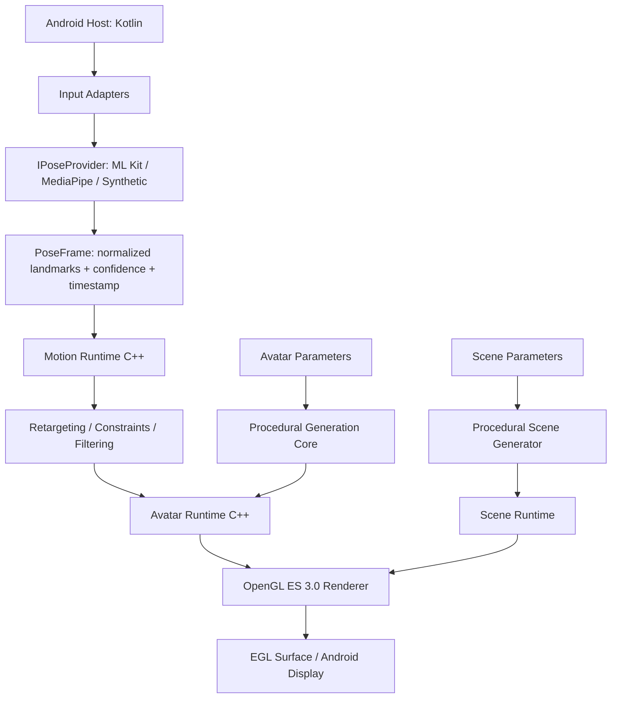

# Procedural Avatar Engine 技术设计规范

- 文档版本：v1.0
- 状态：架构基线 / MVP 实施规范
- 目标平台：Android 手机、Android TV / 电视盒子
- 核心语言：C++17（核心运行时），Kotlin（Android 宿主与系统能力）
- 图形 API：OpenGL ES 3.0（GLES 3.0）+ EGL
- 产品目标：从实时摄像头视频流或本地视频中提取人体姿态，驱动一个实时 3D 卡通数字人；支持数字人外观、材质、服装参数和程序化背景切换。

---

## 0. 本规范的决策摘要

本项目采用 **Code-Generated / Procedural-First** 路线：数字人的几何、骨骼、蒙皮权重、材质表现和背景场景由代码与参数生成，不使用外部制作的 3D 美术资产。

### 0.1 已确定的架构决策

| 领域 | 决策 |
|---|---|
| 渲染 | 自研专用渲染器，直接使用 OpenGL ES 3.0；不引入 Filament、Unity、Unreal、Godot、Three.js 等渲染引擎 |
| EGL | 由 C++ Native 层管理 EGL Display / Context / Surface；渲染线程独占 EGL 和 GL Context |
| 数字人几何 | C++ 程序化生成顶点、索引、法线、可选 UV、切线、关节索引和权重；不加载 GLB/GLTF/FBX/OBJ |
| 骨骼 | 程序化创建标准人体骨架、Bind Pose、Inverse Bind Matrix |
| 蒙皮 | 每顶点最多 4 个骨骼影响；默认 GPU Linear Blend Skinning（LBS） |
| 材质 | GLSL ES 3.00 Shader + 参数；不依赖外部贴图；初版以顶点色和程序化着色为主 |
| 场景 | 纯色、渐变、程序化几何场景；不依赖外部背景图片、HDRI、环境贴图 |
| 动作输入 | 通过 `IPoseProvider` 抽象姿态识别 SDK；第一阶段可用合成姿态数据验证引擎，再接入 ML Kit 或 MediaPipe |
| Android 接入 | Kotlin + CameraX / 系统文件选择器 / MediaCodec + JNI + C++ Native Runtime |
| 视频处理 | 实时流采用最新帧优先，允许丢弃过期帧；文件视频按 presentation timestamp 驱动播放与动作同步 |
| 目标帧率 | 以指定基准设备上 30 FPS 作为 MVP 目标，不作跨设备保证；姿态推理频率可低于渲染频率 |

### 0.2 “无外部资源”的准确边界

本规范中的 **Zero External Art Assets** 指不依赖外部制作的美术资产，不等同于“完全没有第三方代码或运行库”。

**禁止作为数字人或场景资产加载的文件：**

- `.glb`、`.gltf`、`.fbx`、`.obj`、`.dae` 等模型文件；
- `.png`、`.jpg`、`.jpeg`、`.webp`、`.ktx` 等外部角色/场景贴图或纹理文件；
- 外部骨骼动画、动作片段、HDRI、环境贴图、预制 3D 场景包；
- 运行时下载的角色模型、贴图或场景资源。

**允许的代码与系统依赖：**

- Android SDK、Android NDK、CMake、JNI、EGL、OpenGL ES；
- CameraX、MediaCodec、系统文件选择器等 Android 平台能力；
- 可插拔的人体姿态识别 SDK（例如 ML Kit / MediaPipe）。姿态识别 SDK 可能包含模型二进制或运行时文件，它们属于算法模型/软件依赖，不属于角色美术资产；必须在依赖清单中披露其体积、许可证、离线能力和版本状态；
- 项目自身编写的 C++、Kotlin、GLSL、数学函数、参数配置和自动化测试代码。

**特别说明：**若产品定义进一步要求“APK 内不能有任何模型二进制”，则不能直接采用捆绑模型的姿态识别 SDK；届时必须单独评估系统服务或其他部署方式。这是另一项产品约束，不应与“无外部 3D 美术资源”混为一谈。

---

## 1. 产品目标与非目标

### 1.1 MVP 必须实现

1. 输入源：实时摄像头视频流；预留并实现本地视频文件输入接口。
2. 姿态：从输入帧获得人体关键点、置信度和时间戳；统一转换为内部 `PoseFrame`。
3. 数字人：至少生成一个完整的卡通人形，具有头部、躯干、双臂、双手、双腿和双脚。
4. 动作：数字人能够跟随肩、肘、腕、髋、膝、踝等主要关节运动；支持基础躯干倾斜和身体朝向估计。
5. 渲染：实时显示程序化生成的 3D 人物；不需要任何外部 3D 模型或贴图。
6. 外观：运行时切换皮肤颜色、头发颜色、服装颜色和至少 2 个身体比例/头身比参数。
7. 背景：支持纯色、渐变背景和至少一种由代码生成的简单 3D 背景。
8. 生命周期：处理 Surface 创建/销毁、EGL Context 丢失、Activity 暂停/恢复和资源重建。
9. 性能：在明确记录型号与图形能力的基准设备上测量；以 30 FPS 渲染作为目标，报告渲染帧时间、姿态推理耗时、端到端延迟、CPU、内存和温度降频情况。

### 1.2 第一版不要求

- 写实级数字人、毛发物理、布料物理、复杂皮肤次表面散射；
- 手指逐关节动作捕捉、面部表情捕捉、口型同步；
- 多人同时驱动、全身真实尺度深度重建、遮挡补全；
- 通用游戏引擎功能、物理引擎、粒子系统、场景编辑器；
- 运行时任意复杂服装裁剪或无限制人体拓扑重建；
- 在所有 Android 手机和所有电视盒子上保证同样帧率。

### 1.3 技术边界

姿态识别 SDK 返回的单目关键点不是完整、准确的真实 3D 动捕数据。尤其是单目 Z 值通常是相对深度线索，不能直接当作米制世界坐标。系统必须将其视为带不确定性的姿态输入，使用几何约束、时间滤波和关节限制生成视觉上合理的数字人动作。不可在文档或 UI 中宣称“精确真实 3D 动捕”。

---

## 2. 总体架构



### 2.1 分层职责

| 层 | 职责 | 不应承担的职责 |
|---|---|---|
| Android Host | 权限、生命周期、相机/文件输入、UI、Surface 提供 | 几何生成、骨骼算法、GL 绘制细节 |
| Input Adapter | 从 CameraX / MediaCodec 获取帧并提供时间戳、旋转、格式 | 持有长期未消费的帧队列 |
| Pose Provider | 图像转姿态关键点；返回置信度和时间戳 | 直接操作数字人骨骼或 OpenGL |
| Motion Runtime | 坐标归一化、姿态滤波、Retargeting、IK/关节限制 | 依赖某个具体姿态 SDK 的对象类型 |
| Procedural Core | 根据参数生成 Mesh、Skeleton、Weights、材质参数和场景描述 | 每帧重建整个人体 |
| Avatar Runtime | 管理生成资产、骨骼矩阵、角色配置和变更 | 访问 Android UI 或 CameraX 对象 |
| Renderer | EGL、GL 资源、Shader、GPU Skinning、绘制 | 执行姿态模型推理或耗时 CPU 网格生成 |

### 2.2 线程模型

至少划分以下逻辑执行单元：

1. **UI/Main Thread**：交互和 Android 生命周期；不得执行耗时几何生成、推理或 GL 绘制。
2. **Camera/Decode Thread**：相机帧或视频解码帧的生产。
3. **Pose Inference Thread**：运行姿态 SDK；同一时刻最多处理有限数量帧，实时模式优先最新帧。
4. **Procedural Worker**：角色初次生成、外观导致的局部网格重建、法线和权重计算。
5. **Render Thread**：独占 EGL Context 和所有 OpenGL ES 调用；从线程安全命令队列接收参数更新、资源上传和销毁命令。

不得跨线程直接调用 OpenGL ES。不得让 `ImageProxy` 或解码帧在推理完成后仍被持有。所有缓冲区必须有明确的所有者与释放路径。

### 2.3 数据流与同步

- `PoseFrame`、`AvatarParameters`、`SceneParameters` 都应带时间戳或版本号。
- 实时模式使用容量为 1 或非常小的 latest-value buffer；新姿态覆盖旧姿态，避免积压造成“数字人追赶过去动作”。
- 渲染帧率与姿态推理帧率解耦。渲染器在相邻姿态之间进行插值/预测，但不得无限外推。
- 文件视频模式应以视频 PTS（presentation timestamp）为动作时间基准；解码、推理与渲染均需要保留时间戳。
- 角色外观更新采用命令式变更：只重建受影响的模块；纯颜色变化只更新 Uniform，不重新生成几何。

---

## 3. Android 与 Native 技术规范

### 3.1 平台技术栈

- Android 宿主：Kotlin。
- Native 核心：C++17；优先避免不必要的第三方 C++ 运行库。
- 构建：Gradle + Android NDK + CMake。
- Native 接口：JNI；接口传递稳定的 POD 数据或直接写入 Native Pose Buffer，避免频繁创建大量 Java 对象。
- 图形：EGL + OpenGL ES 3.0；Shader 使用 `#version 300 es`。
- 设备：Android 手机和 Android TV/盒子；需要通过真实硬件矩阵验证，不按 Android 版本推断 GPU 能力。

### 3.2 OpenGL ES 能力检测

启动时必须：

1. 创建 EGL Display、选择支持目标窗口配置的 EGLConfig。
2. 尝试创建 GLES 3.0 Context。
3. 查询并记录 `GL_VERSION`、`GL_RENDERER`、`GL_VENDOR`、`GLSL_VERSION` 和必要扩展。
4. 查询关键限制，例如最大顶点 Uniform Block 大小、最大纹理尺寸、顶点属性数量、渲染缓冲格式支持。
5. 若 GLES 3.0 Context 创建失败，显示明确的“不支持的图形能力”状态并安全退出渲染；不得静默假装支持。
6. 如果产品决定 GLES 3.0 是最低要求，在 Manifest 声明 `android:glEsVersion="0x00030000"`；同时保留运行时检查。

**MVP 不实现 GLES 2.0 的完整降级渲染管线。** 若产品后续需要 GLES 2.0，需要作为单独版本立项，不能在 GLES 3.0 Shader 中隐式使用不兼容特性。

### 3.3 EGL / Surface 生命周期

- C++ Native 层封装 `EglContextManager`。
- EGL Context 和 GL 资源由 Render Thread 创建、访问和销毁。
- Surface 通过 Android `Surface`/`ANativeWindow` 交给 Native 层；引用计数必须正确配对。
- Surface 销毁后停止绘制并释放 EGLSurface；Context 丢失后标记所有 GPU 资源失效。
- Context 恢复后从 CPU 端保留的程序化描述数据/参数重新创建 VBO、IBO、VAO、UBO、Shader Program。
- 不假设 GL object ID 在 Surface 重建后仍有效。
- 不在 Activity 暂停时继续无意义地循环渲染。

### 3.4 Android 输入方式

**实时相机：**

- 优先使用 CameraX `Preview` + `ImageAnalysis`；具体 Preview 是否显示由产品 UI 决定。
- 图像分析默认采用 `STRATEGY_KEEP_ONLY_LATEST`，避免推理落后时排队。
- 使用 `YUV_420_888` 优先；只有姿态 SDK 要求时才转换为 RGBA/Bitmap。
- 正确处理 rotationDegrees、前置摄像头镜像、传感器方向和显示方向。
- 确保 `ImageProxy.close()` 在异步推理完成后执行；异常路径也必须关闭。
- 姿态推理在专用 Executor 执行，不占 UI 和 Render Thread。

**本地视频：**

- 使用 Android 系统文件选择器获取用户选择的视频 URI；不得将视频当作内置美术资产。
- 使用 MediaExtractor / MediaCodec 或经验证的 Android 视频解码方式获得帧。
- 保留 PTS；播放、姿态计算和动画显示遵循相同时间轴。
- 暂停、拖动、倍速播放时同步清理或重置姿态滤波状态。
- 文件输入与摄像头输入最终都转换为统一 `PoseFrame`。

---

## 4. 坐标系、数学与公共数据类型

### 4.1 坐标约定

引擎内部必须使用唯一约定，不允许各模块自行解释左右手系：

- 右手坐标系（Right-handed）。
- 人体局部坐标：`+Y` 向上，`+Z` 为角色正面方向，`+X` 为角色自身左侧方向。
- 长度单位：米；基础卡通人物默认身高参数可设置为约 `1.7 m`，但所有尺寸由参数控制。
- 四元数用于旋转；矩阵采用明确且一致的存储/乘法约定，并在 `Math` 模块文档化。
- 相机图像坐标、姿态 SDK 坐标和世界坐标必须经显式转换，不得直接混用。

### 4.2 数学模块

自研或选择轻量数学实现时，至少提供并测试：

- `Vec2`、`Vec3`、`Vec4`；
- `Quat`：归一化、乘法、反向、Slerp、FromToRotation；
- `Mat3`、`Mat4`：乘法、逆矩阵、转置、TRS、LookAt、Perspective、Orthographic；
- 点到线段距离、射线/平面相交、AABB；
- Catmull-Rom 或 Bezier 曲线采样；
- 稳定的平行运输框架（Parallel Transport Frame），用于 Sweep Surface，避免截面沿曲线扭转跳变。

所有角度在 API 边界明确使用弧度或角度；内部统一使用弧度。

### 4.3 公共数据结构（概念接口）

```cpp
struct PoseLandmark {
    uint16_t id;
    Vec3 imageOrWorldPosition;  // 具体坐标语义由 coordinateSpace 标明
    float visibility;           // [0, 1]
    float presence;             // [0, 1]，若 Provider 不提供则用默认值
    bool valid;
};

struct PoseFrame {
    int64_t timestampNs;
    CoordinateSpace coordinateSpace;
    uint32_t landmarkCount;
    PoseLandmark landmarks[MAX_POSE_LANDMARKS];
    float poseConfidence;
    bool hasPerson;
};

struct AvatarParameters {
    BodyParameters body;
    AppearanceParameters appearance;
    uint64_t revision;
};

struct SceneParameters {
    BackgroundMode backgroundMode;
    Vec3 backgroundColorA;
    Vec3 backgroundColorB;
    LightingParameters lighting;
    uint64_t revision;
};
```

要求：真实代码可以调整字段，但必须保留明确的坐标语义、单位、时间戳、置信度和版本号。

---

## 5. Procedural Generation Core

### 5.1 核心原则

- 几何生成是初始化或参数变更时的工作，不是每个渲染帧的工作。
- 所有生成算法必须确定性：相同参数和 seed 生成相同结果。
- 生成器输出纯 CPU 数据结构；只有 Renderer 在 Render Thread 上传 GPU。
- 生成器不能直接调用 OpenGL。
- 所有算法均需验证 NaN/Inf、索引越界、退化三角形、法线异常和权重和不为 1 等问题。

### 5.2 基础几何函数

至少实现以下生成器：

| 函数 | 用途 | 关键参数 |
|---|---|---|
| `GenerateUVSphere` / `GenerateIcosphere` | 头部、眼球、球形关节 | radius、segments、rings、subdivisions |
| `GenerateEllipsoid` | 头部、手掌、关节体积 | radii、segments、rings |
| `GenerateCapsule` | 简单肢体和关节过渡 | radius、height、segments、hemisphereRings |
| `GenerateRoundedBox` | 鞋、简化手掌、几何配件 | size、cornerRadius、subdivisions |
| `GenerateLatheSurface` | 颈部、躯干局部、柱状结构 | profile、radialSegments |
| `GenerateSweepSurface` | 手臂、腿、头发束、服装边缘 | centerline、radiusProfile、frameSamples、radialSegments |
| `GenerateLoftSurface` | 胸腔、腹部、骨盆等截面插值曲面 | sectionProfiles、interpolation |

### 5.3 MeshData 规范

生成器统一输出：

```cpp
struct Vertex {
    Vec3 position;
    Vec3 normal;
    Vec4 tangent;             // 可选；没有法线贴图时可省略
    Vec2 uv;                  // 允许由程序生成；没有纹理时不要求非零
    U16Vec4 joints;           // 最多 4 个骨骼索引
    Vec4 weights;             // 对应权重，归一化
    Vec4 color;               // 可选顶点色
};

struct SubMesh {
    uint32_t firstIndex;
    uint32_t indexCount;
    uint16_t materialId;
};

struct MeshData {
    std::vector<Vertex> vertices;
    std::vector<uint32_t> indices;
    std::vector<SubMesh> subMeshes;
    Aabb bounds;
};
```

字段可按内存布局优化，但要保持数据语义一致。索引使用 32 位 CPU 表示；上传时可根据顶点数量选择 16/32 位 GPU 索引，必须验证 GLES 版本和绘制类型要求。

### 5.4 程序化人体形态

人体采用参数化人体（Parametric Humanoid），不要把最终角色定义为若干互不相关的球体/圆柱体拼接物。

MVP 的生成结构：

1. **躯干**：由胸腔、腹部、骨盆截面环插值生成 Loft Surface；支持胸宽、腰宽、骨盆宽、躯干长度和厚度参数。
2. **头部**：由椭球/细分球变形生成；支持头宽、头高、头深、下颌收窄参数；第一版允许简化卡通脸，不要求真实五官拓扑。
3. **颈部**：由 Sweep/Lathe Surface 生成，连接胸腔和头部。
4. **上肢**：肩到腕采用连续 Sweep Surface；沿肩、上臂、肘、前臂和腕设置截面半径曲线；肘部权重跨区渐变。
5. **下肢**：髋到踝采用连续 Sweep Surface；沿大腿、膝、小腿设置截面曲线；膝部权重渐变。
6. **手与脚**：先使用参数化椭球/圆角几何；MVP 无需逐指骨骼。
7. **肩/髋连接**：必须确保大范围动作时不出现可见网格裂缝。可使用融合桥接面、重叠遮挡和专用关节过渡几何；需要通过抬臂、屈肘、抬腿和屈膝测试。后续可研究隐式曲面/体素融合，但不得将其作为 MVP 的唯一实现路径。

**连续表面算法要求：**

- Sweep Surface 必须为每个采样截面建立稳定局部坐标框架；不得简单地每个点重新叉乘固定向量而产生突然翻转。
- 半径曲线应可在关节处设置渐变平台，避免肘膝出现尖锐收缩。
- 截面采样和沿长度采样密度可配置；移动端默认低细分。
- 生成后计算平滑法线；跨接缝的顶点法线应一致或通过共享顶点/法线组处理。
- 对需要变形的网格保留足够的环向与纵向边缘环；不能为了极低面数破坏肘膝弯曲。

### 5.5 形体参数

`BodyParameters` 至少包含：

- `height`、`headScale`、`headWidth`、`headHeight`；
- `shoulderWidth`、`chestWidth`、`waistWidth`、`hipWidth`；
- `torsoLength`、`neckLength`；
- `upperArmLength`、`lowerArmLength`、`armRadius`；
- `upperLegLength`、`lowerLegLength`、`legRadius`；
- `handScale`、`footLength`、`footWidth`；
- `stylization`（控制卡通夸张程度）；
- 生成细分等级与随机 seed。

参数必须有合法范围，互相约束。例如身高变化时，骨骼关节位置和网格尺度必须同步变化，不能只缩放网格而让骨骼留在原位。

### 5.6 生成结果验证

每个生成器需要自动检查：

- 顶点数和索引数大于合理下限；
- 所有顶点属性都是有限值；
- 所有索引都小于顶点数；
- 三角形面积大于阈值，或被明确标记为可接受的特殊情况；
- 法线长度接近 1；
- AABB 有效且尺寸符合人体参数；
- 蒙皮权重非负，权重和约等于 1；
- 相同参数与 seed 可生成一致结果。

---

## 6. Procedural Skeleton 与 Skinning

### 6.1 标准骨架

初版采用固定、版本化的 Humanoid Skeleton。推荐最少包含以下主关节（可增加辅助 twist/joint，但不得破坏标准 ID）：

| Bone ID | 名称 | 主要用途 |
|---:|---|---|
| 0 | Root | 角色整体移动与朝向 |
| 1 | Hips | 骨盆 |
| 2 | Spine | 腰/下脊柱 |
| 3 | Chest | 胸腔 |
| 4 | Neck | 颈部 |
| 5 | Head | 头部 |
| 6 | LeftShoulder | 左肩连接 |
| 7 | LeftUpperArm | 左上臂 |
| 8 | LeftLowerArm | 左前臂 |
| 9 | LeftHand | 左手 |
| 10 | RightShoulder | 右肩连接 |
| 11 | RightUpperArm | 右上臂 |
| 12 | RightLowerArm | 右前臂 |
| 13 | RightHand | 右手 |
| 14 | LeftUpperLeg | 左大腿 |
| 15 | LeftLowerLeg | 左小腿 |
| 16 | LeftFoot | 左脚 |
| 17 | LeftToe | 左脚趾（可选） |
| 18 | RightUpperLeg | 右大腿 |
| 19 | RightLowerLeg | 右小腿 |
| 20 | RightFoot | 右脚 |
| 21 | RightToe | 右脚趾（可选） |

骨骼定义必须包含：稳定 ID、名称、父节点 ID、Bind Local Transform、Bind Global Transform、Inverse Bind Matrix、长度/朝向元数据。

### 6.2 Bind Pose

- 生成器负责构建骨骼层级和默认站立姿势（T-Pose 或轻微 A-Pose，项目只能选择一种作为 canonical bind pose 并固定）。
- 每根骨骼的局部变换、全局变换和 Inverse Bind Matrix 在资产生成阶段计算。
- 骨骼矩阵计算顺序和矩阵乘法顺序必须通过单元测试确认。
- 骨骼层级不得出现循环、无效父节点或不连通的非 Root 节点。

### 6.3 自动蒙皮权重

每个顶点最多 4 个骨骼影响。建议结合 **解析权重 + 距离场权重**：

- 对 Sweep 生成的肢体，优先使用沿骨骼段参数化的解析权重；在关节过渡带内对相邻骨骼做平滑插值。
- 对躯干与肩/髋交界区域，可使用顶点到骨骼线段的距离生成候选影响，再应用区域掩码。
- 候选权重可使用 Gaussian 或 inverse-distance 函数；取权重最高的 4 根骨骼后重新归一化。
- 权重函数必须避免距离为 0 时除零，且必须处理候选影响为空的顶点。
- 不得简单地将整个上臂刚性权重设为 100% 上臂骨骼，否则肘部变形会断裂。
- 每个生成部件应有可视化调试模式：按权重将顶点绘制为颜色，便于检查肩、肘、髋、膝区域。

### 6.4 GPU Linear Blend Skinning

- 默认每顶点 4 influences。
- 顶点属性：Position、Normal、Joints（整数属性）、Weights。
- 骨骼矩阵通过 Uniform Buffer Object（UBO）上传；不要假设大量 `uniform mat4[]` 在所有 GLES 3.0 GPU 上都能满足限制。
- 初版骨骼数量约 22 根；UBO 布局采用 `std140`，矩阵对齐和 C++ 端写入布局必须严格一致。
- 顶点 Shader 计算加权 skin matrix，再变换 Position 与 Normal；Normal 应重新归一化。
- 角色非均匀身材缩放优先在几何生成时烘焙，避免骨骼矩阵的非均匀缩放导致法线处理复杂化。
- CPU Skinning 只作为测试/调试或兼容路径，不作为常规渲染路径。

### 6.5 关节限制与姿态连续性

- 肘、膝默认按单轴铰链关节近似；肩、髋使用有限范围球关节；脊柱和颈部限制最大弯曲角度。
- 对输入噪声进行时间平滑后再应用关节限制，避免限制器放大跳变。
- 当某关键点低置信度时，沿用最近可信姿态并渐进回到中性姿势；不可瞬间跳到零姿态。
- 姿态丢失超过配置时长后，将角色平滑过渡到 Idle/Neutral Pose。

---

## 7. Motion Runtime 与 Pose Retargeting

### 7.1 Provider 抽象

定义独立接口：

```cpp
class IPoseProvider {
public:
    virtual ~IPoseProvider() = default;
    virtual bool start(const PoseProviderConfig&) = 0;
    virtual void stop() = 0;
    virtual bool pollLatest(PoseFrame& outFrame) = 0;
};
```

实际姿态 SDK 可在 Kotlin 层运行，再经 JNI 推送 `PoseFrame`；也可在 Native 层实现适配，但 Motion Runtime 不得依赖 ML Kit/MediaPipe SDK 类型。

至少提供：

- `SyntheticPoseProvider`：可生成站立、抬手、屈肘、下蹲、抬腿等确定性测试动作；
- 一个真实 Android Pose Provider Adapter；
- Provider 能力信息：landmark 数量、坐标类型、是否提供 world landmarks、单人/多人、置信度字段语义。

### 7.2 输入姿态语义

`PoseFrame` 必须包含：

- 单调时间戳（纳秒）；
- 源帧尺寸、图像旋转和镜像信息（可在 Adapter 转换后保留元数据）；
- 每个关键点 ID、位置、有效标记、可见度/置信度；
- 坐标语义：Normalized Image / Pixel / Provider World 等；
- 全局 pose confidence 和 person detected 状态。

禁止把归一化图像坐标直接当成 3D 米制坐标。

### 7.3 Landmark 到 Humanoid Skeleton 的映射

内部定义统一 Landmark ID，不把 SDK 的枚举值散落在引擎核心中。对于 33 点姿态模型，映射至少覆盖：

- Nose / Ear（可选用于头部朝向辅助）；
- Left/Right Shoulder；
- Left/Right Elbow；
- Left/Right Wrist；
- Left/Right Hip；
- Left/Right Knee；
- Left/Right Ankle；
- Heel / Foot Index（可选用于脚方向）。

第一版不使用手指关键点驱动逐指骨骼。

### 7.4 Retargeting 计算原则

1. 先将输入坐标转换到统一的归一化人体坐标系，修正旋转、镜像和宽高比。
2. 通过肩宽、髋宽、躯干长度估计人体尺度；避免单独依赖一个关节点。
3. 由相邻 Landmark 形成骨骼方向向量；与数字人 Bind Pose 的参考骨骼方向比较，求出局部旋转。
4. 使用四元数表达骨骼局部旋转，避免欧拉角顺序问题。
5. 肩/髋朝向可由左右肩线、左右髋线与躯干方向构造局部坐标框架；单目相机无法唯一确定的扭转角必须采用约束/先验，而不是声称已测得。
6. 根据关节角限制修正结果；手腕、脚踝可先采用方向跟随，不推断缺失的手指/脚趾动作。
7. 对 Root Translation、全身缩放和地面接触分别处理；相机画面中的人体上下移动不应不加区分地映射成角色世界空间移动。

### 7.5 滤波与丢点处理

- 初版可实现 One Euro Filter 或置信度加权的自适应低通滤波。
- 位置使用向量滤波；旋转使用 Quaternion Slerp / 角速度约束。
- 滤波参数可配置，并有“响应速度—平滑程度”调节。
- 置信度低时降低新观测权重；连续丢失时保持/衰减到中性姿态。
- 过滤器基于真实时间戳计算 delta time，不假定推理频率固定。
- 对异常大跳变设定速度/角速度阈值，但必须避免把真实快速动作全部滤掉。

### 7.6 单目 3D 限制

- ML Kit 的 Z 值是相对/估计深度，不是真实三维世界坐标；不得用于精确距离测量。
- 仅依赖单目 2D 关节点无法唯一恢复人体绕垂直轴的转身、身体前后深度、遮挡肢体的真实姿态。
- MVP 以“看起来合理的卡通跟随动作”为目标；在深度不确定时使用骨骼长度、身体左右对称先验和时间连续性。
- 如果未来需要高质量 3D 动捕，应另行评估双目/多摄像头、深度相机或专门 3D Pose 模型。

---

## 8. Procedural Material 与 Shader

### 8.1 原则

- 不使用外部位图纹理作为皮肤、头发、服装或背景材质。
- 通过 Uniform、Vertex Color、几何属性和程序化数学函数生成外观。
- Shader 使用 GLSL ES 3.00；Shader 编译错误必须在日志中显示完整 source、编译日志和设备信息（Release 可裁剪敏感调试信息）。
- 材质参数变化不得重新生成网格，除非参数会改变几何形态。

### 8.2 MVP 材质类型

1. `SkinMaterial`：基础色、粗糙度近似参数、明暗响应、轻量色调变化。
2. `HairMaterial`：基础色、主光高光、卡通分层明暗；头发几何由 Hair Generator 生成。
3. `ClothMaterial`：基础色、粗糙度近似参数、可选程序化条纹/点状效果；不得使用外部贴图。
4. `EyeMaterial`：眼白、虹膜、瞳孔通过程序化几何和参数生成，不依赖眼睛贴图。
5. `BackgroundMaterial`：纯色或屏幕空间渐变。

### 8.3 基础光照

MVP 使用低成本风格化光照：

- 一个方向光（主光）；
- 一个环境光系数；
- 可选简化 Rim Light / 卡通明暗分段；
- 暂不要求实时软阴影；
- 不依赖 HDRI 或外部环境贴图。

必须避免在 Fragment Shader 中使用高成本、多层噪声或大量动态循环。低端设备优先使用简单 Lambert/Toon shading。

### 8.4 程序化 Shader 参数

`MaterialParameters` 至少有：`baseColor`、`roughnessLike`、`metallicLike`（仅需要时）、`specularStrength`、`toonSteps`、`rimStrength`、`opacity`。所有值范围需校验。

---

## 9. Procedural Scene / Background

### 9.1 MVP 背景模式

- `SolidColor`：单色清屏。
- `Gradient`：屏幕空间垂直/径向渐变，不需要纹理。
- `ProceduralStudio`：由地面平面、墙面/弧形背景、简单几何装饰和一组灯光参数构成。
- 后续可扩展 `ProceduralOutdoor`、`ProceduralRoom` 等生成器。

### 9.2 场景系统约束

- 场景参数与角色参数分离；切换背景不得重建数字人。
- 背景生成器不得引入贴图、HDRI 或外部模型。
- 首版控制 Draw Calls、顶点数和光照数量；不实现通用场景图编辑器。
- 背景和角色分别有可见性/质量控制。

---

## 10. OpenGL ES Renderer 规范

### 10.1 Renderer 模块

建议至少包含：

- `EglContextManager`：EGL 初始化、Surface 绑定、Context 恢复；
- `GlCapabilities`：GL 版本、扩展和硬件限制查询；
- `ShaderProgram`：编译、链接、Uniform/Block 绑定和错误日志；
- `GpuMesh`：VAO/VBO/IBO 生命周期；
- `GpuSkinning`：骨骼 UBO 上传和蒙皮 Shader；
- `MaterialSystem`：材质参数与 Program 绑定；
- `CameraSystem`：View / Projection / Model 矩阵；
- `SceneRenderer`：背景与场景绘制；
- `AvatarRenderer`：角色子网格绘制；
- `RenderStats`：FPS、CPU frame time、GPU time（若可测）、draw calls、triangle count、buffer bytes。

### 10.2 基础渲染状态

- Depth Test：开启。
- Back-face Culling：默认开启；几何生成器必须保持一致的 winding order。
- Blend：默认关闭；只有透明部件显式启用并排序。
- MSAA：作为设备能力和性能开关，不作为最低要求。
- Color Space：首版明确使用线性或非线性流程，并对输出进行一致处理；不可材质随意混用。
- Viewport 根据 Surface 尺寸变化更新；屏幕方向变化后更新投影矩阵。

### 10.3 绘制顺序

建议：

1. 更新 Render Surface / Viewport。
2. 消费最新 Scene / Avatar / Pose 命令。
3. 生成当前帧相机矩阵和角色模型矩阵。
4. 绘制程序化背景（或清屏渐变）。
5. 上传最新 Bone Palette UBO。
6. 按材质批次绘制角色 SubMesh。
7. 绘制可选调试骨架/关键点（Debug Build）。
8. 输出性能统计。

### 10.4 GPU 资源管理

- 每个 GL 资源都必须有 RAII 包装或等价清晰生命周期。
- GL 资源只在 Render Thread 创建和销毁。
- CPU 生成数据与 GPU 资源句柄分离。
- 资源缓存由 Geometry Key / Material Key / Avatar Revision 标识。
- 仅对发生变化的几何重新上传；只改变颜色时不上传顶点数据。
- Context Lost 后重新创建全部 GPU 资源。
- 避免每帧 `glBufferData` 大量分配；使用稳定 Buffer、`glBufferSubData` 或合适的缓冲更新策略。

---

## 11. Avatar 参数、预设与运行时 API

### 11.1 预设原则

Avatar Preset 是参数，不是模型文件。可以存成 C++ 常量、源代码中的结构体或普通 JSON 配置，但不允许包含模型/贴图二进制。

建议至少提供：

- `Cartoon_Default`：中性卡通人；
- `Cartoon_Chibi`：大头短身比例；
- `Cartoon_Tall`：较高身材比例。

场景至少提供：

- `Solid`；
- `GradientStudio`；
- `ProceduralStudio`。

### 11.2 核心 API（概念）

```cpp
class AvatarEngine {
public:
    bool initialize(const EngineConfig& config);
    void onSurfaceCreated(NativeWindowHandle window, int width, int height);
    void onSurfaceChanged(int width, int height);
    void onSurfaceDestroyed();

    void setPoseFrame(const PoseFrame& frame);
    void setAvatarParameters(const AvatarParameters& params);
    void setSceneParameters(const SceneParameters& params);

    void start();
    void pause();
    void resume();
    void shutdown();
};
```

真实实现可拆成多个类；上述 API 仅表达模块边界，不要求一个巨型类。

### 11.3 外观更新策略

| 参数变化 | 必须执行的工作 |
|---|---|
| 皮肤颜色 | 更新 Uniform / Material Instance |
| 头发颜色 | 更新 Uniform |
| 服装颜色 | 更新 Uniform |
| 服装款式 | 重新生成对应服装几何并重新上传对应 Buffer |
| 头身比 / 肩宽 / 腿长 | 重建相关几何、骨架 Bind Pose、权重和包围盒 |
| 背景颜色 | 更新背景参数 |
| 背景类型 | 重新生成背景几何/状态，不影响 Avatar |
| 渲染质量等级 | 改变细分、Shader Feature 和渲染分辨率；必要时重新生成低细分网格 |

---

## 12. 性能预算与质量等级

性能预算是初始目标，需要用真实设备测量，不是对所有设备的承诺。

### 12.1 初始预算（可在基准设备测试后修订）

| 指标 | MVP 初始目标 | 说明 |
|---|---:|---|
| 同屏角色 | 1 | 单人驱动 |
| 角色三角形 | 5,000–15,000 | 卡通人体起始预算，按变形质量调整 |
| 主骨骼数 | 22 左右 | 不含可选辅助骨 |
| 每顶点骨骼影响 | 最多 4 | GPU LBS |
| Draw Calls | 目标不超过 20–30 | 尽量合批，避免过多材质分段 |
| 渲染帧率 | 30 FPS 目标 | 以指定基准设备为准 |
| Pose 推理 | 15–30 FPS 测试区间 | 依 SDK、输入分辨率与设备而变 |
| 输入图像 | 从 480×360 附近开始验证 | subject 必须占据足够画面比例；按 Provider 要求调整 |
| 场景 | 简单单场景 | 一主光、无高成本阴影 |

### 12.2 质量等级

- **Low**：较低网格细分、简化 Shader、无轮廓描边、关闭阴影。
- **Medium**：默认细分、基础 Toon/Lambert、轻量轮廓效果（若性能允许）。
- **High**：更高细分、额外材质细节和可选后处理；只在通过性能检测的设备启用。

质量等级必须由运行时指标和用户设置共同控制，不得仅按设备名称硬编码。

### 12.3 性能测量

至少记录：

- 平均 FPS、1% low FPS、帧时间 P50/P95/P99；
- Pose SDK 单帧推理耗时、输入至姿态回调延迟；
- PoseFrame 到屏幕显示的端到端延迟（通过时间戳/测试标记测量）；
- CPU 使用率、Native Heap、Java Heap、GPU 内存可用指标；
- Draw Calls、三角形数、Shader Program 数、Buffer 大小；
- 连续运行 10–30 分钟后的温度与热降频变化。

如果设备没有 GPU 时间查询扩展，不得虚构 GPU 时间；记录 CPU 提交时间和可获得的系统指标即可。

---

## 13. 工程目录建议

目录应结合现有仓库调整，以下为逻辑参考，不要求机械照搬：

```text
ProceduralAvatarEngine/
├── app/                         # Kotlin Android Host
│   ├── camera/
│   ├── video/
│   ├── pose/
│   ├── ui/
│   └── nativebridge/
├── native/
│   ├── CMakeLists.txt
│   ├── core/
│   │   ├── math/
│   │   ├── memory/
│   │   └── diagnostics/
│   ├── procedural/
│   │   ├── primitives/
│   │   ├── surfaces/
│   │   ├── humanoid/
│   │   ├── face/
│   │   ├── hair/
│   │   ├── clothing/
│   │   └── scene/
│   ├── skeleton/
│   │   ├── definition/
│   │   ├── builder/
│   │   ├── skinning/
│   │   └── constraints/
│   ├── motion/
│   │   ├── poseframe/
│   │   ├── retargeting/
│   │   ├── filtering/
│   │   └── ik/
│   ├── materials/
│   ├── renderer/
│   │   ├── egl/
│   │   ├── gl/
│   │   ├── shaders/
│   │   ├── mesh/
│   │   ├── camera/
│   │   └── stats/
│   └── runtime/
├── tests/
│   ├── unit/
│   ├── geometry/
│   ├── skeleton/
│   ├── motion/
│   └── integration/
├── docs/
│   ├── Procedural_Avatar_Engine_Technical_Spec_v1.0.md
│   ├── architecture-decisions/
│   └── performance/
└── README.md
```

---

## 14. 测试策略与验收标准

### 14.1 单元测试

- Math：四元数 FromTo、Slerp、矩阵逆、TRS/层级组合。
- Geometry：顶点/索引合法性、法线归一化、边界框、参数边界、确定性。
- Skeleton：父子层级、Bind Pose、Inverse Bind Matrix、骨骼矩阵顺序。
- Skinning：权重非负且和为 1；中性姿势下蒙皮结果应接近原始网格；单骨骼旋转测试符合预期。
- Motion：标准静态姿势、左右肢体映射、镜像切换、置信度下降、丢点恢复和时间戳变化。

### 14.2 视觉/集成测试

必须提供 Debug Scene 或测试入口：

1. 生成卡通人 T-Pose/A-Pose 并显示骨架。
2. 自动执行抬臂、屈肘、双臂水平、下蹲、抬膝和躯干倾斜动作。
3. 显示骨骼权重热力图。
4. 切换皮肤色、头发色、衣服色，确认只更新参数。
5. 切换背景，确认角色几何和骨骼没有重建。
6. 反复销毁/重建 Surface，确认 GL 资源正确恢复。
7. 连续运行至少 10 分钟，检查崩溃、内存增长和帧率波动。

### 14.3 MVP 验收条件

- [ ] 不存在运行时加载的 GLB/GLTF/FBX/OBJ 或外部角色/场景贴图。
- [ ] 人体几何、骨骼、蒙皮权重由代码生成。
- [ ] GLES 3.0 初始化和能力检测有效；不支持设备能给出明确错误。
- [ ] 程序化卡通人物能正确显示，法线、深度和三角形 winding 正确。
- [ ] GPU Skinning 工作；抬臂、屈肘、抬腿和屈膝不出现明显裂缝或翻面。
- [ ] 皮肤、头发、服装颜色可在运行时切换，且不重建网格。
- [ ] 背景能在纯色、渐变、程序化场景之间切换。
- [ ] SyntheticPoseProvider 能驱动角色，便于无摄像头测试。
- [ ] 至少一个真实姿态 Provider 可接入，并输出统一 PoseFrame。
- [ ] 实时输入不会因推理变慢而无限排队；过期帧会按策略丢弃。
- [ ] Surface/Activity 生命周期处理正确；Context 重建后可恢复渲染。
- [ ] 构建、单元测试和可运行验证结果有记录。
- [ ] 在至少一台真实 Android 手机和一台目标 Android TV/盒子上记录性能数据；若暂时没有设备，明确标为未验证，不得宣称通过。

---

## 15. 实施顺序与交付门槛

虽然整体架构一步确定，但工程实现按可验证的增量推进，防止多个复杂模块同时失效。

### M0：仓库审查与工程基线

- 审查现有仓库、构建链、SDK/NDK、包名、代码规范和已有实现。
- 识别已有依赖，清点任何外部 3D 资源。
- 建立本规范、架构决策记录和实施清单。
- 不得覆盖或删除未理解的既有代码。

**门槛：** 能稳定构建空壳/现有工程；架构与依赖清单明确。

### M1：Native EGL + GLES Renderer

- Kotlin Surface 生命周期连接 C++ EGL。
- 建立 GLES 3.0 Context、能力检测和清屏/基础几何绘制。
- 增加 RenderStats、错误日志和 Context 恢复。

**门槛：** 真机稳定绘制程序化三角形/基础几何，Surface 重建不崩溃。

### M2：Procedural Geometry + Humanoid Skeleton

- 完成 Math、MeshData、Primitive/Sweep/Loft Generator。
- 生成头、躯干、四肢、手脚。
- 生成标准骨架、Bind Pose 和权重。
- 完成几何和权重验证工具。

**门槛：** 程序化人物可以显示；不读取任何外部模型或贴图。

### M3：GPU Skinning + Procedural Materials

- UBO Bone Palette、GLES 3.0 顶点蒙皮 Shader。
- 骨骼动作测试；权重热力图。
- 皮肤/头发/服装参数和背景 Shader。

**门槛：** 合成动作驱动角色，主要关节运动无明显裂缝。

### M4：Motion Runtime + Synthetic Provider

- PoseFrame、坐标转换、Retargeting、滤波、关节约束。
- 合成姿态轨迹驱动角色。

**门槛：** 不依赖相机与 ML SDK 即可重复验证动作链路。

### M5：真实姿态识别接入

- 增加真实 Pose Provider Adapter。
- CameraX 实时帧接入，处理旋转、镜像、帧丢弃和资源释放。
- 记录推理延迟与动作抖动。

**门槛：** 摄像头动作可以稳定驱动数字人；低置信度和丢点行为可控。

### M6：视频文件输入

- MediaExtractor/MediaCodec 或验证过的等价实现。
- PTS 与 PoseFrame 时间戳同步；暂停、拖动、倍速和重新播放时重置状态。

**门槛：** 同一个 Motion Runtime 能处理实时流与本地视频。

### M7：设备适配与优化

- 建立 Low/Medium/High 质量等级。
- 测量指定手机、电视盒子的 FPS、延迟、CPU/GPU/内存和热稳定性。
- 按数据优化，不以主观感觉判断。

**门槛：** 交付设备矩阵、性能报告和已知限制。

---

## 16. 风险与技术决策记录

| 风险 | 影响 | 应对 |
|---|---|---|
| 单目姿态的深度不准确 | 转身、前后动作表现失真 | 以视觉跟随为目标，加入先验和约束；不宣传精确 3D 动捕 |
| 程序化肩/髋连接质量 | 大幅动作时出现裂缝 | 重点测试关节过渡面和权重；必要时增加局部几何细分 |
| 权重算法自动生成不够自然 | 肘膝变形塌陷 | 解析权重优先、距离权重补充、热力图调试 |
| GLES 3.0 设备覆盖差异 | 某些盒子无法启动 | 运行时检测；建立明确设备准入矩阵 |
| Pose SDK 包体/许可证/状态变化 | 包体变大或 API 变更 | Provider 抽象；依赖清单记录版本、许可证、模型体积和 Beta 状态 |
| 推理低于渲染帧率 | 动作不连续或延迟累积 | 最新帧优先、插值、低延迟滤波，不堆积队列 |
| Context 丢失 | 黑屏或 GL 崩溃 | CPU 生成数据保留，GPU 资源可重建 |
| 完全自研范围扩大 | 项目周期失控 | 仅实现数字人必要子集，不扩展为通用 3D 引擎 |

### 16.1 必须形成的 ADR

实现过程中至少记录：

- ADR-001：为什么采用 GLES 3.0 + 自研 Renderer；
- ADR-002：为什么定义当前坐标系和 Humanoid Skeleton；
- ADR-003：为什么选用当前姿态识别 Provider；
- ADR-004：程序化人体几何与关节融合策略；
- ADR-005：GPU Skinning Buffer 与骨骼数量限制；
- ADR-006：视频输入与实时姿态时间同步策略。

---

## 17. 官方技术参考

以下资料用于实现阶段核对 Android 平台 API 行为与限制；具体 SDK 版本须在实际开发时重新验证。

1. Android OpenGL ES 概览与设备版本检测：<https://developer.android.com/develop/ui/views/graphics/opengl/about-opengl>
2. Android NDK Native APIs（OpenGL ES / EGL）：<https://developer.android.com/ndk/guides/stable_apis>
3. CameraX ImageAnalysis、`STRATEGY_KEEP_ONLY_LATEST` 与帧生命周期：<https://developer.android.com/media/camera/camerax/analyze>
4. ML Kit Android Pose Detection、33 个关键点、STREAM_MODE、输入要求和 API 状态：<https://developers.google.com/ml-kit/vision/pose-detection/android>
5. ML Kit Pose Detection 的 Z 坐标语义与能力范围：<https://developers.google.com/ml-kit/vision/pose-detection>

---

## 18. 最终架构原则

本项目不是一个通用游戏引擎，也不是一个 GLB 模型播放器。它是一个为 Android 低性能设备优化的、程序化生成资产的实时数字人引擎。

必须始终遵循：

1. 资产由规则和参数生成，而不是从美术文件加载。
2. 生成阶段与实时渲染阶段分离。
3. 姿态识别 Provider 与 Motion Runtime 解耦。
4. Motion Runtime 与 Avatar Renderer 解耦。
5. GLES 资源只由 Render Thread 管理。
6. 任何性能结论都必须来自真实设备测量。
7. 先建立可验证的完整链路，再提升人体形态质量和视觉效果。

**v1.0 的成功标准：一个完全由代码生成的卡通数字人，能够在 Android 上通过 OpenGL ES 3.0 实时渲染，并由摄像头/视频姿态数据驱动，且支持参数化外观和程序化背景切换。**
