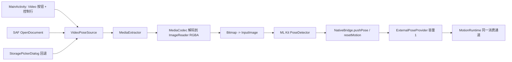

# M8 — 02 设计

## 模块与数据流

- 解码线程 = 推理线程（单线程顺序执行）：解码一帧 → 推理 → 按视频时钟等待/跳帧。推理慢时按 PTS 跳过过期帧（时间轴优先），天然背压、无帧积压，满足"最新帧优先"在视频域的语义（时间轴上的最新）。

## VideoPoseSource（Kotlin，新文件）

- 状态机：`IDLE / PREPARED / PLAYING / PAUSED / SEEKING / ENDED / STOPPED / ERROR`，全部状态迁移在解码线程串行执行；UI 通过 `post()` 投递命令（play/pause/seekTo/setSpeed/restart/stop）。
- 视频时钟：`videoNowUs = anchorPtsUs + (nowWallUs - anchorWallUs) * speed`；seek/pause/倍速切换时重新锚定。
- PTS 传递：`bufferInfo.presentationTimeUs * 1000` → `PoseFrame.timestampNs`；帧旋转来自 `MediaFormat.rotationDegrees`（API 27 支持）；镜像不做（视频源无前置镜像概念）。
- 解码输出：`MediaCodec.configure(format, imageReader.surface, null, 0)`，`ImageReader.newInstance(w, h, RGBA_8888, 3)` → `acquireLatestImage()` → `Bitmap.copyPixelsFromBuffer`（行对齐处理：Image rowStride 可能 > width*4，逐行拷贝）→ `InputImage.fromBitmap(bitmap, rotation)`。
- 每帧结束 `image.close()`（所有路径，含异常 finally）；`bitmap.recycle()`。
- 统计：每 30 帧输出 `video stats: decoded=.. skipped=.. pts=..s inference_ms=..`（OBS-001）。
- 失败：`MediaCodec.CodecException`/无视频轨/无解码器 → 状态 ERROR + 日志 + UI Toast；`stop()` 释放 codec/extractor/imageReader（finally 链）。
- 生命周期：Activity `onPause` → `pausePlayback()`（不清资源）；`onDestroy` → `stop()` 释放全部。

## Native 变更（复用 M6/M7 通道，新增最小接口）

- `MotionRuntime` 已有 `resetFilters()`（清 One Euro、filtered_、lastFrameNs_、lastValidNs_）——直接作为 seek 重置语义。
- `RenderThread` 新增命令 `MotionReset`（`postMotionReset()`）；`EngineRuntime::resetMotion()`；JNI `nativeResetMotion(handle)`；`NativeBridge.resetMotion()`。
- 无 ML Kit/视频类型进入 Native（保持 ADR-003 边界）。

## UI

- 按钮行新增 `Video`（选择视频）。
- 视频激活时显示第二行控制：`Play/Pause`、`-10s`、`+10s`、`1x`（循环 1x→2x→0.5x）、`Replay`、`Stop`（TV 焦点可用）。
- 错误提示 Toast + `PAE_VIDEO` 日志。

## 单元测试（宿主，tests/unit/motion_tests.cpp 增补）

- `reset_restores_identity_pose`：外部帧驱动后 resetFilters()，update() 无新帧输出与全新实例一致（中性/绑定姿势）。
- `reset_clears_frame_time`：reset 后首次有效帧的 dt 使用默认 1/60（通过复位后姿态立即响应间接验证——filtered_ 无旧姿态残留）。
- `pts_monotonic_frames_drive_pose`：以递增 PTS 推入多帧，姿态随时间推进（覆盖 PTS 时间戳语义）。

## ADR-007（新增）

- 背景：技术规范要求"系统文件选择器"，但目标盒子无 DocumentsUI。
- 决定：SAF 为主路径（手机/有 DocumentsUI 设备），`StoragePickerDialog` 应用内浏览器为回退（电视盒子）；两者都只访问用户自选文件，不打包任何媒体资产，维持零外部美术资产约束。回退路径需要 READ_EXTERNAL_STORAGE 运行时权限。
- 影响与回滚：不影响 Native 架构；若后续设备均有 DocumentsUI，可移除回退路径。
