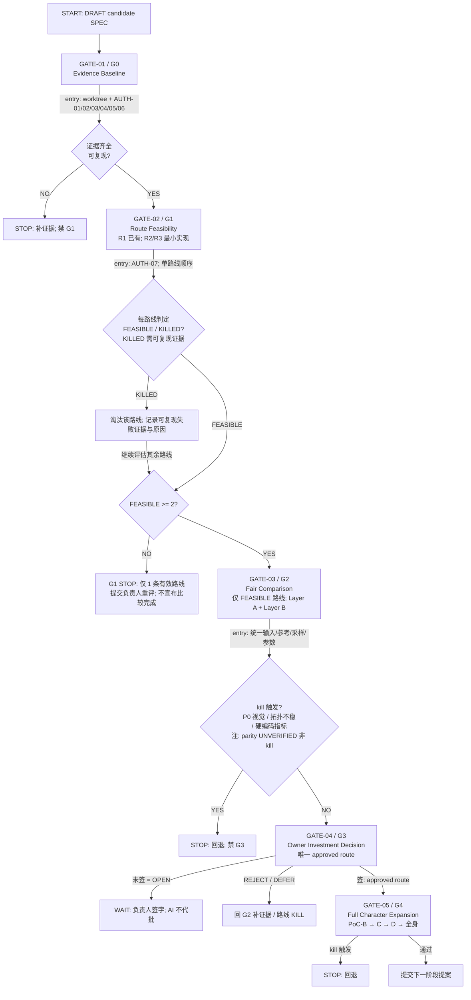

# Anatomy-driven Geometry — Implementation SPEC（v2.1 FORMAL CANDIDATE，仍为 DRAFT）

> **状态：v2.1 DRAFT / FORMAL CANDIDATE — 未经项目负责人批准，不授权编码、不授权构建、不授权设备操作。**
> 本文件是评审报告与 PoC-A 投资决策 Gate 计划的整合版，提交负责人审核。所有 DEC-xx / AUTH-xx 未获签字者保持 OPEN。
> 阶段范围：**PoC-G0、G1、G2（PoC-A 对比实验）**；G3 为投资决策；G4 才允许完整人体扩展。P1-B/C/D、肩部/手臂完整生成、头发/服装/面部均不在本 SPEC 授权范围内。
> 依据：`ProceduralAvatarEngine-Anatomy-driven-Geometry-Development-Prompt-v1.0.md`；`docs/proposals/anatomy-driven-geometry-redesign/` README + 00–09 共 11 份；SPEC 独立技术评审报告；PoC-A 投资决策 Gate 计划。
> 文档日期：2026-11-23。标签：`[FACT]` / `[INFERENCE]` / `[RECOMMENDATION]` / `[OPEN QUESTION]`；状态：`VERIFIED` / `PARTIALLY VERIFIED` / `DECLARED ONLY` / `NOT IMPLEMENTED` / `UNVERIFIED` / `REJECTED`。

---

## 0. 本次修订说明（v2.0 → v2.1 FORMAL CANDIDATE）

| 项目 | 说明 |
|---|---|
| v2.0 修订目标（已完成） | 关闭 SPEC-01…SPEC-09；把评审报告与 Gate 计划整合为一份可批准候选规范 |
| **v2.1 修订目标（本次）** | 关闭独立审核 FIX-01…FIX-06：PoC-A Topology Scope、CPU/GPU Parity Gate 职责、Layer A 比较对称性、G0 Worktree/相机协议、参数状态证据等级、G1 FEASIBLE/KILLED 规则；并使 Scope/Gate/Topology/Skinning/Comparison/Acceptance 相互一致 |
| 未改变 | DRAFT 状态；源码；CMake / Gradle；分支；Git 历史；用户原有未提交变更与 10 份根目录 untracked 副本；PoC-A 范围未扩大（仅内部工作日志追加记录） |
| 基线 Commit | `bd3ad72f9541020f90d48a90dbfd7ee2a0142f85`（v2.0 已推送；v2.1 为工作区文档修改，未提交） |
| 既有章节 | SPEC Closure Matrix（§5）、统一 Gate 体系（§6）、三类 Register（§7）、Fair Comparison Protocol（§8）、Parameter Traceability Matrix（§9）、Topology Capability Matrix（§10）+ §10.1 Scope 分层、Skinning Parity（§11）、G0 Test Execution Matrix（§12）+ §12.1 Worktree 细节、视觉与算法验收标准（§13）、PoC-A Acceptance Matrix（§14）、Mermaid Gate Flow（§6.1） |
| 编号统一 | 旧 A1–A12 / 附录 A1–A11 → `DEC-xx`（架构/形态/范围）、`AUTH-xx`（操作/构建授权）、`GATE-xx`（验收状态），见 §7.5 映射表 |
| 变更清单 | `docs/phases/anatomy-driven-geometry-poc/01-spec-consolidation-change-report.md`；FIX-01…06 Closure Matrix 在该报告 §7 |

---

## 1. Git 基线（关闭 SPEC-01 / SPEC-02 / SPEC-03）`[FACT]`

采集时间：2026-11-23 15:56 GMT+8（v2.1 修订前实测）。**以下为实测，不是历史报告转述。**
`[FACT]` v2.0 的两份文档已提交并推送为 `bd3ad72`（见 §1.1）；v2.1 修订尚未提交。

### 1.1 已提交事实（Committed Facts）

| 项 | 实测值 |
|---|---|
| `git rev-parse --show-toplevel` | `C:/Users/Giant/Desktop/GITCODE/Procedural Avatar Engine` |
| `git rev-parse HEAD` | `bd3ad72f9541020f90d48a90dbfd7ee2a0142f85` |
| HEAD 标题 | `docs: consolidate implementation SPEC candidate and PoC-A investment gate` |
| HEAD 提交时间 | `2026-11-23 15:39:15 +0800` |
| 当前分支 | `feature/procedural-character-foundation` |
| upstream | `origin/feature/procedural-character-foundation`（`0 0` 同步；v2.0 已 push） |
| remote | `origin https://github.com/Vin535LFJ/ProceduralAvatarEngine.git`（fetch/push） |
| main | `c539afbec299ed4a066429ea09f9d3d36e67f74d` |
| `merge-base(main, HEAD)` | `c539afbec299ed4a066429ea09f9d3d36e67f74d`；main 是 HEAD 的祖先 |
| `rev-list --left-right --count main...HEAD` | `0 8`（main 无独有提交；HEAD 领先 8） |
| `6eab7f4..HEAD` | 1 个新提交 `bd3ad72`：v2.0 SPEC + 变更报告的文档整合，**纯文档**；无 C++/JNI/Kotlin 改动 |
| `486a00d8..6eab7f4` | 1 个提交 `6eab7f4`：归档 M 路线/v1.0 资料、新增 11 份设计文档包、SPEC 草案、archive 索引；纯文档 |
| 历史值 `6eab7f4…` / `486a00d8…` | 均为 HEAD 祖先，仅作历史快照，**不作当前状态** |

### 1.2 工作区未提交变更（Uncommitted, tracked）`[FACT]`

`git diff --stat`（v2.1 修订中，相对已推送的 `bd3ad72`）：当前为两份 SPEC 文档的 v2.1 一致性修订（未提交）。
用户原有未提交变更基线：`4 files changed, 28 insertions(+), 1519 deletions(-)`（v2.0 提交前采集值）。

| 状态 | 文件 |
|---|---|
| ` D`（未暂存删除） | `01_Procedural_Character_Foundation_Specification_v1.0.md`（658 行） |
| ` D` | `02_Procedural_Character_Development_Roadmap_v1.0.md`（483 行） |
| ` D` | `03_AI_Engineering_Execution_Prompt_v1.0.md`（341 行） |
| ` M` | `README.md`（65 行变动；仍记录旧 HEAD `486a00d…` 与旧分叉数 6） |
| ` M`（本次 v2.1 修订，未暂存） | `docs/phases/anatomy-driven-geometry-poc/00-implementation-spec.md`（本文件） |
| ` M`（本次 v2.1 修订，未暂存） | `docs/phases/anatomy-driven-geometry-poc/01-spec-consolidation-change-report.md` |

`git diff --cached --stat`：**空**（无 staged 变更）。

### 1.3 Untracked 文件 `[FACT]`（**未 stash、未覆盖、未纳入 G0 Worktree**）

`.workbuddy-ai/memory/2026-11-23.md`（**助手内部工作日志**：v2.1 结束时追加本次修订记录；非设计交付物、非用户业务文件）；`00-current-state-audit.md`；`01-visual-shape-requirements.md`；`02-anatomical-shape-model.md`；`03-geometry-representation-study.md`；`04-shoulder-and-joint-study.md`；`05-topology-and-rigging-design.md`；`06-target-architecture.md`；`07-poc-roadmap.md`；`08-risk-and-decision-register.md`；`09-final-recommendation.md`（以上 10 份用户副本**未触碰**）。

### 1.4 三类事实冲突与处置（SPEC-03）`[FACT]` `[OPEN QUESTION]`

- committed `docs/archive/README.md:31-33` 称 3 份 v1.0 root 文档"保留原位"；工作区已删除它们；被改写的 root `README.md` 仍记录旧 HEAD 与旧分叉数 6。三者互相矛盾。
- **本 SPEC 不擅自恢复或删除**上述任何文件。归属处置保持 `AUTH-02 = OPEN`，由负责人决定；影响：决定 G0 baseline 是否"干净"、是否可作为可复现证据源。
- 明确区分：(a) 已提交事实 = §1.1；(b) 当前工作区未提交变更 = §1.2；(c) untracked 用户文件 = §1.3。禁止把 (b)(c) 当作 (a) 引用。

---

## 2. 设计包状态与历史定性 `[FACT]`

- 设计包总体为 **PROPOSAL**，不是已批准 Foundation Specification / ADR，也不是已验证技术路线。
- **M11**：完整 Loft/Sweep + 独立 Part 的 buffer 合并（merge ≠ fusion）；历史 14,065 tris / 50.6–53.2 FPS、视觉 `PASS WITH FOLLOW-UPS`（`docs/phases/M11-anatomy-visual-rebuild/05-test-and-acceptance.md:4,23,29-31`）属 REPORTED。
- **M12**：统一 SDF + Surface Nets 得 components=1 / boundary=0 水密表面，但场由椭球/胶囊/圆台构成；24,360 tris / ~51.7 FPS、8/8 47 cases、Gate A 待用户确认（`docs/phases/M12-unified-human-geometry/06-test-and-acceptance.md:8,16-27,36-38,87-89`）属 REPORTED。"水密 ≠ 自然人体"。
- **P1-A**：**REJECTED**（项目方 Gate）。工程 9/9 PASS、870 verts / 1664 tris / boundary=80 / gen 2.419ms / 46–55 FPS，视觉 **REJECTED**，7 项缺陷含 5 项 P0（`docs/phases/P1A-geometry-poc/05-implementation-report.md:33-36`；`06-visual-defect-report.md:5,12-18`）。原文："工程指标（拓扑/性能/测试）合格，但无法抵消视觉质量不达标"（:18）。**不继续修补，不进入 P1-B**。
- 三套几何路径在 HEAD 全部并存且开机全生成：`RenderThread.cpp:568,592,613`。这是"模块增加但质量无实质改善"的直接证据 `[FACT]` `[VERIFIED]`。
- 本 SPEC 不认定任一历史路线为最终技术选择；M12 提取器与 P1-A 失败证据仅作 G2 对照基线。

### 2.1 ADR / Contract 冲突表（保留，`[FACT]`）

| ID | 旧合同 / 决策 | 适用性判定 | 新路线处理 |
|---|---|---|---|
| C-01 | Foundation 03 主线：Surface Patch / Sweep / Patch Assembler | 仅适用 P1-A 旧 PoC；已 REJECTED | 不直接沿用；需新 ADR 裁决（DEC-04） |
| C-02 | ADR-009 统一 SDF 上半身（main Accepted） | feature 被 ADR-010 取代；M12 证据保留 | SDF/Surface Nets 作 R1 对照，不是默认终局 |
| C-03 | ADR-010 P1 Surface Patch 主线（feature Accepted，待用户 Gate） | PoC 视觉失败，ADR 文本仍存在 | 不改写；新 ADR 单独编号说明取代/兼容范围 |
| C-04 | Foundation 02：BoneId 0–21、父子链、坐标/米制 | 仍有效，ABI 冻结 | **必须保持** |
| C-05 | Foundation 04 / ADR-005：UBO `mat4[22]` 1408B、binding 0、64B packing | 仍有效 | **必须保持**；RegionId/UV/seam 先作 CPU metadata |
| C-06 | Foundation 05：视觉协议、AI 不得代批 Gate | 仍有效 | 严格执行；GATE-04 由负责人签字 |
| C-07 | Foundation 06：Worker/RenderThread 分离、GenerationVersion、CPU cache | 合同有效但**实现未满足**（§4.4） | G0 记录现状；本轮不重写 RenderThread |
| C-08 | JNI/Kotlin 对外接口 | 仍有效 | 保持函数签名；新增仅内部 previewMode 通道 |

---

## 3. 源码事实基线（`[FACT]`，逐行核对）

### 3.1 历史缺陷
- C0/G1 硬编码：`BodyPatchGenerator.cpp:331-350` 写死 `maxPositionDeviation=0`、`maxNormalDeviationDeg=0`、`smoothSeam=true`、`valid=true`，另 3 条为副本；`character_patch_tests.cpp:53-54` 断言这些零值 → 伪绿。**历史 C0/G1 证据 NOT MEASURED，不可采信**。
- `BodyPatchGenerator.cpp:97-101` 含 `const Skeleton& skeleton` 但未读取 → 非 Rig-aware。
- 符号约定：`SdfFusion.cpp:53` 为 `+ k*h*(1-h)`；`AnatomyField.cpp:109` 为 `- k*h*(1-h)`；均声称 negative inside。差异真实但生产路径只用 AnatomyField 版（`fusion::sdSmoothUnion` 仅测试调用）→ 休眠缺陷，禁止猜改符号，须先数学推导 + 双实现单测统一（列入 G2）。
- Muscle features：`AnatomyField.cpp:212-348` 构建 trap/pec/biceps/triceps/brachialis/rectus/intercostal/lumbar/flex/ext 原语，但 `side()`（:407-450）与 `regionFields()`（:458-483）**不消费**它们；`AnatomyFeatures.cpp` 未进 `native/CMakeLists.txt:10-32`，`baseMaleFeatures()` 零调用 → 死代码。
- PTF：`ParametricSurfaces.cpp:26-56` 无重复点清理与显式反平行分支；`BodyPatchGenerator.cpp:33-57` 同样；测试仅覆盖温和情形，未覆盖近 180° 反平行/重复点。

### 3.2 几何与拓扑
- 默认渲染路径是独立 mesh append（`Humanoid.cpp:451-466` buffer 拼接），不是统一曲面。
- P1-A patch 路径用共享顶点索引做桥接（`BodyPatchGenerator.cpp:244-318`），previewMode=2，历史 REJECTED。
- `MeshTopology.h:10-20` 仅提供 components / boundaryEdges / nonManifoldEdges / degenerateTriangles / duplicateVertices / invalidNormals / boundarySamples；**无** non-manifold vertex、winding、outward normal、self-intersection、aspect/sliver、UV/attribute、孤立点、区域边界。详见 §10。
- 无 stable vertex ID / face connectivity / joint loop / edge flow / reference-to-topology fitting；`surfaceQuads`（`SdfFusion.h:31-33`）仅为 dual-lattice 待分析数据。

### 3.3 Skeleton / Skinning
- BoneId 0–21 冻结（`Skeleton.h:10-34`），层级 `Skeleton.cpp:31-62`，bindLocal 仅平移（:64-68），inverseBind（:74-78）。
- 主路径 top-4 归一化权重（`WeightGenerator.cpp:82-106,132-139,166-173`）；anatomy 路径仅 2 权重（`HumanAnatomyGenerator.cpp:112-117`）。
- GLSL `layout(std140) uniform BoneBlock { mat4 uBones[22]; }`（`RenderThread.cpp:21`；outline :130）；UBO 1408B binding 0（`BonePaletteUbo.h:10`）；64B packing pos@0/normal@12/joints@24/weights@32/color@48（`SkinnedGpuMesh.cpp:23-50`），UV 未上传。
- CPU LBS（`Skinning.cpp:25-39`）与 GPU LBS（`RenderThread.cpp:32-39`）数学等价；**数值 parity 未经设备实测** → `[UNVERIFIED]`，见 §11。

### 3.4 Renderer / 线程 / 设备（G0 待复核项）
- 同步生成：`RenderThread.cpp:412 → 499-634`（:568/:592/:613）；`SetQuality` 亦在 :474 同步重建；无 geometry worker thread（`std::thread` 仅 :218）。
- 资源缺口：`releaseGpuResources()`（`RenderThread.cpp:636-643`）未释放 `anatomyMesh_` / `anatomyLines_`；`EglContextManager::recreate()` 定义但未调用；无 `EGL_CONTEXT_LOST` 分支。
- GenerationVersion：正式机制不存在；只有诊断计数器 `avatarRevision_`/`sceneRevision_`（`RenderThread.h:126-127`），不用于过期丢弃。
- 设备：仅 `nunai_max`（`MAX0019111000104`，Android 8.1/API27，arm64-v8a，GLES3.0 native context）在线（`docs/performance/device-matrix.md:7-8`）；Android 手机 `[UNVERIFIED]`。
- 图片：99 张 PNG 未逐张像素复核；P1-A 文档引用的 `M12/evidence/dv3_presetN.png` 不存在（M12 仅 dv0/dv1/dv2）→ 悬空引用，G0 标 `[UNVERIFIED]` 并重新采集。

---

## 4. 历史问题状态表（`[FACT]`）

| 问题 | 判定 | 状态 |
|---|---|---|
| C0/G1 指标硬编码 | 仍硬编码，测试使其变绿 | `VERIFIED`（缺陷仍在）/ `REJECTED`（作为证据） |
| SdfFusion vs AnatomyField 符号差异 | 代码差异真实，生产路径未组合 | `VERIFIED`（休眠） |
| Muscle features 进入最终几何 | 未进入；死代码 | `VERIFIED` / `NOT IMPLEMENTED` |
| RenderThread 同步生成 | 成立 | `VERIFIED` |
| anatomyMesh_/anatomyLines_ 生命周期 | 释放缺口仍在 | `VERIFIED` |
| GenerationVersion 缺失 | 正式机制缺失，有诊断计数器 | `PARTIALLY VERIFIED` |
| M12 dv3 图片引用 | 悬空 | `VERIFIED` |
| 99 张图逐张复核 | 未完成 | `UNVERIFIED` |
| CPU/GPU skin parity 数值 | 未测 | `UNVERIFIED` |

---

## 5. SPEC-01…SPEC-09 Closure Matrix

| ID | 原缺陷 | 关闭方式 | 关闭状态 | 残留 / 归属 |
|---|---|---|---|---|
| SPEC-01 | §1 Git 事实过时（HEAD 486a00d、分叉 0 6、无 tracked 修改） | §1.1 用实测 HEAD `bd3ad72`、分叉 `0 8`、tracked diff 重写；三类事实分列 | **CLOSED** `[FACT]` `[VERIFIED]` | 无 |
| SPEC-02 | 未反映 `486a00d..HEAD` 新提交 | §1.1 记录两段历史提交链（`486a00d→6eab7f4→bd3ad72`），均为纯文档、不改源码结论；源码结论仍成立 | **CLOSED** `[FACT]` `[VERIFIED]` | 无 |
| SPEC-03 | Archive README / root v1.0 / README 矛盾 | §1.4 明确三方冲突，分列三类事实，不恢复不删除用户文件 | **CLOSED（记录层）** `[FACT]` | **归属处置仍 OPEN → `AUTH-02`**；影响 G0 baseline 干净度 |
| SPEC-04 | R2/R3 无实现却当作可比路线 | §6 Gate 链规定 G1 必须先产出 R2/R3 最小实现；§8 公平比较协议；§10 拓扑能力矩阵 | **CLOSED（规则层）** `[RECOMMENDATION]` | R2/R3 代码仍 `NOT IMPLEMENTED`，需 `AUTH-07` 授权后才实现 |
| SPEC-05 | 缺两层比较框架 / counts 直接比较 | §8 定义 Layer A Reference Surface Quality + Layer B Canonical Mesh Quality；counts 仅成本指标 | **CLOSED** `[RECOMMENDATION]` | 阈值 TBD（§13），需负责人批准 |
| SPEC-06 | G0 缺执行字段 | §12 G0 Test Execution Matrix 列全命令/输入/输出/生成文件/工作区影响/风险/授权/失败处理 | **CLOSED** `[FACT]` `[RECOMMENDATION]` | 各命令需 `AUTH-03..06` |
| SPEC-07 | 参数真实性无清单 | §9 Parameter Traceability Matrix 全字段 + 六级证据规则（FIX-05）；未进顶点者标 NOT IMPLEMENTED / DECLARED ONLY；仅代码依赖者标 PARTIALLY VERIFIED | **CLOSED** `[FACT]` `[VERIFIED]` | 处理方式需 `DEC-06` 裁决；逐参数差分待 G0/G2 |
| SPEC-08 | 拓扑能力缺口未登记 | §10 Topology Capability Matrix + §10.1 Scope 分层（FIX-01），区分已实现与 PoC-A 需新增 | **CLOSED** `[FACT]` `[VERIFIED]` | stable ID/connectivity 等需新增设计；T3–T5 延后 |
| SPEC-09 | CPU/GPU parity 未带入 Gate | §11 + §11.1 分阶段责任（FIX-02）：G0 UNVERIFIED / G1 契约 / G2 权重+CPU（GPU 可 UNVERIFIED，非 kill）/ G3 风险计划 / G4 必须实测 | **CLOSED** `[FACT]` | 阈值实测前不得写 VERIFIED；G4 前必须完成 |

**结论** `[FACT]`：9 项缺陷在文档层全部关闭；其中 SPEC-03 的**文件归属处置**、SPEC-04 的**R2/R3 实现授权**、SPEC-05 的**阈值批准**、SPEC-06 的**命令授权**、SPEC-07 的**参数处理决策**、SPEC-09 的**数值实测**仍为 OPEN，不构成"已批准"。

---

## 6. 统一 Gate 体系（正式冻结）

主链 **G0 → G1 → G2 → G3 → G4**，不可跳级。核心约束：**GATE-04（G3 投资决策）未经项目负责人签署，不允许扩展完整人体；AI 不得自行批准。**

### 6.1 Mermaid Gate Flow

### 6.2 Gate 定义表

| Gate | Entry Criteria | Required Evidence | Exit Criteria | Owner | Failure Handling | Authorization Boundary |
|---|---|---|---|---|---|---|
| **GATE-01 / G0** Evidence Baseline | 负责人批准候选 SPEC；`AUTH-01` worktree 隔离（含 L2 元数据变更）；`AUTH-02` 工作区归属已定；`AUTH-03..06` 授权 | §12 全部 10 项产出；Git baseline 可复现（L1/L2/L3/L4 分列）；99 PNG manifest；dv3 标 UNVERIFIED | 证据来自真实计算，无硬编码 PASS/零偏差；**相机协议复用现有 8 preset + gray-clay debug view（§12.1），不以源码修改为前提**；baseline 两次同 preset 差分在阈值内 | 工程执行，负责人复核 | 证据不全 → STOP，补证据；不进 G1；缺失能力转 AUTH-06 | 只读 + 明确构建/设备授权；不改源码；不 commit |
| **GATE-02 / G1** Route Feasibility | G0 通过；`AUTH-07` 授权；R2/R3 最小实现（**顺序**进行，不并发无约束扩展） | 每路线在同 Shape Model/参数/参考面下产出合规 `MeshData`；组件边界与生成耗时；**FEASIBLE/KILLED 判定 + 可复现失败证据** | 每路线得到 `FEASIBLE` 或 `KILLED`；KILLED 须有可复现失败证据与原因；**≥2 条 FEASIBLE 才能进 G2**；仅 1 条 → G1 STOP 并提交负责人重评（不宣布比较完成） | 工程 | KILLED 路线淘汰并记录；仅 FEASIBLE 进 G2；不足 2 条 → STOP 重评 | 仅新增 previewMode 通道；不触碰遗留三路径；ABI 冻结 |
| **GATE-03 / G2** Fair Comparison | **≥2 条 FEASIBLE 路线进入**；§8 协议生效；§13 阈值已批 | Layer A 参考面质量报告（所有路线统一输入/采样/指标）+ Layer B 规范网格报告；E1/E2/E3 分列；stable ID/连接性记录 | 仅比较统一输入/参考/采样的 FEASIBLE 路线；指标可复算；差异可归因于表示法；counts 仅成本；kill 项全清（**G2 parity 未测不是 kill**） | 工程实现，负责人复核 | 任一 kill 触发 → STOP，回退；不进 G3 | 不改 ABI；不改冻结合同 |
| **GATE-04 / G3** Owner Investment Decision | G2 报告齐备 | G3 Decision Record（§7.2 模板）：每路线证据、推荐、后果、kill 记录；**GPU Parity 后续风险与计划** | **负责人签署唯一 `approved route`**；AI 不得自批；决策记录明确 parity 风险与 G4 前完成计划 | **项目负责人签字** | 未签 = OPEN；REJECT = 路线 KILL；DEFER = 补证据重开 G2 | 无签字不得进 G4 |
| **GATE-05 / G4** Full Character Expansion | G3 已签 approved route | 沿批准路线按 PoC-B→C→D→全身；每阶段独立 Gate；**CPU/GPU 数值 Parity + Android GLES3 验证** | 单一批准路线扩展；Parity 数值验证完成；任一 kill → 回退 | 项目负责人 | STOP，不静默带过 | 新模块必须归属批准路线；遗留冻结 |

### 6.3 Kill / Stop 触发条件（统一，消除 FIX-02 / FIX-06 冲突）

| Gate | Kill / Stop 触发 | 不是 Kill 的情况 |
|---|---|---|
| G1 | 路线无法产出合规 MeshData（可复现失败证据）→ 该路线 `KILLED`；FEASIBLE < 2 → **G1 STOP + 负责人重评** | 有可复现失败证据但未记录原因 → 不得 KILLED |
| G2 | 视觉 P0 缺陷（owner 否决）；拓扑不稳（components≠1 / boundary/nonmanifold≠0 未登记 crop）；指标硬编码 / 赋值；参数声明未达顶点；设备 UNVERIFIED 报 PASS；用 tri/vertex 数冒充质量 | **GPU Parity `[UNVERIFIED]` 不是 G2 Kill，不触发 STOP**（§11.1）；counts 仅成本 |
| G3 | 未签字 = OPEN；REJECT / DEFER | — |
| G4 | CPU/GPU 数值 Parity 未完成；Android GLES3 验证失败；批准路线外扩展 | — |

**明确** `[FACT]`：v2.0 中"G2 kill 含 parity 未测"已废除；G2 只验权重合法性与 CPU 侧变形，GPU Parity 保持 UNVERIFIED 属允许状态。

---

## 7. Register 体系（DECISION / AUTHORIZATION / GATE）

### 7.1 DECISION Register（架构、形态、范围）

| ID | Question | Options | Recommendation（**非批准**） | Rationale / Consequences | Validation | Approval Owner | 状态 |
|---|---|---|---|---|---|---|---|
| DEC-01 | 基础体型 archetype | ①单一中性轻度运动型 H≈1.70m；②男性化；③女性化；④多 profile | ①只锁一种，先不支持多 profile | 单一 baseline 可复现、可归因；多 profile 污染变量控制。换体型需重跑 | GATE-03 固定机位视觉审查 | 负责人 | `OPEN` |
| DEC-02 | PoC-A 几何范围 | ①胸腹腰盆上部+双侧肩连接锚点、不含上臂；②截面/单臂；③含完整肩 | ①接受躯干/腰盆/肩连接锚点，不做完整手臂 | 与"不提前开发肩/手臂"一致；crop 需显式登记 | 几何边界审查 + manifest | 负责人 | `OPEN` |
| DEC-03 | 设备策略 | ①TV Box + 手机；②仅 TV Box + 书面豁免；③补设备 | ②当前允许 TV Box，手机维持 `[UNVERIFIED]`；豁免由负责人确认 | 仅 `nunai_max` 在线；手机路径硬件 BLOCKED。TV Box 结果不得写成手机通过 | 真机 P50/P95/P99 + APK SHA | 负责人 | `OPEN` |
| DEC-04 | ADR-011 授权 | ①新建 ADR-011，不覆盖旧 ADR；②改写旧 ADR；③不建 | ①新建 ADR-011，不覆盖 ADR-008/009/010 | ADR-010 仍 Accepted（待 P0 Gate）；冻结文档不应被覆盖 | 负责人签字 ADR-011 后更新状态入口 | 负责人 | `APPROVED`（2026-11-24 签署 ADR-011 = `ACCEPTED`，`docs/architecture-decisions/ADR-011-shape-model-contract.md`） |
| DEC-05 | 目标参考形态与视觉验收数据 | ①负责人提供授权参考图 + rubric；②仅灰模协议无外部参考；③AI 自定 | ①由负责人确认目标形态和标准 | **没有负责人认可的目标形态，AI 只能做数值对照，不能宣布视觉合格** | 固定机位视觉 Gate，owner 独立否决 | 负责人 | `OPEN` |
| DEC-06 | 参数与 Muscle Feature 处理原则 | ①标记未实现、G1/G2 重建；②把半成品当已实现；③删除历史参数 | ①声明未进顶点者标 `NOT IMPLEMENTED`/`DECLARED ONLY`；muscle feature 归入 Shape Model 重新设计，不复用半成品 API | `AnatomyFeatures.cpp` 死代码；6+ 参数不进顶点（§9） | G0 Parameter Baseline + G2 参数组对照 | 负责人 | `OPEN` |
| DEC-07 | 遗留路线冻结原则 | ①三路径冻结为基线、不删不静默替换；②删除 legacy；③静默替换 | ①冻结为对照基线，新能力走独立 previewMode | ADR-010:22 / 缺陷报告:6 要求保留；避免"堆模块"重演 | `previewMode_` 回归 0/1/2；Git diff 审计 | 负责人 | `OPEN` |
| DEC-09 | 是否采纳 09 文档的 `CharacterDefinition` 分层 Shape Model 契约作为下一阶段上游设计 | ①采纳为 PoC-SM 契约；②另起炉灶；③继续加 R2/R3 代码量 | ①采纳为契约；R2 保留为后端候选；R3 暂停投入 | G2 实证：R3 上胸缺口 13.5 cm、有效参数 7/20（不收敛）；R2 E2 0.98 mm / 0 sliver / stable ID（后端成立）。G1/G2 的 PoC-A 是路线比较，形态 PoC 另起名为 PoC-SM，避免与 09 的 PoC-A 冲突 | PoC-SM Before/After 灰模 + ≤5° 接缝复测 + 以新 Target Reference 重跑 G2 | 负责人 | `APPROVED`（2026-11-23 负责人「同意，采纳你全部建议」；实施仍受 AUTH-08 约束） |

### 7.2 G3 Decision Record 模板（GATE-04 签署物）

字段：仅列出 G1 判定为 **FEASIBLE** 的路线 R1/R2/R3（KILLED 路线列在附注，不参与决策；+可选 R4 Dual Contouring，无理由不扩大）；每选项 Layer A/B 证据、截图、kill 记录；推荐项；后果（ABI/主线/遗留影响）；kill criteria；**GPU Parity 后续风险与 G4 前完成计划**；**`approved route`（唯一，默认空）**；owner 签字 / 日期 / 状态 `OPEN`。
`[RECOMMENDATION]` 未签即 OPEN，不得进 G4。REJECT = 该路线 KILL 并记原因；DEFER = 补指定证据后重开 G2，不得默认为通过。仅有 1 条 FEASIBLE 路线时 G1 已 STOP 重评，不进入本决策记录。

### 7.3 AUTHORIZATION Register（操作与构建授权）

| ID | 操作 | 范围 / 命令 | 生成文件 | 修改工作区? | 风险 | 状态 |
|---|---|---|---|---|---|---|
| AUTH-01 | Git Worktree 隔离 | 基于**重新核实**的 baseline commit 建独立 worktree；`git worktree add` **改变 Git 公共元数据（L2）**，明确包含此操作；当前未提交变更与 untracked（L1）不纳入、不覆盖；细节见 §12.1 | worktree 目录（L3/L4 产物） | 否（L1 不变；L2 元数据变更需授权） | 中 | `OPEN` |
| AUTH-02 | 未提交文件处置 | 3 份 root v1.0 删除 + README 改写：保留原状 / 恢复 / 负责人另行处置；**AI 不擅自恢复、删除、覆盖** | 无 | 视决策 | 中（决定 baseline 干净度） | `OPEN` |
| AUTH-03 | G0 Host Tests | `cmake -S tests -B <worktree/build> && ctest --test-dir <worktree/build> --output-on-failure` | build 目录 + 输出 | 否（worktree 内） | 低 | `OPEN` |
| AUTH-04 | Android Build | `./gradlew assembleDebug` | APK + SHA256 | 否（worktree 内） | 中（SDK/网络） | `OPEN` |
| AUTH-05 | TV Box 安装与证据采集 | `adb install -r <apk>` + 固定 preset 截图 + `adb logcat` | evidence 截图/日志 | 设备状态 | 中 | `OPEN` |
| AUTH-06 | 其他可能产生工作区修改的命令 | 逐条列明后单独授权；未列明者禁止执行 | 视命令 | 可能 | 视命令 | `OPEN` |
| AUTH-07 | G1/G2 实现（新建 R2/R3 最小实验） | 新 previewMode 通道；不触碰遗留三路径；不改 ABI | 新源码/测试文件（worktree 内） | 是（worktree 内新增） | 中 | `EXECUTED`（`a32251b`，已推送远端） |
| AUTH-08 | PoC-SM：Shape Model v2 形态 PoC | 新 worktree；新建 `native/procedural/shape/v2/` host-only 契约 + shared envelope + Before/After 灰模探针；不改 BoneId 0–21 / UBO[22] ABI；不改 RenderThread 生产入口；不替换 legacy 三路径；不引入 Three.js / JS 运行时 | 契约、envelope 参考面、ADR-011 草案、Before/After 报告与灰模图 | 是（新 worktree，L1 不变） | 中（形态语义契约设计错误会重做；用 DEC-05 + visual rubric 控制） | **`GRANTED`（2026-11-24）** —— 基线 `a32251bf798e46159696a637a699a062453df345`；worktree `E:/AI-Tools/ProceduralAvatarEngine-poc-sm`；分支 `poc-sm/shape-model-v2`；AL-7 姿态轴协议**纳入**（OQ-33）。授权书：`10-decision-records/04-AUTH-08-granted.md` |

### 7.4 GATE Register（验收状态）

| ID | Gate | 状态 | 签署人 |
|---|---|---|---|
| GATE-01 | G0 Evidence Baseline | `NOT RUN` | 负责人复核 |
| GATE-02 | G1 Route Feasibility | `NOT RUN` | 工程 |
| GATE-03 | G2 Fair Comparison | `EVIDENCE COMPLETE / AWAITING OWNER REVIEW`（工程证据 `a32251b` 已推送；阈值未批，不得判 PASS） | 负责人复核 |
| GATE-04 | G3 Owner Investment Decision | **`DEFER`（已于 2026-11-24 签署）** — 补 DEC-05 参考图 + PoC-SM Before/After + 新 Target Reference 下的 G2 重测后重开；`approved route` 保持空 | **负责人**（2026-11-24 签署；记录：`05-g3-decision-record.md`） |
| GATE-05 | G4 Full Character Expansion | `NOT RUN` | 负责人 |

### 7.5 旧编号 → 统一编号映射（消除 A1–A12 / 附录 A1–A11 冲突）

| 用户建议/旧编号 | 统一编号 | 说明 |
|---|---|---|
| 建议 DEC-01 目标体型 | `DEC-01` | 架构/形态决策 |
| 建议 DEC-02 PoC-A 范围 | `DEC-02` | 范围决策 |
| 建议 DEC-03 设备策略 | `DEC-03` | 范围决策 |
| 建议 DEC-04 ADR | `DEC-04` | 治理决策 |
| 建议 DEC-05 视觉参考 | `DEC-05` | 形态决策 |
| 建议 DEC-06 Git 隔离 | `AUTH-01` | **操作授权**，按分类归 AUTH，避免与 DEC-06（参数）冲突 |
| 建议 DEC-07 未提交变更 | `AUTH-02` | **操作授权** |
| 建议 DEC-08 投资 Gate | `GATE-04` | **验收状态**，按分类归 GATE |
| 旧主计划 A1–A12 / 附录 A1–A11 | 分配至 `DEC-01..07` / `AUTH-01..07` / `GATE-01..05` | 全部保持 OPEN，见 §7.1/7.3/7.4 |

---

## 8. R1/R2/R3 Fair Comparison Protocol（关闭 SPEC-04 / SPEC-05）

### 8.1 比较对称性前提（FIX-03：所有路线完全同等）

**R1、R2、R3 各自产出自己的 Reference Surface；三者使用完全相同的输入与评估标准。禁止因 R1 已有代码而给 R1 不同输入、不同采样或不同标准。**

| # | 必须完全相同的项 | 说明 |
|---|---|---|
| 1 | Target Reference | 同一授权目标参考形态（DEC-05），同一 Shape Model 定义 |
| 2 | Sample Distribution | 同一采样分布（面/体采样规则、位置生成方式） |
| 3 | Sample Count | 同一样本数量（每路线、每组参数、每个视角） |
| 4 | Distance Metric | 同一距离度量（Hausdorff / RMS 定义一致） |
| 5 | Normal Metric | 同一法线度量（同一参考法线、同一角度计算） |
| 6 | Landmark Set | 同一 landmark 集合与定义 |
| 7 | Coordinate System | 米；右手系 +Y Up / +Z Forward / +X Character Left |
| 8 | Parameter Set | 同一解剖参数集、同一 seed；**任一路线单独调参即判对比无效** |

其余恒定项：同一 `AnatomicalLandmarks` / 同一 Reference Surface 定义 / 同一相机-光照-灰模协议（7 固定视角）/ 同一 `MeshData` 契约 / 同一误差计算方法与采样密度。
`[FACT]` 现状：R1 有代码（`SdfFusion.cpp:64-242`、`AnatomyField.cpp`、`HumanAnatomyGenerator.cpp`）；R2 / R3 `NOT IMPLEMENTED`，仅文档。故 G1 必须先产出最小实现（FEASIBLE 路线 ≥2 才进 G2）。

### 8.2 误差分解（FIX-03：三项分别记录，每项对每条路线单独测量）

| 误差项 | 定义（对所有路线统一） | 归属 | 单路线测量 |
|---|---|---|---|
| E1 Reference Surface → 目标参考形态误差 | **每条路线的 Reference Surface** 到同一 Target Reference 的采样距离（Hausdorff / RMS），与拓扑无关 | Layer A | 是，每路线单独 |
| E2 Reference Surface → Canonical Mesh 拟合误差 | 该路线 Reference Surface 投影/重采样到固定 quad template 产生的偏差；重拓扑误差单列 | Layer B 前置 | **是，每路线单独测量** |
| E3 最终 Canonical Mesh 形态误差 + 拓扑质量 | 归一化到同一拓扑后的形态误差（到同一 Target Reference）与 edge flow / joint loop / 面质量 / 权重稳定性 | Layer B | 是，每路线单独 |

E2（重拓扑操作）误差**必须单列并归因**，不得混入 E1 或 E3。三层分离：① 参考面误差（E1，Layer A）；② 参考面→规范网格拟合误差（E2）；③ 最终规范网格形态误差与拓扑质量（E3，Layer B）。

### 8.3 两层指标体系（对所有 FEASIBLE 路线统一适用）

**Layer A — Reference Surface Quality（与拓扑表达无关，每路线同法测量）**
1. 双向 Hausdorff / RMS 到同一 Target Reference（统一采样方法、样本数）。
2. 解剖 landmark 位置误差（同一集合、同一单位）。
3. 轮廓/截面偏差（front/side/45 数值 contour 差）。
4. 法线场一致性（同一参考法线，角度分布）。
5. 视觉 gray-clay 固定机位（owner Gate，独立否决）。

**Layer B — Canonical Mesh Quality（先归一化拓扑）**
1. 先把每条 FEASIBLE 路线重采样到**同一固定 quad template**，统一顶点数与连接关系；之后才比较 edge flow、joint loop、面质量、权重稳定性。
2. Stable Vertex ID / Face Connectivity 稳定性：同一 ID 在参数变化前后是否指向同一解剖位置；face 邻接是否恒定。
3. manifold / boundary / degenerate / self-intersection / winding / outward normal 全报告。
4. **Triangle Count / Vertex Count 仅作成本指标，不作质量排名**（`06-visual-defect-report.md:18`：工程指标不能替代视觉 Gate）。

### 8.4 样本与归因
每路线 7 视角 + ≥2 组参数（Baseline / Chest Width-Depth / Waist-Pelvis Ratio）；所有路线同样本数、同参数、同相机；禁止参数特调；差异只能归因于表示法。R4 Dual Contouring 可选，无理由不扩大范围。

---

## 9. Parameter Traceability Matrix（关闭 SPEC-07）

列定义：Parameter → Declaration → Read Location → Geometry Dependency → Vertex Impact → Region Impact → Validation / Status。
依据 `HumanAnatomyParameters`（`AnatomyField.h:18-51`）、`buildPrimitives`（`AnatomyField.cpp:212-348`）、`makeUpperBodyField`（`AnatomyField.cpp:386-456`）、`regionFields`（`:458-483`）。

**证据等级规则（FIX-05）**：状态分层 —— ① 声明（Declaration）；② 参数读取（Read Location）；③ 进入几何计算（Geometry Dependency）；④ 影响最终顶点（Vertex Impact）；⑤ 参数变化后的可测量 Mesh Delta；⑥ 自动化差分测试。
`[FACT]` **仅有 ①–④ 代码依赖证据、缺少 ⑤/⑥ 逐参数差分证据者，最高只能标 `PARTIALLY VERIFIED`，不得因存在代码依赖就标 `VERIFIED`。** 当前唯一例外为 `chestWidth`（`anatomy_tests.cpp:169` 有胸宽变化 >3cm 的单项断言），但它是单一测试、非完整逐参数差分，仍标 `PARTIALLY VERIFIED`。所有 `VERIFIED` 须在 G0 Parameter Baseline / G2 参数组对照采集逐参数 Mesh Delta 与自动化差分测试后方可升级。

| Parameter | Declaration | Read Location | Geometry Dependency | Vertex Impact | Region Impact | Validation / Status |
|---|---|---|---|---|---|---|
| torsoHeight | `AnatomyField.h:20` | 0 处 | 无 | 无 | 无 | `NOT IMPLEMENTED` |
| shoulderWidth | `h:21` | `cpp:261-263`（trapRa/trapRbBelly/trapRb） | trap 原语 | **无**：trap 未被 `side()`/regionFields 消费 | 无 | `DECLARED ONLY`（构建后丢弃） |
| chestWidth | `h:22` | `cpp:219`（ribCageR.x）、`:270`（pecRbBelly） | ribCage → `side():413` | **有**（经 ribCage） | Thorax | `PARTIALLY VERIFIED`；`anatomy_tests.cpp:169` 单项胸宽变化 >3cm 断言，非完整差分 |
| chestDepth | `h:23` | `cpp:221`、`:267`(pec)、`:324`(rectus) | ribCage → `:413` | 有 | Thorax | `PARTIALLY VERIFIED`（pec/rectus 部分丢弃；无逐参数 Mesh Delta） |
| waistWidth | `h:24` | `cpp:224`、`:338`(lumbar) | abdomen → `:415` | 有 | Abdomen / Waist | `PARTIALLY VERIFIED`（lumbar 丢弃；无差分） |
| waistDepth | `h:25` | `cpp:226`、`:325`(rectus) | abdomen → `:415` | 有 | Abdomen / Waist | `PARTIALLY VERIFIED`（无差分） |
| pelvisWidth | `h:26` | `cpp:229`、`:339`(lumbar) | pelvis → `:416` | 有 | Pelvis | `PARTIALLY VERIFIED`（无差分） |
| ribCageVolume | `h:29` | `cpp:222` | ribCage → `:413` | 有 | Thorax | `PARTIALLY VERIFIED`（无差分） |
| abdominalVolume | `h:30` | `cpp:227` | abdomen → `:415` | 有 | Abdomen | `PARTIALLY VERIFIED`（无差分） |
| backDepth | `h:31` | `cpp:233`（backCarveC.z） | back carve → `:419` | 有 | Back | `PARTIALLY VERIFIED`（无差分） |
| waistCurvature | `h:32` | `cpp:224`、`:338` | abdomen → `:415` | 有 | Waist | `PARTIALLY VERIFIED`（无差分） |
| clavicleWidth | `h:35` | `cpp:238,241` | clavicle → `:425` | 有 | ShoulderRoot | `PARTIALLY VERIFIED`（无差分） |
| deltoidVolume | `h:36` | `cpp:248,250-251` | deltoid → `:424` | 有 | ShoulderRoot | `PARTIALLY VERIFIED`（无差分） |
| shoulderSlope | `h:37` | `cpp:239,249,274` | clavicle/deltoid/arm → `:425,:424,:430` | 有 | ShoulderRoot / Arm | `PARTIALLY VERIFIED`（无差分） |
| axillaDepth | `h:38` | `cpp:405`（kShoulder） | shoulder blend → `:427` | 有（blend 锐度，**非真实凹腋窝**） | Axilla | `PARTIALLY VERIFIED`；凹面需 G2 验证 |
| upperArmLength | `h:41` | 0 处 | 无 | 无 | 无 | `NOT IMPLEMENTED` |
| upperArmVolume | `h:42` | `cpp:276,286,292` | upperArm → `:430` | 有 | Arm | `PARTIALLY VERIFIED`（biceps/triceps 丢弃；无差分） |
| elbowWidth | `h:43` | `cpp:275,277,279` | upperArm/elbow → `:430-431` | 有 | Elbow | `PARTIALLY VERIFIED`（无差分） |
| forearmLength | `h:44` | `cpp:303` | forearm → `:433` | 有 | Forearm | `PARTIALLY VERIFIED`（无差分） |
| forearmVolume | `h:45` | `cpp:304,307,314,319` | forearm/spindle → `:433,:439` | 有 | Forearm | `PARTIALLY VERIFIED`（无差分） |
| wristWidth | `h:46` | `cpp:305` | forearm → `:434` | 有 | Wrist | `PARTIALLY VERIFIED`（无差分） |
| stylization | `h:49` | 0 处 | 无 | 无 | 无 | `NOT IMPLEMENTED` |
| smoothness | `h:50` | `cpp:404-405,411-448` | 所有 smooth-union k | 有（全局混合） | 全局 | `PARTIALLY VERIFIED`（无差分） |
| BodyParameters::stylization | `Humanoid.h:82` | clamp `Humanoid.cpp:136` | 无 | 无 | 无 | `NOT IMPLEMENTED` |
| TorsoShape::backFlatness | `Humanoid.h:21` | clamp `Humanoid.cpp:144` | 无 | 无 | 无 | `NOT IMPLEMENTED` |
| CharacterDefinition::armDepth | `CharacterDefinition.h:19` | 0 处 | 无 | 无 | 无 | `NOT IMPLEMENTED` |
| MuscleShape.{sectionScale,bellyAt,bellyGain,squash,roll,groove,blend} | `AnatomyFeatures.h:23-39` | `baseMaleFeatures()`（`.cpp:5`），零调用；文件未进 CMake | 无 | 无 | 无 | `NOT IMPLEMENTED`（死代码） |
| AnatomyFeatureSet.* | `AnatomyFeatures.h:44-69` | 同上 | 无 | 无 | 无 | `NOT IMPLEMENTED` |

**结论** `[FACT]`：6+ 高层参数与整个 muscle feature 系统未进入最终顶点；所有"进入顶点"的参数因缺逐参数 Mesh Delta / 自动化差分测试，最高为 `PARTIALLY VERIFIED`，无 `VERIFIED`。处理方式待 `DEC-06`；升级到 `VERIFIED` 需 G0 Parameter Baseline / G2 参数组对照的差分证据。

---

## 10. Topology Capability Matrix（关闭 SPEC-08）

| 能力 | 当前实现 | 证据 | PoC-A / G2 需要 | 新增 or 已有 |
|---|---|---|---|---|
| Stable Vertex ID | 无 | 全局无符号 | 必须（跨参数稳定） | **新增** |
| Stable Face Connectivity | 无 | 全局无符号 | 必须 | **新增** |
| Joint Loops（按 §10.1 分层，不再笼统要求肩/肘环线） | 无 | 仅文档提案 | **PoC-A 仅要求 Torso Canonical + Shoulder-root Connection；肩/肘变形环线延后** | **新增（分层）** |
| Edge Flow | 无 | 无强制；`surfaceQuads` 仅 dual-lattice 数据（`SdfFusion.h:31-33`） | 必须（动画拓扑） | **新增** |
| Reference-to-Topology Fitting | 无 | 无投影实现 | 必须（E2 误差单独记录） | **新增** |
| Manifold（edge） | 有 | `MeshTopology.h:15`、`MeshTopology.cpp:64` nonManifoldEdges | 必须 | 已有（保留） |
| Manifold（vertex） | 无 | 校验器无 vertex link audit | 必须 | **新增** |
| Boundary | 有 | `MeshTopology.h:14` boundaryEdges；crop 需显式登记 | 必须 | 已有（补 crop 语义） |
| Degenerate Face | 有 | `MeshTopology.h:16` degenerateTriangles | 必须 | 已有 |
| Self-intersection | 无 | 校验器无 | 必须 | **新增** |
| Winding / Outward Normal | 部分 | `SdfFusion.cpp:173,223` gradient winding；无通用校验 | 必须 | **新增（通用校验）** |
| Duplicate Vertices / Invalid Normals | 有 | `MeshTopology.h:17-18` | 必须 | 已有 |
| Aspect / Sliver | 无 | 校验器无 | 建议（G2 记录） | **新增** |
| UV / Attribute | 未上传 | `MeshData.h:14` 有 UV；64B packing 无 UV；C-05 保持 | CPU metadata 优先 | 保持（不改 ABI） |
| Region Boundary | 无 | 校验器无 | 必须（参数影响区域） | **新增** |

### 10.1 Topology Scope 分层（FIX-01：消除 PoC-A 范围冲突）

`[FACT]` PoC-A 不含完整肩部/上臂/肘部生成（§14.1、DEC-02），因此拓扑要求必须分层。**Shoulder-root Connection Topology ≠ 完整 Shoulder Joint Topology。**

| 层级 | 拓扑对象 | PoC-A / G1 / G2 要求 | 延后到 |
|---|---|---|---|
| T1 Torso Canonical Topology | 胸/腹/腰/盆的躯干规范 quad 拓扑（stable ID、face connectivity、edge flow） | **PoC-A 必须** | — |
| T2 Shoulder-root Boundary / Connection Topology | 肩根连接边界的接合拓扑、连续性与封口（显式 crop boundary） | **PoC-A 必须** | — |
| T3 Shoulder Deformation Loops | 肩关节外展/前举用的变形环线 | **延后** | PoC-B（肩/腋 PoC） |
| T4 Elbow Joint Loops | 肘关节环线 | **延后** | 后续 Limb PoC（PoC-C） |
| T5 Full Limb Joint Topology | 上臂/肘/前臂完整关节拓扑 | **延后** | G4 或后续专项 PoC |

**硬约束** `[FACT]`：T2 只保证肩根与躯干的**解剖连接结构**（连续、无独立片）；**不允许用独立肩球或简单圆管替代**（§14.1）。T3–T5 在 PoC-A/G1/G2 的 Acceptance Matrix 与 Exit Criteria 中**不作要求**。

---

## 11. CPU/GPU Skinning Parity（关闭 SPEC-09 / FIX-02）`[FACT]`

- 实现状态：CPU LBS（`Skinning.cpp:25-39`）、GPU LBS（`RenderThread.cpp:32-39`）；UBO `mat4[22]` 1408B binding 0；64B packing；BoneId 0–21。
- 数学关系：对刚体、归一化权重二者等价（CPU `1/transformed.w` 对 Σw=1 的仿射矩阵为 no-op）。
- **数值 parity 尚未实测** → 当前 `[UNVERIFIED]`，不得写 VERIFIED。
- 权重约束：主路径 ≤4、非负、和=1±1e-3、ID∈[0,21]；anatomy 路径仅 2 权重（`HumanAnatomyGenerator.cpp:112-117`），属现状差异，G1/G2 需记录。

### 11.1 Parity 分阶段责任（统一，消除 Gate 冲突）

| Gate | Parity 责任（本阶段应做到） | 是否 Kill 条件 |
|---|---|---|
| **G0** | 确认当前实现（CPU/GPU LBS 源码、UBO/packing）与测试状态；**记录 `UNVERIFIED`** | 否 |
| **G1** | 确认生成网格符合现有 Skinning 数据契约（joint IDs∈[0,21]、weights 合法、64B packing 兼容） | 否（数据契约不符 → 该路线 KILLED，但非 parity） |
| **G2** | 验证**权重合法性**与**CPU 侧变形**正确性；**GPU Parity 可以保持 `[UNVERIFIED]`** | **否** —— G2 的 parity UNVERIFIED 不是 Kill 条件，不触发 STOP |
| **G3** | 投资决策记录中明确 GPU Parity 的后续风险与完成计划（负责人审阅） | 否 |
| **G4** | **必须完成 CPU/GPU 数值 Parity + Android GLES3 验证**；阈值由设备精度实验确定 | 是（G4 未完成 parity → 回退） |

**明确** `[FACT]`：GPU Parity 数值验证在 G2 **不被要求**，因此 §6.1 Mermaid 与 §6.2 Gate 表的 kill 触发项**不含** "parity 未测"。原 v2.0 表述已废除。
**阈值**：设备精度实验确定，未测前 `TBD`（§13）。

---

## 12. G0 规范与 G0 Test Execution Matrix（关闭 SPEC-06）

### 12.1 隔离策略与 Worktree 细节（FIX-04）`[FACT]` `[RECOMMENDATION]`

**四层必须明确区分**：

| 层 | 内容 | 是否受 G0 影响 |
|---|---|---|
| L1 原工作区文件状态 | 当前仓库中 3 份已删 root v1.0 文档 + README 改写 + 10 份 untracked 副本 + v2.1 两份文档修改 | **否**；不纳入、不覆盖、不 stash、不 clean（AUTH-02） |
| L2 Git 公共元数据 | `.git/` 下的 refs / worktrees 注册信息 | **`git worktree add` 会修改** → 必须在 AUTH-01 中明确授权 |
| L3 Worktree 独立目录 | 新检出的 baseline 源码树（独立于 L1） |是；仅在此目录操作 |
| L4 Worktree build/evidence 产物 | `<worktree>/build`、`app/build`、evidence 截图/日志 | 是；仅写入 L3，不回写 L1 |

**AUTH-01 明确操作**（`git worktree add` 改变 L2 公共元数据，必须列为授权内容）：
- Baseline Commit：**授权时先重新核实** `git rev-parse HEAD`（当前实测 `bd3ad72f9541020f90d48a90dbfd7ee2a0142f85`；v2.1 未提交，G0 基线取已提交 commit，具体 SHA 以授权时核实为准）。
- 创建命令（示意，路径待负责人确认）：`git -C <repo> worktree add <worktree-path> <baseline-SHA>`；独立目录建议置于项目外或专门目录，避免落入 L1。
- 路径：`<worktree-path>` 由 AUTH-01 指定；所有 build/evidence 输出到 `<worktree-path>` 内（L4）。
- 清理边界：仅负责人授权后 `git worktree remove <worktree-path>`；**不得**对 L1 执行 reset / clean / stash / checkout 覆盖。
- 失败处理：若 worktree 创建失败（路径已存在 / SHA 无效 / L2 锁定），停止并记录错误；**不重试、不改动 L1**；提交负责人决定。

**G0 固定相机协议不得要求修改源码才能成立** `[FACT]`：
- 现有能力已核实：`RenderThread.cpp:726-744` 提供 8 个固定相机 preset（0 front / 1 back / 2 left / 3 right / 4 45L / 5 45R / 6 shoulder closeup / 7 torso closeup），JNI `nativeSetCameraPreset`（`jni_bridge.cpp:151`）、`nativeSetDebugView`（:156），`debugView_ 0..3`（0 shading / 1 wire / 2 normals / 3 gray clay，`RenderThread.h:125`；gray clay shader `RenderThread.cpp:105,540`），`kAnatomyClayFragment`。
- 因此 G0 可直接复用现有 camera preset + gray-clay debug view，**无需源码修改**。
- 若 G0 执行中发现缺失能力（如自动截图工具不存在、相机参数与 SPEC 期望不符），**标记为 MISSING / GAP 并列为后续单独授权事项（AUTH-06）**，不得要求 G0 自身修改源码，也不得把该能力当作 G0 Exit 的隐藏前置条件。
- §12.3 G0 Exit Criteria 已按此原则表述（"复用现有 preset/灰模协议"，不以源码修改为前提）。

### 12.2 Execution Matrix

图例：Mode = 只读 / 构建 / 设备。所有命令在 worktree 内执行；未获对应 AUTH 者禁止执行。

| # | 项 | 命令 / 工具 | 输入 | 预期输出 | 生成文件 | 修改工作区 | Mode | 风险 | 授权 | 失败处理 |
|---|---|---|---|---|---|---|---|---|---|---|
| 1 | Git Baseline + Worktree | `git rev-parse HEAD`（重核 baseline SHA）；`git status -sb`；`git -C <repo> worktree add <worktree-path> <baseline-SHA>`（**改变 Git 公共元数据 L2**） | 当前仓库 | HEAD/分支/worktree 路径记录；独立 worktree 目录 | worktree 目录 + 报告文本 | 否（L1 不变；L2 变更须授权） | 只读 + 元数据变更 | 中（L2 公共元数据） | **AUTH-01**（含 worktree add）；AUTH-02（L1 保护） | 创建失败 → STOP 并记录，不改动 L1 |
| 2 | Host Tests | `cmake -S tests -B <worktree/build> && ctest --test-dir <worktree/build> --output-on-failure` | `tests/unit/*` | 真实 ctest 输出（PASS/FAIL 明细） | build 目录 | 否（worktree 内） | 构建 | 低 | AUTH-03 | FAIL 如实记录，不改弱断言 |
| 3 | Android Build | `./gradlew assembleDebug` | `app/` | APK + SHA256 | `app/build` | 否（worktree 内） | 构建 | 中（SDK/网络） | AUTH-04 | 记录错误与环境，不猜测 |
| 4 | 历史图片清单 & 证据完整性 | 只读目录遍历 + manifest；逐张人工查看 | `docs/**/evidence/*.png`（99 张） | 清单：commit/preset/debugMode/device/APK SHA；dv3 标 UNVERIFIED | manifest 文本 | 否 | 只读 | 低 | 无需额外 | 缺字段标 `[UNVERIFIED]`，不沿用 dv3 |
| 5 | R1 Geometry Baseline | 现有 generator + 导出工具（工具存在性需先确认） | `HumanAnatomyGenerator` 参数集 | components/boundary/nonmanifold/winding 真实报告 | 报告 | 否 | 只读/运行 | 中 | AUTH-06（若需工具） | 工具不存在 → 标 NOT RUN，先授权 |
| 6 | Topology Baseline | `MeshTopology` 分析器 | 同上 | 顶点/面/连通/边界/退化统计 | 报告 | 否 | 只读/运行 | 低 | AUTH-06 | 缺失能力按 §10 标 NOT IMPLEMENTED |
| 7 | Parameter Baseline | 参数扫描（只读运行） | §9 参数 manifest | 每参数影响区域/顶点位移表 | 报告 | 否 | 只读/运行 | 中 | AUTH-06 | 未进顶点者标 NOT IMPLEMENTED |
| 8 | Performance Baseline | `RenderStats` + logcat | TV Box | gen_ms/upload_ms/FPS/P50/P95/P99/bytes；APK SHA | 日志 | 设备状态 | 设备 | 中 | AUTH-05 | 无设备 → 标 UNVERIFIED |
| 9 | CPU/GPU Parity 状态 | 同一 PoseFrame 对照（本阶段只记录状态） | §11 | 状态记录：数值未测 | 报告 | 否 | 只读 | 低 | 无需额外 | 写 `[UNVERIFIED]`，不得 VERIFIED |
| 10 | 异常与失败项清单 | 汇总 1–9 | 上述产出 | FAIL / UNVERIFIED / NOT RUN 全列表 | 报告 | 否 | 只读 | 低 | 无需额外 | 不隐藏、不改写 |

### 12.3 G0 Exit Criteria（全部满足才通过）
1. Git baseline 可复现（记录 HEAD/分支/worktree/SHA；L1 工作区与 L2 元数据、L3/L4 产物分列记录）。
2. 相关测试结果可复现（真实输出+环境+退出码）；固定相机协议复用现有 8 preset + gray-clay debug view（§12.1），**不以源码修改为前提**；缺失能力标 GAP 并转 AUTH-06，不作 G0 Exit 隐含前置。
3. 历史截图完整且有索引（99 PNG manifest；dv3 标 UNVERIFIED）；**99 张逐张检查未完成不得写成已完成**。
4. Mesh / Topology / Parameter 基线已采集。
5. Performance 数据有实际来源（设备/分辨率/APK SHA；REPORTED 与 MEASURED 分列）。
6. CPU/GPU Parity 状态如实（未测 = UNVERIFIED）。
7. 所有测试失败均有记录；不存在未经解释的基线差异。
8. 硬编码指标清零（任何 0/PASS 必须来自真实计算）。
G0 未过 → 不开始 G1。

### 12.4 设备分级（必须分别记录）
- Host Validation：ctest/CMake（可真实验证）。
- Android GLES3 Validation（TV Box `nunai_max`）：设备可用，Android 8.1/API27，GLES3.0 native context。
- TV Box Validation：历史有 REPORTED 数据；本次 MEASURED 待采集。
- Low-end Android Phone Validation：`UNVERIFIED`（无硬件）；豁免需 `DEC-03` 负责人书面确认。

---

## 13. 视觉及算法验收标准（阈值不臆造）

原则 `[RECOMMENDATION]`：**不凭经验臆造精确阈值**。下列除"合同已有"者外一律 `TBD`；阈值产生办法 = 先用 G0/G2 采集真实基线分布，由负责人结合 `DEC-05` 授权参考形态批准数值；未批准前该指标不得判 PASS。

| # | 指标 | 量化测量方法 | 阈值 | 阈值批准办法 |
|---|---|---|---|---|
| 1 | Thorax Silhouette | 固定 front/side/45 机位，轮廓采样点到授权参考轮廓的有向距离分布（p50/p95/max） | TBD | G2 基线分布 + DEC-05 参考图 |
| 2 | Abdomen Volume | 封闭曲面体积（MeshData 三角体积和）与参考体积的差 | TBD | G0 Volume Baseline |
| 3 | Waist Compression | 腰/胸横截面宽度比随参数变化的曲线；侧/背轮廓一致性 | TBD | G2 参数组基线 |
| 4 | Pelvis Proportion | 髂嵴宽/盆深 landmark 距离比 | TBD | DEC-05 参考形态 |
| 5 | Landmark Error | 对应 landmark 欧氏距离（同一集合、同一单位） | TBD | G0 Landmark Baseline |
| 6 | Reference Surface Distance | 双向 Hausdorff / RMS（§8 E1），记录样本数 | TBD | G2 Layer A 基线 |
| 7 | Normal Deviation | 采样点法线与参考法线夹角分布（p50/p95/max）；smooth/hard seam 分类 | `≤5°`（smooth seam，合同已有 `docs/foundation/03`）；其余 TBD | 合同值复用；其余 G2 基线 |

### 13.1 ≤5° 合同值的测量定义（2026-11-24 随 OQ-03 决策固定）

`[VERIFIED]` "≤5°"此前只有阈值、没有可复核的测量口径，导致判定不可复现。OQ-03 决策记录
（`10-decision-records/01-OQ-03-decision-seam-hard-condition.md`）固定如下，并作为
**PoC-SM 复测与 G2 重跑的共同口径**：

| 项 | 固定口径 |
|---|---|
| **测量对象** | canonical mesh（固定拓扑四边模板）的**肩根 crop 环**（crop 标签 `shoulder-root`，`ringIndex = rings-1`） |
| **角度定义** | 相邻两个 quad 的**面法线夹角**，取值域 **[0°, 180°]**（> 90° 表示折叠/翻面，必须暴露而非折成锐角） |
| **法线朝向** | **外法线**，由面顶点绕序（winding）确定；统计前必须验证绕序一致性 |
| **纳入的 quad** | 上行顶点落在 crop 环上的那一圈 quad（`ringIndex - 1` 带）；底盖扇形三角纳入并单独标注 |
| **排除的 quad** | 与该环**不共享边**的 quad |
| **统计量** | 环上所有相邻 quad 对夹角的 **max**（硬条件用 max，不用 mean） |
| **输出** | max、mean、p95、纳入 quad 数、参与角度样本数 |
| **不适用时** | 路线无 crop 环 → 记 `NOT APPLICABLE`，**不得**记 PASS |

**性质**：≤5° 是 **PoC-SM 的几何验收硬条件**，**不阻止 PoC-SM 开始编码**（AUTH-08 已签发）。
测量值 > 5° → `G-P1-GEO` 不得判 PASS，且 G2 重开后只能记部分通过。

> ⚠️ **口径变更纪律**：本口径的任何修改必须由负责人决定并重新记录，**不得由实现侧单方面调整**。
> 已发布的 G2 数值（R1/R2 47.66°、R3 16.13°）在新口径下**必须重算**后才能用于判定。
| 8 | Surface Volume Delta | 参数变化前后体积差与区域限定差 | TBD | G0 Parameter Baseline |
| 9 | Parameter Region Impact | 目标区域顶点位移 >0 且 mustRemainStableRegions 位移在阈值内；非法向影响计数 | TBD | G2 参数组基线 |
| 10 | Topology Stability | 同 ID 跨参数指向同一解剖位置的比例；face 邻接恒定比例；components/boundary/nonmanifold | TBD（components=1、boundary=0 除 crop、nonmanifold=0 为合同目标） | G2 Layer B + 负责人 |

**视觉 Gate** `[FACT]`：负责人保留独立否决权；AI 不得自标 VISUALLY ACCEPTED。任一 P0 轮廓/融合/动作缺陷 → REJECTED，停止，不进 G4。

---

## 14. PoC-A 工程边界与 Acceptance Matrix（关闭 SPEC-04 范围部分）

### 14.1 硬边界 `[FACT]`
- 下界：骨盆/髂嵴上部，可见腰盆过渡。
- 上界：胸廓上缘、锁骨根部、颈基底。
- 覆盖：前胸、侧胸、胸腔侧面、后背、肋弓、上腹、下腹、侧腰、腰背、髂嵴、骨盆前后体积。
- **双侧肩连接锚点**必须存在；**不生成完整上臂**；**不执行肩部 PoC**；不做头发、服装、面部细节。
- **Crop Boundary 必须显式定义**（位置、顶点/边索引映射、封口方式）。
- **不允许独立肩球或圆管掩盖接缝**；**不允许简单 Mesh Append 冒充连续曲面**（`Humanoid.cpp:451-466` 是反例）。
- **拓扑范围按 §10.1 分层**：PoC-A 只要求 T1 Torso Canonical Topology + T2 Shoulder-root Boundary/Connection Topology；T3 Shoulder Deformation Loops、T4 Elbow Joint Loops、T5 Full Limb Joint Topology 均延后。**Shoulder-root Connection Topology ≠ 完整 Shoulder Joint Topology。**
- 一个 Shape Model / Shared Skin Envelope 负责整个表面；多 field 贡献只允许一个最终外表面。
- **本 PoC-A 与历史被 REJECTED 的 P1-A 不是同一个实施任务**：P1-A 是 5 站位 Loft + bridge + Sweep 的固定补丁，已 REJECTED 且仅作失败证据；本 PoC-A 是在 G1/G2 中对 R1/R2/R3 表示法进行同输入对比实验，代码不继承 P1-A 路径。

### 14.2 Acceptance Matrix

| 维度 | GATE-02（G1） | GATE-03（G2 / PoC-A） | GATE-04（G3） | GATE-05（G4） |
|---|---|---|---|---|
| front/side/45 silhouette | 不适用（仅可行性） | 必须（7 视图） | 复核 G2 | 必须 |
| back / scapular contour | 不适用 | 必须 | 复核 | 必须 |
| gray Lambert clay | 必须 | 必须 | 复核 | 必须 |
| wireframe / normals | 必须 | 必须 | 复核 | 必须 |
| C0/G1 measured（真实计算） | 不适用 | 必须（禁赋值） | 证据齐备 | 必须 |
| topology manifold audit | 合规 MeshData | 必须（§10 能力项，按 §10.1 分层：T1+T2） | 证据齐备 | 必须（全层） |
| stable ID / connectivity | 记录状态 | 必须评估（T1+T2） | 证据齐备 | 必须 |
| shoulder-root connection topology（T2） | 记录状态 | **必须（≠ 完整肩关节拓扑）** | 证据齐备 | 必须 |
| shoulder deformation loops（T3） | 不要求 | **不要求（延后 PoC-B）** | 不要求 | 必须 |
| elbow loops（T4）/ full limb topology（T5） | 不要求 | **不要求（延后 Limb PoC / G4）** | 不要求 | 必须 |
| semantic weight heatmap | 记录状态 | torso regions | 复核 | 全部 |
| neutral pose | 不适用 | 必须 | 复核 | 必须 |
| arm raise / forward | 不要求 | 不要求 | 不要求 | 必须 |
| CPU/GPU parity | 状态记录 `[UNVERIFIED]` | 权重合法性 + CPU 侧变形；GPU parity 可 `[UNVERIFIED]`（非 kill） | 记录后续风险与计划 | **必须数值 Parity + Android GLES3** |
| Android frame stats | 记录 | 记录 | 复核 | 必须实测 |
| Visual Gate approval | 不适用 | 工程/视觉分离 | 负责人签字 | 负责人 |

---

## 15. 测试与开发流程 `[RECOMMENDATION]`

流程：`grill-with-docs → to-spec → to-tickets → implement + tdd → 独立 code-review → retro`。本阶段只到 to-spec（candidate）。TDD 顺序：先写失败测试（参数校验、landmark 约束、真实 C0/G1、topology、权重、确定性、极端参数），再写最小实现；不通过改弱断言让测试变绿。报告状态只用 `PASS / FAIL / PARTIAL / NOT VERIFIED`；未执行项 `NOT RUN`，不预写 PASS。

## 16. 文件边界与回滚 `[FACT]` `[RECOMMENDATION]`

- 本阶段新增：`00-implementation-spec.md`（本文件，修订）、`01-spec-consolidation-change-report.md`（变更清单）。
- 未来实施阶段拟新增（**尚未创建**）：approved route 对应的代码/测试（worktree 内），G0/G1/G2 报告与 manifest。
- 不修改：`native/procedural/character/*`（P1-A）、`native/procedural/humanoid/*`（M11/M12）、`native/renderer/RenderThread.*`、JNI/Kotlin 对外签名、任何冻结合同/ADR/project-status、3 份 root v1.0 文档、README（工作区已有改动）、untracked 用户文件（内部工作日志 `.workbuddy-ai/memory/2026-11-23.md` 的会话记录追加除外）。
- 回滚：新增能力走独立 previewMode 通道；失败时 `previewMode_` 回 0/1/2，历史路径不受影响。
- 无 commit / push / merge / rebase / reset / clean / stash。

---

## 17. 状态声明与五个必答问题

**状态声明** `[FACT]`：本 SPEC 为 **v2.1 DRAFT / FORMAL CANDIDATE / NOT RUN**，不含任何 PASS 声明。G0/G1/G2 代码、测试、截图、报告均 `NOT VERIFIED` / `NOT RUN`。GATE-04 未签字。v2.1 修订未提交（基线 `bd3ad72`）。下一步等负责人审核。

1. **九项 SPEC 缺陷是否全部关闭？** 文档层全部关闭（§5）；其中 SPEC-03 归属、SPEC-04 R2/R3 实现、SPEC-05 阈值、SPEC-06 命令授权、SPEC-07 参数处理、SPEC-09 数值实测仍 OPEN —— 关闭 ≠ 批准。
2. **是否仍存在相互冲突的 Gate 或 Decision？** 无未解决编号冲突：旧 A1–A12 / 附录 A1–A11 已映射到 DEC/AUTH/GATE（§7.5）。v2.1 已关闭六项 Gate/Scope 不一致：拓扑分层（§10.1）、Parity 分阶段责任（§11.1）、G2 parity 非 kill（§6.3）、Layer A 对称性（§8.1）、参数证据等级（§9）、G1 FEASIBLE/KILLED（§6.2/§6.1）。残留依赖：`AUTH-02`（工作区归属）影响 G0 baseline；`DEC-05`（参考形态）影响 G2/G3 视觉判定；`AUTH-01` 的 `git worktree add` 改变 Git 公共元数据已明示。
3. **是否达到负责人批准条件？** **尚未**。本文件是正式候选，不是已批准规范；需负责人逐项签 §7.1 DEC-01..07、§7.3 AUTH-01..07 并确认 §6 Gate 冻结。
4. **哪些事项仍需负责人亲自决定？** DEC-01..07 全部；核心：DEC-05 目标形态与视觉验收数据（没有它 AI 只能做数值对照，不能宣布视觉合格）、DEC-02 范围、DEC-03 设备豁免、DEC-04 ADR-011、DEC-06 参数处理、DEC-07 遗留冻结；以及 GATE-04 唯一 approved route 的最终签字。
5. **下一阶段 G0 需要什么授权？** `AUTH-01`（worktree，基于重新核实的 HEAD `bd3ad72` 或授权时核实值；**含 `git worktree add` 改变 Git 公共元数据**，见 §12.1）、`AUTH-02`（工作区归属）、`AUTH-03`（Host Tests）、`AUTH-04`（Android Build）、`AUTH-05`（TV Box 安装/采集）、`AUTH-06`（其他命令逐条列明，含任何相机/截图缺失能力）、`AUTH-07`（G1/G2 实现，仅 G0 通过后）。相机协议复用现有能力，不需源码修改授权。

**最终停止条件** `[FACT]`：本次仅修订文档；未执行 G0 / Host Tests / Android Build / APK 安装；未开始 R2/R3 或 PoC-A 源码开发；未 commit/push；未修改源码；SPEC 保持 DRAFT。等待负责人审核。
