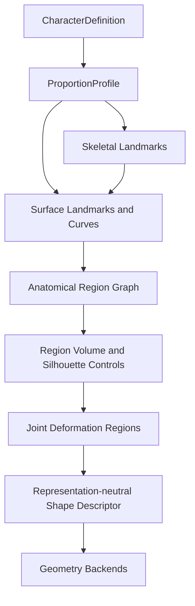

# 02 — Anatomical Shape Model

## 1. 核心设计原则

Shape Model 是唯一人体形态语义来源；SDF、NURBS、Sweep、Subdivision Patch 只是将该模型转成连续表面的不同表示方式。

不能将模型设计为“数百个互不关联的半径和偏移”。也不能只用 Skeleton 关节点推出整个人体。必须把**比例、关节、体表 landmarks、解剖区域、形态参数、局部形变**区分开，并通过关系图连接。

## 2. 五层语义契约

### 2.1 CharacterDefinition

定义一个版本化角色实例，包含：

- `schemaVersion`：数据版本；
- `bodyProfileId`：风格/体型预设标识（值域 OPEN）；
- `globalScaleMeters` / `targetHeightMeters`；
- `proportionProfile`：身高、头身比、肩髋比、胸腰比、四肢比例；
- `anatomyShape`：高层区域形态；
- `styleProfile`：卡通化程度、轮廓软硬、局部夸张；
- `symmetryMode`：双侧镜像、有限不对称或显式左右值；
- `seed`：只用于确定性细节，不应决定基础人体轮廓。

### 2.2 AnatomicalLandmarks

分为三类，不能再合并成单一 BodyJoints：

| 子集 | 示例 | 用途 |
|---|---|---|
| SkeletalLandmarks | hips、spine、chest、neck、head、shoulder、elbow、wrist、hip joint、knee、ankle | 骨骼关节位置、骨段方向和 Bind Pose |
| SurfaceLandmarks | sternum notch、sternum base、xiphoid、rib arch endpoints、iliac crest、ASIS/PSIS proxies、acromion、scapular spine、olecranon、epicondyles、wrist crease | 定义体表轮廓控制点、曲面控制曲线和区域边界 |
| AnatomicalCurves | clavicle curve、rib-arch curve、midline torso curve、scapular ridge curve、arm muscle origin/insertion paths | 形成体块导向和曲面流向 |

每个 landmark 包含稳定 ID、局部坐标系/左右侧、置信来源、是否从骨架推导、约束关系和单位。骨骼 landmark 与表面 landmark 可以有关联，但不可相互替代。

### 2.3 AnatomicalRegions

采用有向区域图，而不是孤立区域列表。初始主区域：

- `Thorax`：rib cage / sternum / posterior thorax；
- `AbdominalWall`：upper abdomen / lower abdomen / oblique transition / lumbar；
- `PelvicMass`：iliac crest / sacral / gluteal envelope / groin root；
- `ShoulderComplex`：clavicle / acromion / scapular region / deltoid heads / axilla envelope；
- `UpperArm`：biceps / triceps / brachialis / humeral envelope；
- `ElbowComplex`：olecranon / medial-lateral epicondyle / flexion crease / transition envelope；
- `Forearm`：flexor compartment / extensor compartment / wrist transition；
- 后续扩展 `NeckHead`、`Thigh`、`Knee`、`Calf`、`HandFoot`。

每个 Region 定义：父区域、邻接区域、骨骼影响候选集、形态控制方式、允许的相交/过渡区、局部密度优先级、UV/material group、是否允许独立 seam。Region 之间的共享边界必须显式声明，不能靠两个字段互相覆盖猜测。

### 2.4 ShapeParameters

高层参数按四组组织：

**A. Proportion Parameters（整体比例）**

- `headToBodyRatio`；
- `shoulderToHipRatio`；
- `chestToWaistRatio`；
- `pelvisToWaistRatio`；
- `upperToLowerArmRatio`；
- `legToTorsoRatio`；
- `frontBackDepthRatio`。

**B. Region Volume Parameters（区域体积）**

- thorax fullness / rib flare；
- upper/lower abdominal fullness；
- lumbar depth；
- iliac flare / gluteal projection；
- pectoral mass / trapezius slope；
- deltoid anterior-lateral-posterior balance；
- biceps-triceps ratio；
- forearm flexor-extensor balance。

**C. Silhouette Parameters（轮廓）**

- chest upper/lower contour；
- sternum projection；
- rib arch drop；
- waist inward curve；
- iliac crest transition height；
- shoulder slope / arm socket depth；
- elbow posterior relief；
- wrist taper。

**D. Style Parameters（卡通风格）**

- exaggeration scale；
- feature softness；
- mass separation；
- contour smoothness；
- symmetry/asymmetry amount。

不要直接向 UI 暴露所有底层 primitive 半径。高层参数通过样条/控制场生成 derived controls，再转化为不同几何表示的输入。

### 2.5 JointDeformationRegions

围绕肩、肘、髋、膝等关节定义形变语义：

- `jointId`、`primaryBones`、`secondaryBones`；
- 关节中心和局部旋转轴；
- compression side / stretch side；
- influence envelope；
- minimum retained volume / max stretch ratio；
- semantic weight masks；
- corrective pose keys / blendshape region（后续）；
- 受限运动范围和 twist axis。

它不是另一个 skeleton，而是 Shape Model 与 Skeleton 之间的变形接口。

## 3. 参数不爆炸的约束方式

1. **参数分层**：角色整体比例 → 区域体积分布 → 局部轮廓 → 风格夸张。底层截面半径和隐式场系数由上层派生。
2. **用比值驱动**：例如肩宽变化时，锁骨跨度、三角肌锚点、胸腔上缘与腋窝入口共同重算，避免各自单独调节。
3. **锚点约束曲线**：控制点优先来自 landmark，不使用无语义 world-space 常数。
4. **区域共享预算**：区域体积变化后，邻接区以比例和曲率约束重新分配过渡空间；避免“胸宽增大但肩/背不变”的互相穿插。
5. **低维形态基底**：一个 body preset 可由少量主成分/shape family 权重表示；局部自由度限制在有明确视觉语义的控制组。
6. **参数范围与依赖关系**：每项含 min/max、单位、默认值、影响区域和依赖字段；非法组合由 ShapeValidator 提前拒绝或投影至合法区域。
7. **避免同一外观重复参数化**：例如 waistWidth 与 waistPinch 不应都无约束地表达同一个“腰更细”效果；其中一个应作为主比例，另一个定义局部曲线形状。

## 4. Shape Model 派生流程



最终输出 `RepresentationNeutralShape`，其中存储：区域边界曲线/面、关键控制框架、体积函数参数、语义标签和骨骼映射。Geometry backend 不应直接读取 UI 上未经约束的原始 sliders。

## 5. Landmark / Skeleton / Region 一致性规则

- 骨骼、几何和蒙皮共享同一角色局部坐标系与米制单位。
- 关节点必须作为可追踪 landmark 使用；几何可以围绕关节中心偏移，但不允许私自修改 skeleton joint positions。
- 表面 landmark 可以随 proportion profile 派生，但必须记录派生来源，避免出现 skin shape anchor 与 bone endpoint 漂移。
- 左右对称先由同一局部 shape definition 镜像；若允许不对称，差异只保存在显式左右 delta，不复制两套独立完整参数。
- Region ID 是跨系统稳定语义键；用于场贡献、权重 mask、拓扑 template、调试可视化、材质分区和服装 seam 定位。
- BoneId 仍引用既有 0–21 ABI；Shape Model 可以细分肌肉区域，但不能强迫每个肌肉特征新增一根骨骼。

## 6. 示例对象契约（逻辑示意，非批准 API）

```cpp
struct CharacterDefinition {
    uint32_t schemaVersion;
    BodyProfileId profile;
    ProportionProfile proportions;
    AnatomyShapeProfile anatomy;
    StyleProfile style;
    SymmetryProfile symmetry;
};

struct AnatomicalLandmarks {
    SkeletalLandmarks skeleton;       // 与 BoneId 0..21 对应
    SurfaceLandmarkSet surface;      // sternum, acromion, iliac crest...
    AnatomicalCurveSet curves;       // clavicle, rib arch, muscle paths...
};

struct AnatomicalRegion {
    RegionId id;
    RegionId parent;
    Span<const RegionId> neighbors;
    RegionShapeControls shape;
    BoneInfluenceMask bones;
    JointRegionMask deformation;
};

struct RepresentationNeutralShape {
    AnatomicalLandmarks landmarks;
    RegionGraph regions;
    DerivedShapeControls controls;
    JointDeformationRegions joints;
};
```

这里是数据契约示意，不要求现在按这些名称创建 C++ 类。最终应优先通过少量聚合结构与 value types 实现，避免“每个区域一个 manager/Factory/Builder”的无效模块化。

## 7. 验证要求

- Shape parameter 改变必须在目标区域和预期视角产生可测几何差异；同时不能破坏邻接区的比例关系。
- 对每个参数记录 `expectedAffectedRegions` 和 `mustRemainStableRegions`。
- 高层比例与派生 landmark 通过数值测试；表面曲线不允许零长度、反转、局部自交或曲率突变。
- 对称配置左右误差要在生成后复核，不仅只测输入 landmark 对称。
- 同一 `CharacterDefinition + seed + generatorVersion` 输出应确定性相同。

## 8. OPEN

- 第一款标准测试原型偏男性、女性、中性还是可切换 profile：OPEN。
- 基础卡通风格的头身比和肌肉表现程度：OPEN。
- 形态是否支持真实人体采样拟合，或第一期只支持人工参数 preset：OPEN。
- 是否允许局部不对称作为正式产品能力：OPEN。
