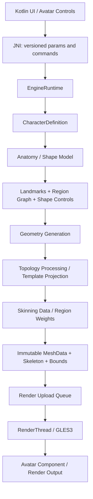
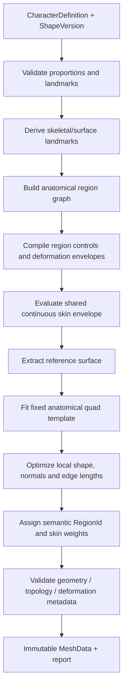

# 06 — Target Architecture

## 1. 总体目标

人体 Shape Model 是核心；Geometry backend 是可替换的表示层；Topology Processing 把连续几何转换为稳定的动画 mesh；Rigging/Skinning 使用相同 Region/Bone 语义；Renderer 只负责 GPU 资源与显示。

不大规模重构现有 RenderThread，也不改变 Kotlin/JNI 对外行为。先在 Runtime 与 Geometry Worker 之间增加一个可取消异步生成边界，RenderThread 接收不可变 MeshData 并上传。

## 2. 目标模块数据流



## 3. 几何生成内部数据流



关键点：`F` 是共享 skin-envelope；胸腔、肌肉、肩部、臂部等可以使用不同数学形态函数贡献，但最终不能各自产生独立可见 mesh 再拼接。`G` 是高密度参考表面；`H` 之后才形成动画拓扑。

## 4. 线程与资源生命周期

```mermaid
sequenceDiagram
  participant UI as Kotlin UI Thread
  participant JNI as JNI Bridge
  participant RT as EngineRuntime
  participant GW as Geometry Worker
  participant Q as Upload Queue
  participant R as RenderThread
  participant EGL as EGL / GLES3
  UI->>JNI: submit CharacterDefinition(v+1)
  JNI->>RT: immutable params + GenerationVersion
  RT->>GW: enqueue pure C++ job(v+1)
  GW->>GW: derive landmarks / shape / mesh / validation
  GW->>RT: immutable MeshData(v+1)
  RT->>Q: enqueue upload candidate(v+1)
  R->>Q: poll completed candidate
  R->>R: compare candidate.version with active version
  alt candidate is newest and context valid
    R->>EGL: create/upload VBO/IBO/VAO
    R->>R: atomic visible mesh swap
  else stale or context unavailable
    R->>R: discard or retain CPU result for restoration
  end
  Note over R,EGL: GL create/upload/delete/draw only on RenderThread
  Note over GW: No EGL/GL calls; CPU-only computation
  Note over UI: Never waits for geometry; only sends commands
```

### 4.1 生命周期契约

- UI Thread：采集控制输入/参数并发送版本化命令，不做几何计算、不持有 GL resources。
- JNI：参数/命令桥接；不负责人体业务建模、不运行大规模采样循环。
- EngineRuntime：维护当前 requested GenerationVersion，调度/取消任务，接收结果，管理 CPU MeshData cache。
- Geometry Worker：纯 C++17；输入不可变 `CharacterDefinition` 和 generation config；不得调用 EGL/GLES；输出不可变 MeshData、Skeleton snapshot、诊断报告。
- RenderThread：唯一 GL/EGL owner；处理 GPU 上传、删除、绘制；不得运行大规模字段采样/重拓扑。
- Upload Queue：有界；同一角色只保留最新待上传版本，避免用户快速拖动参数时堆积大量过期网格。
- MeshData：完成验证后不可变；CPU 数据与 GL Context 分离，可用于 Context 恢复和低内存策略。

### 4.2 GenerationVersion

每次角色参数变化递增 `uint64_t generationVersion`。每个 Worker job 捕获提交时版本；若当前 RequestedVersion 已大于该 job 版本，允许在可检查阶段取消；若 job 已结束，则在上传之前再次比较。旧任务绝不能覆盖新 mesh。

同版本输出的身份建议由：`CharacterDefinition hash + generatorVersion + topologyTemplateVersion + detailTier + seed` 组合。仅靠单调整数不能构成持久 cache key。

### 4.3 EGL Context 丢失和恢复

- SurfaceDestroyed/ContextLost：RenderThread 在有效旧 Context 时删除 GPU objects；若 Context 已失效，作废 GL handles，不能在新 Context 把旧 GLuint 当有效对象删除。
- EngineRuntime 保留 CPU MeshData、Skeleton/pose state 和 mesh version；Context 恢复后重新创建 shader/UBO/VBO/IBO。
- GPU resources 的 owner 始终是 RenderThread；CPU cache owner 是 Runtime/Avatar component。
- 需要补齐当前 `releaseGpuResources()` 未释放 `anatomyMesh_` / `anatomyLines_` 的问题，但这属于未来独立实现任务，不在本设计中修改。

## 5. C++17 数据与实现边界

### 5.1 推荐的少量聚合模块

保留当前工程分层，只建议逐步增加以下职责，不要求按每项新建一对类：

- `CharacterDefinition`：参数、schema version、profile；
- `AnatomicalShapeModel`：landmark/region/derived shape values；
- `GeometryGeneration`：主入口与区域场/曲面 backend；
- `TopologyTemplate`：固定拓扑数据/region annotations；
- `MeshData`：当前 CPU mesh 结构的演进载体；
- `GeometryJobService`（可作为 Runtime 内部 worker）：任务调度/取消/版本过滤。

优先复用现有 `Vec3/Quat/Mat4/MeshData/Skeleton`，避免同时创建 `BodyShapeManager`、`AnatomyFactory`、`SurfaceBuilder`、`JointMeshController` 等冗余层。

### 5.2 内存与采样成本

- 以区域局部 bounds 限制 field evaluation；避免每个采样点遍历全身所有 feature。
- 缓存 Landmark 与 region bounds；job 执行中不重复构造动态分配的 `std::function` 闭包。
- 对体素/采样尺寸、cell count、顶点数和索引数设置明确上限；所有乘法先检查 overflow。
- Worker 用临时 arena/scratch vector 管理大数组；完成后移交 immutable buffers，尽量避免多次完整 copy。
- 通过 detail tier 控制生成分辨率与 topology density，但视觉 Gate 必须使用固定 tier。
- 先保证一条角色生成 job 可确定完成，再评估线程池并行多角色；不要为一个角色的单次初始化过早增加复杂并行图。

## 6. Android GLES3 兼容

- GLES3 支持当前 `uBones[22]` UBO skinning；新网格可继续使用现有 64-byte vertex pack 作第一阶段运行格式。
- 如果拓扑投影需要 UV、tangent、region ID、seam tags，可先作为 CPU-only metadata 存在；是否进入 GPU layout 通过 ADR 决定。
- 大网格应记录 upload bytes/time、index type（当前 uint32 indices）、buffer memory 与 draw calls。
- 不使用 GLES3 compute shader 假设可用性，全部几何计算 CPU 端完成。
- GLES renderer 不应知道 SDF、B-spline、NURBS 或肌肉模型内部实现，只接受 MeshData / Skeleton / material partitions。

## 7. 与现有架构的兼容策略

1. 保留当前 Renderer、EGL 管理、SkinnedGpuMesh 和 JNI/Kotlin API。
2. 新 Geometry Worker 先作为 Runtime 的一个后台组件，不重写 RenderThread 的消息循环。
3. 新 mesh 完成后通过 RenderThread command 发送 `shared_ptr<const MeshData>` 或明确的 move-only immutable handle；RenderThread 只消费。
4. 上传成功后再原子切换当前 Avatar GPU mesh，避免上传失败时旧角色消失。
5. 处理 EGL context destroy/recreate 时保留 CPU mesh，并在新 context 中恢复 GPU buffers。
6. 先把新几何预览挂在独立 preview mode；旧 M11/M12/P1-A 生成器保持可比较，不删历史路径。

## 8. 与现有冻结合同的关系

Feature Foundation Contract 03 当前写明主线是 `Rig-aware Anatomical Landmarks → Topology Templates → Surface Patches → Variable-profile Sweeps → Patch Assembler`，并将 SDF 限为研究/局部辅助；main 的 ADR-009 则记录 M12 上半身已选择统一 SDF。两者是不同分支/决策快照。

本提案提出“shared Anatomy Shape Model + shared envelope + reference surface + fixed quad topology projection”，**不会自动修改或取代任何冻结文档**。如项目负责人接受本方向，需要先审查现有 ADR/contract 的适用范围，再建立新的 ADR 明确替代/兼容关系；在此之前，新方案状态均为 PROPOSAL。

## 9. 可观测性

每次生成至少输出：

- generationVersion / definition hash / generator version / template version；
- Worker thread ID、start/end、cancel reason；
- field sample count、reference mesh vertex/triangle count；
- template vertex/face count、projection iteration count；
- topology report、C0/G1 report、region/bone weight histogram；
- CPU generation time、topology time、upload time；
- CPU bytes、GPU bytes、FPS / P50 / P95 / P99；
- device/Android/GLES/APK SHA。

不设置未经测量的 Android 生成耗时承诺。M12 历史约 51.7 FPS 仅作为同设备旧路线参考。

## 10. OPEN

- Runtime 的 GeometryWorker 是单独线程还是可复用现有 executor：OPEN。
- CPU MeshData cache 保留单档/多档与内存上限：OPEN。
- UV/RegionId 等数据是否进入 GPU Vertex packing：OPEN，需结合换装/材质路线决定。
- 当前 RenderThread EGL recreation 行为是否覆盖实际 `EGL_CONTEXT_LOST` 设备路径：需专门设备验证，NOT VERIFIED。
