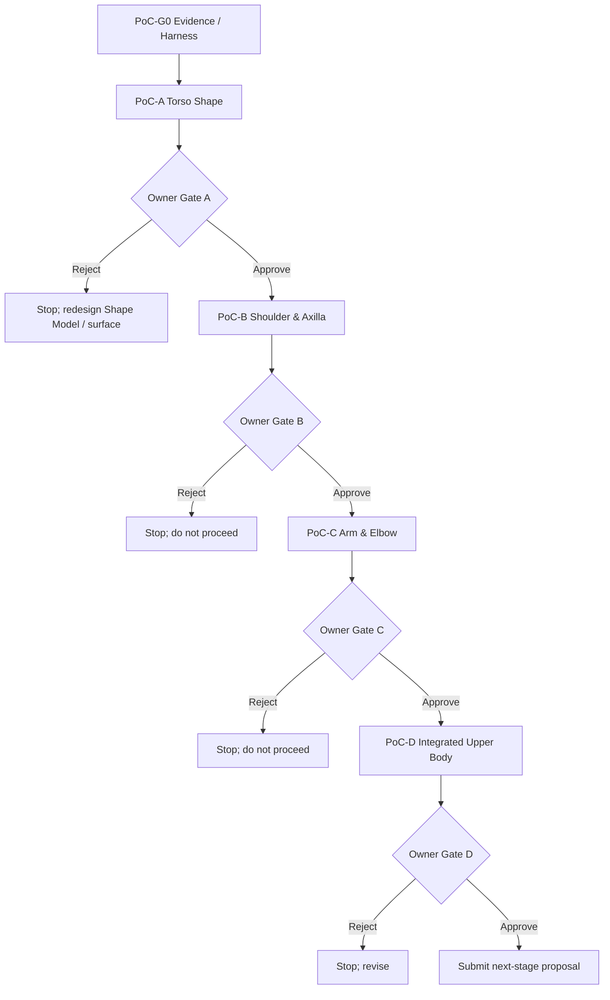

# 07 — PoC Roadmap

## 1. 阶段总原则

本路线重新从 Shape Model 验证开始，不延续 P1-A 的局部补丁迭代。每阶段都是独立 Gate；视觉 Gate 失败时停止，不得将失败阶段通过增大网格、加材质或扩展其他身体区域“带过去”。

## 2. PoC-G0：证据和生成基线（研究准备，不生成新人体）

目标：建立可复核实验 harness。

交付：
- 读取 M11/M12/P1-A 真实 PNG 原图，建立 8 个固定相机/同一光照参数集；
- 固定角色身高、FOV、相机目标和 gray Lambert；
- 建立 Shape Model parameter manifest（参数名称、范围、单位、影响区域）；
- 建立真实 C0/G1、topology、weight 和 pose test 报告格式；
- 确认本地工作区状态、设备和 APK SHA。

Gate：现有证据可被人工独立复核，数据记录无手工伪造字段。未完成图像复核前不开展新路线视觉对比。

## 3. PoC-A：Torso Shape（胸腔、腹部、腰、骨盆上部）

### 3.1 最小可验证范围

不是一个被切断的胸腹筒，也不是只有正面视图的局部椭球。范围为：

- 下界覆盖至骨盆/髂嵴上部，提供完整腰盆过渡；
- 上界覆盖胸廓上缘、锁骨根部和颈基底，肩部连接 landmarks 双侧均存在；
- 左右胸廓、腹壁、腰背和骨盆体积在同一个 Shape Model / shared envelope 中定义；
- 暂不生成完整上臂和手，肩根处以可解释的解剖边界/临时封口定义，不使用独立肩球。

第一版采用一个完整的胸腹腰盆体型（包含后背），先把胸廓、肋弓、腹前壁、侧腰和骨盆形态做好，再将肩部连接关系作为后续 B 阶段的边界条件。

### 3.2 验证问题

- 同一参数在正面/侧面/45°是否同时改变目标轮廓？
- 腰部收缩是否由侧面和后背共同实现？
- 胸腹与骨盆是否有清晰体积节奏？
- 改变胸宽时胸深、肩带锚点和肋弓是否保持合理比例？
- 网格是否由共享场/曲面生成，而不是多个部件遮挡？

### 3.3 变量组

至少 3 组：Baseline、胸深/胸宽变化、腰盆比例变化；每组保留 front/back/left/right/45L/45R/torso closeup 共 7 视图。测试参数改变后目标 landmark 与 contour 的数值偏差。

### 3.4 Gate A

- 视觉：胸/腹/腰/骨盆正侧45°均通过；无筒状、沙漏筒、硬折、过度 smooth blob。
- 几何：单一连续目标表面；components=1、boundary=0、nonmanifold=0，除非边界为显式登记的 PoC crop boundary。
- 数值：C0/G1 实测而非赋值；winding/normal/degenerate/self-intersection 报告。
- 性能：记录 Worker 生成时间、内存和实际目标设备数据，不预设“必定小于 X ms”。

任何一项视觉 P0 缺陷存在则 REJECTED，不进入 PoC-B。

## 4. PoC-B：Shoulder & Axilla

范围：锁骨、肩峰、斜方肌坡度、三角肌前/外/后体积、胸大肌外侧、肩胛区和腋窝凹面；左右两肩必须同时生成，肩部与 PoC-A torso 共享 envelope。

不生成完整手臂；可包含短上臂近端作为关节/腋窝运动体积，但不得用圆管插入肩部替代形态。

验证：BIND、外展 45°、外展 90°、前举 90°、肩外旋；每动作正侧45°+肩部 close-up。腋窝必须既有凹面又不穿洞。

Gate B：肩胸没有可见接缝/贴片感；腋窝无洞、鼓包、硬折； shoulder volume 在动作前后保持可接受；拓扑环线支持外展与前举；权重热力图正确。

## 5. PoC-C：Arm & Elbow

范围：双侧上臂、肘、前臂直至腕部。Shape Model 使用骨架 landmark frames、肌肉起止/肌腹控制和分区截面/隐式体积，不仅仅是一根变截面管。

验证：
- neutral A-Pose；
- elbow flex 45° / 90° / full extension；
- forearm pronation / supination；
- shoulder forward raise 与 abduction 交叉动作；
- 前后/内外四向轮廓。

Gate C：上臂和前臂不再读作圆管；肘部无单环折痕、塌陷、自交和法线翻面；肌群轮廓随旋转有方向性；topology loops 与 region masks 对齐。

## 6. PoC-D：Integrated Upper Body

整合 PoC-A/B/C，包含上胸至腰盆、双侧肩腋、上臂/肘/前臂。通过整合比例检查与动作组合验证，不加服装/头发/材质细节掩盖问题。

验收：
- 整体正/侧/背/45°轮廓比例自然；
- 统一连续 surface，无多个独立可见体块/拼接边；
- topology template 具有稳定 edge flow；
- CPU LBS 与 GPU LBS 数值对照；
- 动作列表全部通过，记录局部体积变化与 surface intersections；
- Android 目标设备实测 P50/P95/P99、FPS、生成和上传耗时、CPU/GPU buffer bytes。

Gate D 通过仍不等于完成商业角色；仅授权讨论后续全身/头部/服装扩展。

## 7. PoC 技术路线对照实验

同一 Shape Model、同一 landmarks、同一 default parameter set，至少比较：

- R1：当前 SDF + Surface Nets 直接作为参考 surface；
- R2：相同 field + fixed quad topology template projection；
- R3：B-spline/envelope control surface + fixed topology template；
- 可选 R4：Dual Contouring 作为特征保持对照。

禁止让每种路线使用不同体型参数，否则结果不能归因于几何表示。视觉 Gate 不以三角形数或生成速度排名替代。

## 8. PoC 视觉验收矩阵

| 维度 | A Torso | B Shoulder | C Arm/Elbow | D Integrated |
|---|---|---|---|---|
| front/side/45 silhouette | 必须 | 必须 | 必须 | 必须 |
| back / scapular contour | 必须 | 必须 | 必须 | 必须 |
| gray Lambert clay | 必须 | 必须 | 必须 | 必须 |
| wireframe / normals | 必须 | 必须 | 必须 | 必须 |
| C0/G1 measured | seam/region only | shoulder interface | joint/region | all required boundaries |
| topology manifold audit | 必须 | 必须 | 必须 | 必须 |
| semantic weight heatmap | torso regions | shoulder/axilla bones | arm/elbow bones | all regions |
| neutral pose | 必须 | 必须 | 必须 | 必须 |
| arm raise / forward | 不要求 | 必须 | 必须 | 必须 |
| elbow bend / rotation | 不要求 | partial | 必须 | 必须 |
| CPU/GPU skin parity | baseline | 必须 | 必须 | 必须 |
| Android frame stats | 必须记录 | 必须记录 | 必须记录 | 必须记录 |
| Visual Gate approval | owner | owner | owner | owner |

## 9. 统一工程 Gate 指标

| 指标 | 检查方式 | 最低要求 |
|---|---|---|
| C0 | 对应 seam sample positions | ≤1e-4 m，沿用现有 contract，测量结果可复算 |
| G1 | 两侧 surface derivative / normal angle | smooth seam ≤5°；hard seam 显式标记 |
| Components | graph connectivity | 单一 skin envelope 目标为 1 |
| Boundary | edge incidence | 正式闭合表面 0；PoC crop edge 必须登记 |
| Nonmanifold edges/vertices | edge/vertex link audit | 0 |
| Degenerate faces | area + aspect checks | 0 容忍明显退化；极端浮点容忍需报告数量和位置 |
| Winding | adjacent face direction / outward probe | 无反向面、整体朝外 |
| Self-intersection | triangle BVH/region probes | 0 未解释的自交 |
| Weights | sum / influence / region mask | ≤4 bones、非负、和=1±1e-3、ID∈[0,21] |
| CPU/GPU parity | 同一 PoseFrame 对照 | 顶点误差阈值经设备精度实验确定，未测前 NOT VERIFIED |
| Frame performance | 真实设备采样 P50/P95/P99 | 记录，不从旧 M12 数字推算新路线 |
| Visual quality | 固定视图人工 Gate | 任一 P0 轮廓/融合/动作缺陷可以否决 |

## 10. 开发流程闸门

## 11. 停止条件

- P1-A REJECTED 仍然有效，不自动进入 P1-B。
- 本路线设计文档完成后即停止。下一步必须由项目负责人审阅本设计并显式批准新 ADR / 新 PoC scope；本报告不授予编码授权。
