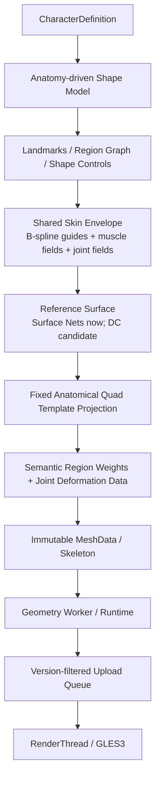

# 09 — Final Recommendation

## 1. 结论摘要

推荐建立 **Anatomy-driven Shape Model → Shared Skin Envelope → Reference Surface → Fixed Anatomical Topology Template → Rig-aware Skinning** 的分层架构。

这不是“所有部位都用 SDF”，也不是“所有部位都用 Sweep”，更不是把多套生成器各自输出的 mesh 焊在一起。人体解剖语义是唯一上游，曲面/场是不同区域的形态表达工具，最终皮肤外表面共享一套连续解算，动画 mesh 则使用固定的解剖拓扑模板。

> **状态：PROPOSAL — 等待项目负责人批准**

## 2. 八个核心问题的回答

### 问题一：为什么之前三条路线都没有达到理想人体形态？

**M11 的问题是几何组件之间没有真正融合。** 它用 Loft/Sweep 生成完整角色，但最后将独立 Part 的顶点/索引合并到同一个 MeshData；buffer 归并并未建立共同曲面。胸腔、肩部、上臂、头颈和衣物仍可能依靠遮挡建立视觉完整性。参数很多，但它们多数直接控制 section width/depth 和路径半径，没有共享的胸肩/腋窝/腹腰盆形态约束。

**M12 的问题是连续性有了，但 shape model 仍不足。** SDF + Surface Nets 证明了连续、水密、单连通输出，但 Smooth Union 只解决标量场融合。场里若主要是椭球、胶囊和圆锥胶囊，提取结果自然仍是这些原语的平滑组合。肌肉 feature scaffolding 在 feature SHA 上尚未并入最终场函数。Surface Nets 本身也不会自动提供适合肩肘动画的 Edge Flow。

**P1-A 的问题是局部 patch 更精致，不等于形态架构升级。** 它把躯干 Loft、肩 bridge 和手臂 Sweep 做了拓扑连接，但仅 5 个截面站位和局部 Gaussian profile 无法描述完整胸腹腰盆的体积关系；肩 bridge 只是连接带，不是肩带/腋窝共同形态模型；臂部仍以管状 Sweep 为主。更严重的是 C0/G1 report 的值被直接赋值为零，Skeleton 参数也没有参与几何计算，部分工程证据无法支持当时的通过结论。

共同根因是过去先选了一个几何算法，再尝试用参数让它像人体。新的做法必须从人体形态语义建模，再让曲面算法服务于形态。

### 问题二：人体形态模型如何组织，既强大又不参数爆炸？

建立版本化 `CharacterDefinition`，下辖：

1. `ProportionProfile`：身高、头身比、肩髋比、胸腰比、肢段比例等低维整体比例；
2. `AnatomicalLandmarks`：骨骼关节点、体表解剖点、解剖曲线分别保存；
3. `AnatomicalRegions`：胸腔、腹壁、骨盆、肩带、腋窝、上臂、肘、前臂等语义区域及邻接关系；
4. `ShapeParameters`：体积分布、正/侧面轮廓、局部风格夸张等高层参数；
5. `JointDeformationRegions`：关节影响带、压缩/拉伸侧、骨骼 mask、体积保持与后续 corrective 入口。

控制参数采用分层与约束派生：整体比例变化时自动重算 landmarks/region controls；局部参数只表达一种清楚的视觉含义；所有底层 section radius、field coefficient 和 control points 都是派生值。每个参数标出影响区域，避免“胸宽”同时无控制地改变肩宽、上臂或背深。

### 问题三：胸腔、腹部、骨盆、肩部、手臂和关节分别适合什么几何表示？

| 部位 | 建议表示 | 理由 |
|---|---|---|
| 胸腔 | landmark 控制的 B-spline/轮廓 envelope + 解剖体积场 | 正面胸宽、侧面胸深、45°胸廓前后不对称需要共同控制 |
| 腹部/腰部 | 前后轮廓控制 + shared implicit volume field | 腰侧收缩不能只改 X 宽度；需要联动肋弓、腹壁和腰背 |
| 骨盆 | 髂嵴/骶骨/臀部 landmarks + 闭合体积 envelope | 骨盆不是椭球，需有腰盆过渡和大腿根空间 |
| 肩部/腋下 | shoulder complex shared field/envelope + 凹面约束 | 肩/腋交汇复杂，不能靠 bridge patch 与 arm tube 拼接 |
| 上臂 | 骨架 frame 驱动的肌肉体积 implicit fields + variable sweep envelope | Sweep 可提供长轴，肌腹需要方向性和独立体积 |
| 前臂 | flexor/extensor 区域体积 + twist-aware taper envelope | 不能只有沿程宽深变化的圆管 |
| 肘部 | joint-specific deformation region + topology loops + corrective envelope | 需同时表达鹰嘴、肘窝、内侧压缩、外侧拉伸 |

没有证据证明一类数学表示可以覆盖全身所有区域。

### 问题四：是否采用 Anatomy-driven Hybrid Geometry？如何避免拼装问题？

**推荐采用，但定义必须是“混合形态函数、共享最终表面”，不是“混合独立 mesh”。**

不同区域可以用 B-spline guide surface、oriented muscle implicit field、variable-profile sweep、joint deformation field 描述；它们全部进入同一 `Shared Skin Envelope`，最后只提取一份最终 skin surface。区域数据保留 RegionId，用于权重和拓扑模板，但不各自输出独立可见 mesh。

若未来确实需要多个 patch 输出，则必须由一个共同 topology template 定义共享边界顶点、顺序、winding 和边界导数约束，并实测 C0/G1。不能再用重叠遮挡或赋值 report 替代。

### 问题五：如何将自然人体曲面变成可控、适合动画的拓扑？

把“形态表面”和“动画拓扑”分开：

- 高质量连续表面（SDF/参数 envelope）用于形态目标、轮廓采样和 surface normal 参考；
- 固定解剖 quad template 定义 torso loop、shoulder loop、axilla flow、elbow loops、forearm flow；
- 将模板顶点投影到参考表面，并以贴合误差、法线、边长、面片 aspect ratio、体积和语义流向进行约束优化；
- Template 的索引与 RegionId 在同一体型家族中保持稳定，参数变化只更新顶点位置和局部 density，不每次自动生成陌生拓扑。

QuadriFlow 等自动 quad remesher 可作为离线比较，但不能替代人工定义肩肘 Edge Flow。

### 问题六：如何让 Shape Model、Skeleton、Topology、Skinning 使用一致人体语义？

四者共用同一个角色坐标系和稳定 `RegionId`：

- Skeleton 提供关节/骨段位置、方向和骨架层级；
- Shape Model 提供体表 landmark、曲线、区域体积和轮廓；
- Topology Template 把 RegionId 固化到面/顶点/边环；
- Skinning 使用 Region allowed-bone mask 限制候选骨，再以骨段距离、局部参数和 joint envelope 计算最多四个权重。

保持当前 BoneId 0–21 ABI 与 UBO[22] 不变。LBS 先作为兼容基线；动作数据证明其存在的 shoulder/elbow volume loss 后，再评估 DQS、Corrective Shapes 或 Local Volume Preservation，不预先把新变形算法作为前提。

### 问题七：怎样在 C++17、Android NDK、GLES3 下实施且不破坏现有系统？

几何在 CPU 端用 C++17 生成；不依赖 GLES compute。Geometry Worker 接受不可变 CharacterDefinition，生成 immutable MeshData 和诊断报告；每任务携带 GenerationVersion，过期任务取消/丢弃。EngineRuntime 管理任务和 CPU MeshData cache。RenderThread 继续作为唯一 EGL/GLES owner，只处理 GPU upload/delete/draw。

不大规模重构 RenderThread：先加一个后台 worker 与有界上传队列，生成结果通过新的 RenderCommand handoff。上传成功后原子切换当前 GPU mesh；EGL Context 恢复时从 CPU mesh cache 重建 GPU buffers。当前 releaseGpuResources 漏掉 anatomyMesh/lines 的释放应另开独立资源生命周期任务。

### 问题八：第一轮最小 PoC 做什么，最大程度验证核心路线？

建议 PoC-G0 先重建 PNG/相机/灯光/数据实验证据；第一个形态 PoC-A 是**完整胸腹腰盆躯干 + 双侧肩连接 landmarks 和肩根形态**，从颈基底到骨盆上部，包含前胸、侧腰和后背，不生成单臂/单管，也不通过服装遮挡。范围小但上下文完整，能一次验证最核心的 Shape Model、体积关系、shared envelope 与三维轮廓。

PoC-A 视觉 Gate 通过后，PoC-B 才扩展肩带、三角肌、腋窝凹面；PoC-C 再加入双侧上臂/肘/前臂与动作；PoC-D 最后整合上半身。任何一关拒绝即停止。

## 3. 最终架构建议

## 4. 技术选型优先级

1. **第一优先：Shape Model 和 landmarks/regions 契约。** 没有它，换任何几何算法都容易重演历史问题。
2. **第二优先：Shared skin envelope。** 把胸、腹、骨盆、肩腋及肌肉 feature 放入共同几何评价，而非多部件拼接。
3. **第三优先：动画 topology template。** 拓扑与外观表面分开，确保关节流向可控。
4. **第四优先：语义权重和姿态变形测试。** 先在 22 骨 ABI 下测 LBS 限制，再决定 DQS/Corrective/LVP。
5. **第五优先：Worker/renderer handoff。** 让几何生成脱离 RenderThread，但不先重构整个 Renderer。

## 5. 明确保留的未解决问题

- 本次没有直接看到 M11/M12/P1-A PNG 像素，不能代替负责人对历史图像的独立视觉审查。
- 默认体型 archetype、性别表达、头身比例与风格夸张程度仍 OPEN。
- Shared skin envelope + quad template 是强推荐候选，尚未通过新 PoC 实测，不能宣称成功。
- 肩胛随手臂运动的运动学、关节体积 corrective、扭转和局部体积保持仍需要动作数据和设备试验。
- 新路线生成时间、内存、三角形数量和 GLES3 FPS 都没有实测。
- 与 feature Foundation Contract 03 / main ADR-009 的适用关系需要项目负责人确认，并通过 ADR 明确治理。

## 6. 交付状态与停止声明

- 设计材料：已整理为 00–09 共十份 Markdown 文档及 README。
- 设计方案：PROPOSAL，未获批准。
- 新代码/正式实施：未开始。
- P1-B：未开始。
- Git commit / push / merge：未执行。
- 远程仓库内容：未修改。
- 下一步：等待项目负责人审阅、确认 OPEN 决策并明确是否授权新的 ADR/PoC 工作。
